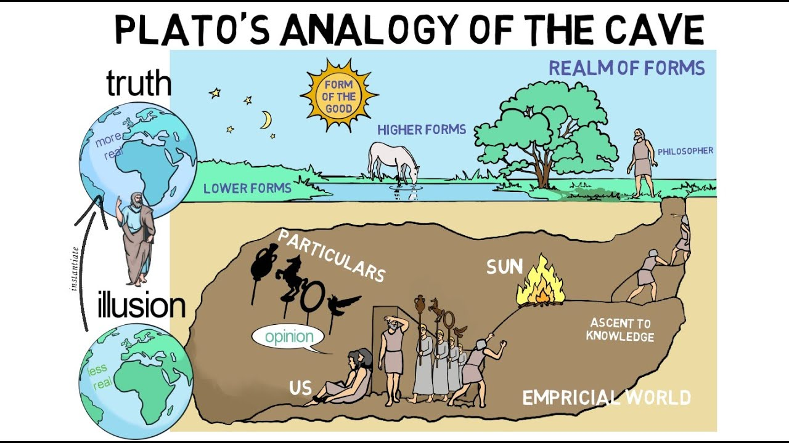
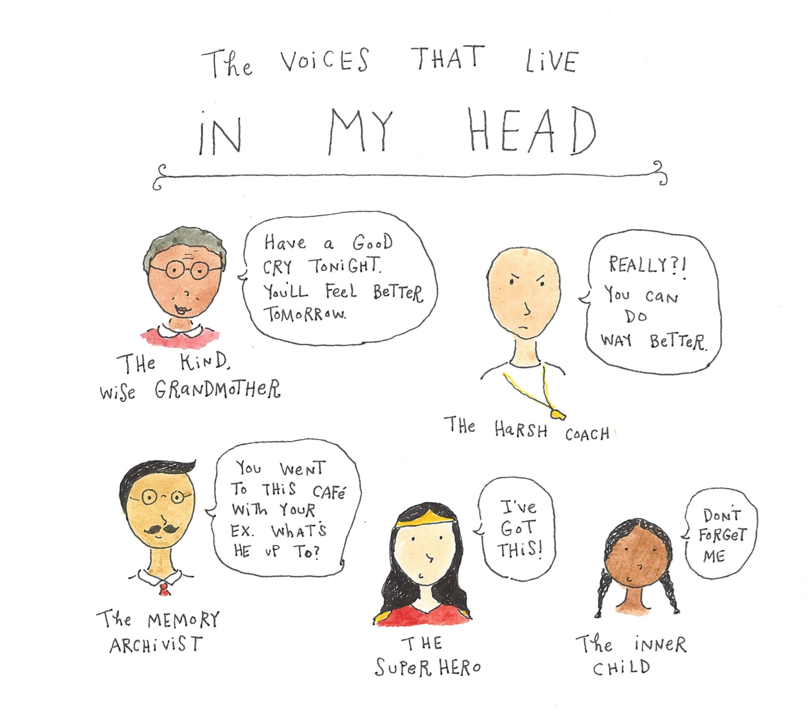
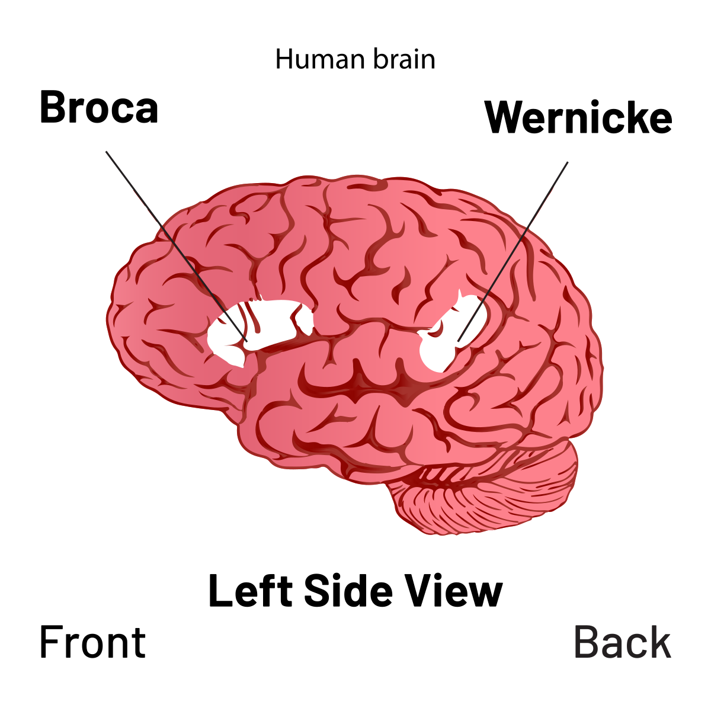
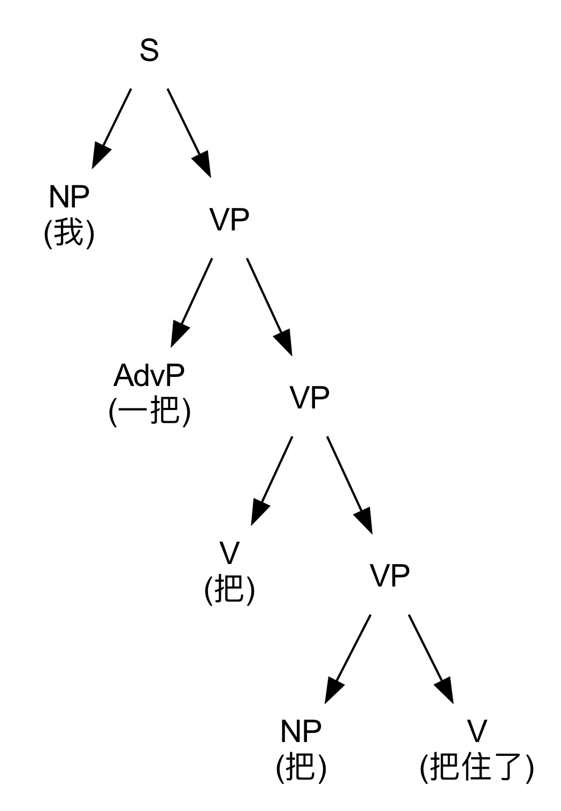

> AI 时代的语言学需要融合语言、数学与认知科学，探索语言与智能的本质。
> {: style="margin-bottom:0.6em;"}

这个公众号已经存在了十年，今天发第一篇文章。

我们原来的名字叫“计算语言学”，然而十年来人工智能的光速发展，已经让语言研究远远超出了计算的范畴，变成了数学、语言学、心理学、神经科学和人工智能几种学科交叉的极富魅力的领域。十年前，我刚刚语言学本科毕业，满怀期待地走进计算机系硕士班，想要一窥计算语言学的究竟。想当年，在深夜图书馆手搓隐马尔可夫模型（HMM）便以为世界在我手的我们，谁能料想十年后的今天连几岁的孩子都熟练地用着大语言模型（LLM）问十万个为什么。从 HMM 到 LLM，你看只变了两个字母，却是整个人类对语言、智能和世界认识的大飞跃。

## 语言与世界

人类生活在宇宙中，这个宇宙是客观存在的外部世界。神奇的是，在人类的内心也有一个微缩的世界，我们的记忆，我们的知识，我们的思想都存在这个内心世界里面。我们每天每分每秒都在这两个世界之间来回穿梭，改变着这两个世界的模样。那么你要问了，改变外部世界主要靠双手，改变内心世界要靠什么？靠语言。

{: .img-fluid .d-block .mx-auto style="max-height:70vh;"}

_图 1　柏拉图的洞穴寓言：人类对现实的感知如同洞穴中的囚徒看到的影子。来源：YouTube。_

### 语言与智能

在你阅读本文的此时此刻，你的脑海里是不是有一个不知道是谁的声音在和你一起读呢？这个声音就是内在语言（inner speech）。大多数时候，人们通过内在语言进行思维。比如，在心里默念“商品原价699，双十一前涨价10%，双十一期间用券减50，我到底是赔是赚？”——这是推理；“我是先起床还是先睁眼？”——这是计划；“啥？老板又不给加班费！？再忍他一次”——这是自我调节，如此种种。平时我们跟别人说话，使用的是外部语言，而生成外部语言也需要靠内在语言先在心里组织好后才能表达。语言是智能的一种外在表现形式，通过语言，人类能够自我思考、交流思想、传递知识、分工合作。虽然很多动物也可以发出声音传递信息，但并没有人类意义上的“语言”。你甚至可以假设，正是有了语言，人类才能走上智能之巅。

{: .img-fluid .d-block .mx-auto style="max-height:70vh;"}

_图 2　内在语言：脑海中的声音在进行思维对话。来源：Cup of Jo。_

### 语言与大脑

众所周知，语言的中枢在大脑。位于左脑的布洛卡区（Broca's Area）和韦尼克区（Wernicke's Area）是最重要的语言功能区，分别负责语言生成和语义理解。这两个区域的病变会导致不同类型的失语症，而渐冻症、帕金森病、阿尔茨海默病等神经退行性疾病也会严重影响语言功能。依靠脑成像技术，我们不仅能看到大脑的生理结构，也能看到大脑在执行语言任务时的状态。令人震撼的是，你在功能磁共振（fMRI）图像上看到的彩色条带，在脑电图（EEG）上看到的波峰波谷，这些神经电信号正如构成计算机的一串串01字符一样，一经解码，便成了莎士比亚笔下的“to be or not to be"，成了少年第一次告白的记忆，成了我们生活的这个世界的倒影。

{: .img-fluid .d-block .mx-auto style="max-height:70vh;"}

_图 3　大脑语言区：布洛卡区负责语言生成，韦尼克区负责语义理解。来源：Wikimedia Commons (CC BY-SA)。_

### 语言与符号

人们头脑中的概念和想法是看不见摸不着的，就像一段神秘的原始密码，要怎么表示出来呢？不同的语言就是一套套编码系统，把看不见的想法变成符号写在纸上、说在话里。掌握这种语言的人，就好比头脑中储存了一套解码系统，把文字符号或声音信号还原成可以理解的概念和想法。人类用语言描绘宇宙，宇宙有结构，语言也有结构。了解了结构，就能找到规律。物理学家研究基本粒子和物理定律，语言学家研究词素音素和语法韵律。知晓 DNA 和蛋白质的结构可以破解生命的奥秘，知晓语言的结构可以破解智能的奥秘。

我们在用母语交流时，不会留意到她的结构，因为我们的大脑对这个语言的编解码过程已经太熟悉了，几乎可以完全自动化和内隐化。但是当你教给外国人“我一把把把把住了”这个句子时，就非得掰开揉碎了不可。由表及里，探索结构，生物学家天天摆弄显微镜，语言学家经常要画句法树。我们一起来研究一下这个句子的成分树（Constituency Tree）：整句话S可以分成“我”（NP，名词短语）和“一把把把把住了”（VP，动词短语），而后者又可以继续分成“一把”（AdvP，状语）和“把把把住了”（VP，动词短语），以此类推。句法树帮助我们把时间线性的词序（例如一句话）映射成有组织的构成单元（短语、词类、依存关系等），便于分析语言的组合规则和句法关系，而结构化的信息是计算机处理的前提。

{: .img-fluid .d-block .mx-auto style="max-height:70vh;"}

_图 4　句子成分树的层级结构示意图。_

### 语言与 AI

从人工智能的构想出现伊始，人类便希望创造出能够理解语言的机器。起初，人们像教小孩子一样教机器学习语言：先由一群语言学家从经验和有限的语料中归纳出规则，再由机器根据这些确定的规则处理语言。很快，人们发现基于规则的专家系统难以处理歧义现象和过长的上下文语境，也难以扩展和泛化。毕竟，现实世界中充满了噪声和不确定性，例外比比皆是。后来，随着互联网的出现，可以使用的语言数据大大增加了，人工智能开始转向“数据驱动”，机器不再依靠人类专家总结的规则说话，而是依靠概率模型从语料中自己总结模式和规律。此后，基于统计方法的人工智能在语音识别和机器翻译等应用领域取得了长足的进步。2010 年左右，深度学习兴起，海量数据和巨大算力赋予了模型学习多层级特征的能力，能够处理更复杂的语言结构，泛化能力也大大增强。大规模的预训练让深度模型获得了内嵌在人类语言中的语法知识和世界知识，加上增强检索生成（RAG）技术和智能体（agent）的工具使用能力，如今的 AI 越来越像一个能够真正理解语言并执行人类指令的强大智慧了。

{: .img-fluid .d-block .mx-auto style="max-height:70vh;"}

_图 5　大语言模型的本质：通过概率和统计进行语言建模。_

## 语言学的未来

现在，让我们回到对“语言表示形式”的讨论。语言的诞生是为了表达思想、传递信息，而思想背后的概念与关系正如数学和逻辑一般，是抽象的表示，看不见也摸不着。这些抽象的存在，表现在人的大脑中，就是神经元的生物电信号；表现在纸面上，就是方块字或拉丁字母；表现在声音里，就是空气分子的振动；而表现在大模型，就是数亿百亿计的权重数字。一种内涵，多种表示，用 AI 领域的术语就叫做多模态（multimodal）。传统语言学的重心在文本模态，而在这个连 AI 都日益多模态的时代，语言学研究该何去何从呢？

答案显而易见：AI 时代的语言学也要跨学科、跨模态。语言学领域还有那么多的未解之谜，例如韵律的结构、内在语言的机制、语言与智能的关系、对话双方大脑的预测与模仿行为等等。同时，在语言学与人工智能的交叉领域也诞生着一个个重要的问题：AI 的语言处理机制与人类大脑是否相似？如何给大模型引入记忆，减少幻觉？研究儿童语言习得是否能够启发类脑智能（Brain-inspired Intelligence）？

AI 在发展，语言也在发展。新的词汇在出现，旧的方言在消失，人们的语言风格正被 AI 影响。从第一次工业革命开始，人类便与机器一同进化。如今，人工智能已经在很多方面接近或者超过了人类智能，通用人工智能（AGI）和超级智能体（Super Agent）的科幻想象也一定会照进现实。拥有 AI 协助的语言研究，将是一个全新的学科。不久前逝去的杨振宁先生曾经多次在演讲中勉励青年，能够与一个学科共同成长是最幸福的事。从苏格拉底到乔姆斯基，语言学这门古老的学问已经走过几千年，她在 AI 时代将走向怎样神秘而璀璨的未来呢？让“元语言”与诸位共同见证。

---

*本文首发于微信公众号「元语言」，[阅读原文](https://mp.weixin.qq.com/s/qWYouVJ2rDh_Oe8LFF-1gw)。*
