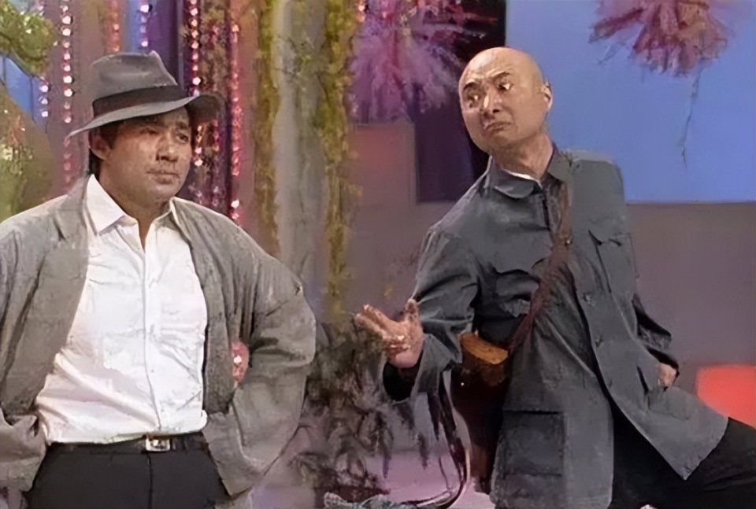
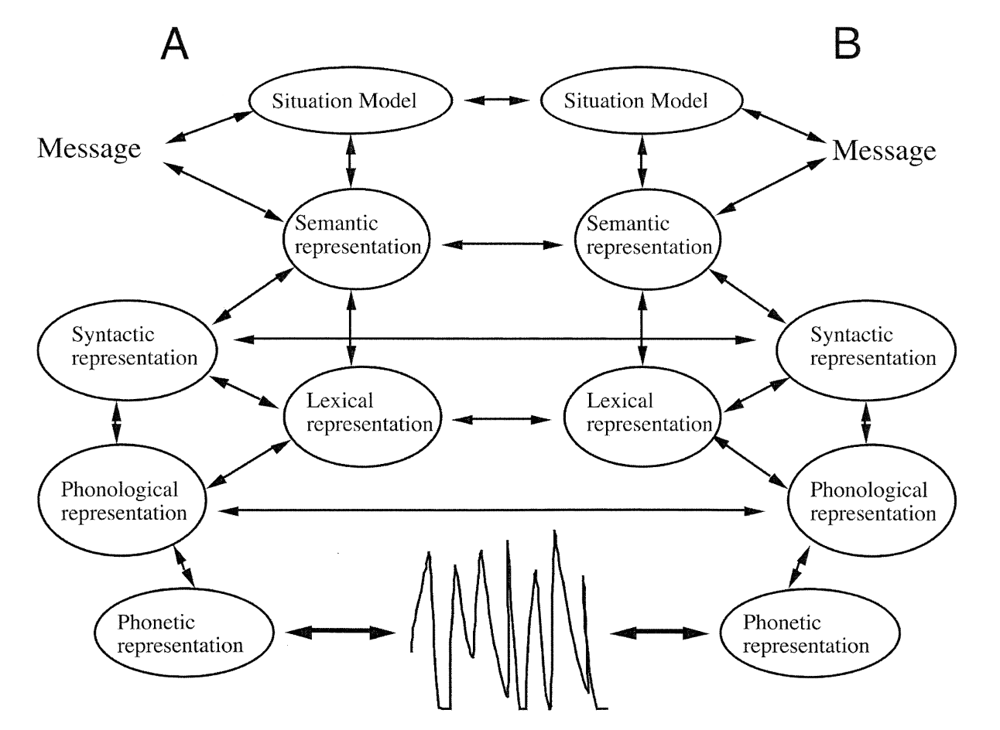
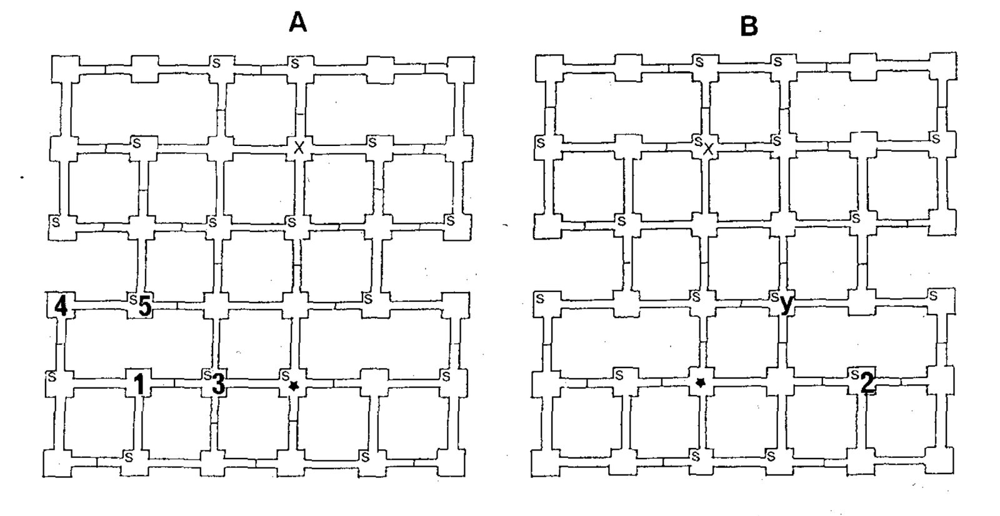
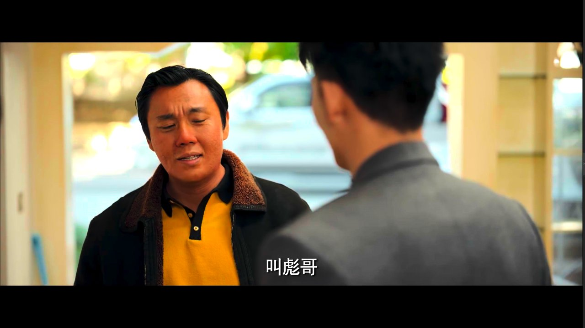
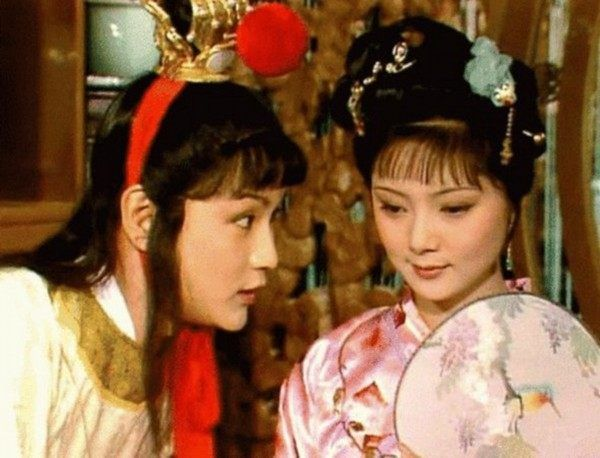

> **朱时茂**（反串叛徒）：队长！  
> **陈佩斯**（反串八路军）：什么人！  
> **朱时茂**：别开枪！是我！  
> **陈佩斯**：啊——是你小子！我问你！是你把**八路军**……  
> **朱时茂**：什么！  
> **陈佩斯**：是你把**鬼子**引到这儿来的？  
> **朱时茂**：队长，**鬼子**让我给你带个话儿……  
> **陈佩斯**：**皇军**说什么？  
> **朱时茂**：啊？——**鬼子**让你交枪投降。  
> **陈佩斯**： 呸！——什么词儿？  
> **朱时茂**：白日做梦。  
> **陈佩斯**：哦对！白日做——梦！
> {: style="margin-bottom:0.6em;"}

{: .img-fluid .d-block .mx-auto style="max-height:70vh;"}

1990 年央视春晚，陈佩斯和朱时茂的小品《主角与配角》中有以上这样一段经典对话。短短几句台词，两位演员在"鬼子"与"皇军"之间反复横跳，制造了强烈的喜剧效果。陈佩斯本来是演叛徒的，在反串八路队长时，把本应说日本兵的地方习惯性地说成了“八路军”，立即遭到了朱时茂的纠正；随后，又把该说"鬼子"的地方顺口叫了"皇军"。相反，朱时茂反串叛徒时，应该称日本兵为“皇军”，却有意无意地仍然称"鬼子"。这种词汇使用的混乱，看上去是为了喜剧效果而刻意为之，其实揭示的是生活中一个普遍而深刻的语言现象：**在对话中，说话人会自动同步和调整彼此的用词、语气、句法等语言表征，这种现象被称为"互动对齐"**。

---

## 互动对齐理论

**互动对齐模型**（Interactive Alignment Model, IAM）由英国心理语言学家**Martin Pickering**和**Simon Garrod**在 2004 年发表于《Behavioral and Brain Sciences》的论文中正式提出。这一理论解释了为什么对话能够如此流畅地进行——对话参与者通过**自动激活机制**（automatic priming），在多个语言层面上实现心理表征的同步。

根据 IAM，互动对齐发生在多个层面：

- **音韵层面**：说话人调整发音、声调和语速来适应对方
- **词汇层面**：对话者倾向于使用相同的词汇指代同一概念
- **句法层面**：说话人复制对方的语法结构
- **语义层面**：对话双方建立共享的情景模型

{: .img-fluid .d-block .mx-auto style="max-height:70vh;"}

_图 1　互动对齐多层次示意图：A 和 B 代表对话中的两位参与者，展示了互动对齐模型中理解和生成过程的语义、句法、词汇、音韵和语音等表征层次。来源：Pickering & Garrod, 2004。_

这种对齐是**自动发生的**——参与者甚至不会意识到自己在调整表达方式。一旦对齐足够深入，对话伙伴建立了"隐性共同基础"（implicit common ground），交流就变得高效而自然。

---

## 经典实验：迷宫游戏

Garrod 和 Anderson 在 1987 年的经典实验中，让 56 对参与者两两组合，彼此分隔在不同房间，通过对话协商共同完成一个在迷宫中彼此指路的导航游戏。

{: .img-fluid .d-block .mx-auto style="max-height:70vh;"}

_图 2　迷宫游戏实验示意图：A 和 B 分别是两位参与者拿到的地图。图中标注了玩家位置（X）、路径开关位置（S）以及路径上的障碍门。来源：Garrod & Anderson, 1987。_

实验发现，参与者使用了四种截然不同的描述方案：

1. **路径描述**："看右下角，向右走两格，再向上走两格"（36.8%）
2. **坐标描述**："我在 C4"（23.4%）
3. **线条描述**："从下往上第三行，从右往左第三个格子"（22.5%）
4. **图形描述**："看到右下角的方形了吗？我就在左上角"（17.3%）

这个实验的核心结论是：每一对的两位参与者会**快速同步到相同的描述方案**，即使这不是他们最初的偏好。更惊人的是，这种同步是**无意识进行的**——参与者没有明确讨论采用哪种方案。当研究人员一个月后重新配对参与者（让他们与使用不同方案的新伙伴配对）时，很多参与者会**快速放弃之前的习惯，与新伙伴一起协商新的方案**。

这个实验证明，**词汇和概念框架的对齐是自动的、适应性的，且受对话伙伴的强烈影响**。

---

## 称谓选择的社会语用学

互动对齐涉及语言的多个层面，本文聚焦于**词汇层面的对齐**，特别是**称谓选择**这一最能体现社会关系和权力结构的语言现象。在后续系列文章中，我们将探讨句法、语义和音韵层面的对齐及其认知机制。

说到词汇，人这一生中听到最多的词汇，可能就是自己的名字。其实，每个人都有好几个名字，不但有名、有姓、还有大名小名，昵称谦称，古代人还有表字、道号、别号；现代人还有微信号、微博号、小红薯号等等。在社会交际中如何称呼彼此的名字是个大学问，离不开互动对齐的作用——不管这种对齐是有意的或无意的，协商的或默认的。称谓对齐不仅是语言现象，更是**身份认同、关系远近、立场表态和权力博弈的微观标记**。

---

## 权力高低与关系亲疏

> "说话注意点儿分寸啊，别彪子彪子，彪子是你叫的吗？叫彪哥！"——《漫长的季节》第 11 集
> {: style="margin-bottom:0.6em;"}

{: .img-fluid .d-block .mx-auto style="max-height:70vh;"}

《漫长的季节》里黄丽茹的合伙人郝哥初次跟龚彪见面，就跟别人一样称呼龚彪为“彪子”，结果遭到了龚彪的一通怒怼。为啥？“彪子”是熟人叫的啊。丽茹可以叫，王响可以叫，马龙德兰胜勉强可以叫，宋厂长就得叫“小龚”或者“龚彪同志”，你郝哥算哪根葱啊，咱俩见过几回面啊，你还跟我老婆眉来眼去的？龚彪通过不与郝哥进行称谓对齐，一下就拉远了关系距离，要求对方叫“彪哥”更体现了想要在权力地位上压对方一头的意图。这是典型的"**XX 也是你叫的？**"模式——当 B 试图通过对齐 A 的称谓来"跨越"自己的社会位置时，C 通过训斥重新确立社会边界。

再举一例，《爱情公寓》中曾小贤有个通用的昵称“曾老师”，公寓里的室友邻居都这么叫，只有两个人直呼其名——一个是 Lisa 榕，一个是胡一菲。两个人的“拒绝对齐”也很好理解，一个是顶头上司，宣示权力；一个是欢喜冤家，要故意“拉开距离”。

---

## 伏地魔与墨镜王

> **Harry Potter**: “Sir?” said Harry. “I’ve been thinking… sir — even if the Stone’s gone, Vol-, I mean, YouKnow-Who ”  
> **Dumbledore**: “Call him Voldemort, Harry. Always use the proper name for things. Fear of a name increases fear of the thing itself.”
> {: style="margin-bottom:0.6em;"}
>
> —— Harry Potter and the Philosopher's Stone, Chapter 17
> {: style="text-align:right;margin-bottom:0.6em;"}

{: .img-fluid .d-block .mx-auto style="max-height:70vh;"}

_图 3　《哈利·波特》伏地魔剧照。来源：Screen Rant。_

面对权力的压迫，有人选择顺从，有人选择反抗。很多反抗，是从称谓上的“拒绝对齐”开始的。《哈利波特》中，巫师界对大反派 Voldemort（伏地魔）的称谓对齐就体现了**恐惧与勇气的对立**：大多数巫师不敢直呼其名，使用的是“神秘人（You-Know-Who）”或者“不能说出名字的人（He-Who-Must-Not-Be-Named）”这种委婉语，表现出恐惧驱动的回避心理；而邓布利多告诫哈利"Fear of a name increases fear of the thing itself（对名字的恐惧会增加对事物本身的恐惧）”，从此哈利与许多人的互动都直呼伏地魔，直至最后决战时甚至直呼其真名“汤姆·里德尔（Tom Riddle）”，完全剥夺其神秘感。

因为有些神秘感是刻意营造出来，用来包装自己，PUA 他人的，比如伏地魔的名字和王家卫的眼镜。一听“水陆大军八十万众”，便只敢随大家一起山呼“曹丞相”，岂知你若敢喊出“孤当亲与曹贼决战，更无他疑”，就发现樯橹早已灰飞烟灭了。

## 对齐的动态性

> **贾母**：她是我们这里有名的泼皮破落户儿，你只叫她凤辣子就是了。
> {: style="margin-bottom:0.6em;"}
>
> **众姐妹**：这是**琏嫂子**。
> {: style="margin-bottom:0.6em;"}
>
> **黛玉**：（思忖再三后）忙赔笑见礼，以**嫂**呼之。
> {: style="margin-bottom:0.6em;"}
>
> ——《红楼梦》第三回
> {: style="text-align:right;margin-bottom:0.6em;"}

{: .img-fluid .d-block .mx-auto style="max-height:70vh;"}

_图 4　《红楼梦》宝玉与宝钗。来源：搜狐网。_

前文说过，称谓的选择反映了社会关系和权力结构，而这种选择是**动态变化的**，会随着关系的发展和交际的情境而调整。《红楼梦》第三回林黛玉初进贾府时，贾母打趣让黛玉叫凤姐“凤辣子”，姐妹们提供了正式称谓“琏嫂子”，黛玉初来乍到最终选择了“以嫂呼之”——既体现尊重又不过分生疏。随着情节发展，二人熟络后，便只称“凤姐姐”了。

当然，称谓能否对齐也要视具体的交际情境而定。还是《红楼梦》的例子：第十八回元妃省亲一节中，宝钗因指点了宝玉一句诗，宝玉便说“从此以后我只叫你师父，再不叫姐姐了”。平日里叫惯了的“宝姐姐”此时却说“谁是你姐姐？那上头穿黄袍的才是你姐姐”。这个“拒绝对齐”，想必是当了皇妃的正牌姐姐在此，此时又正在作诗考试，宝钗觉得不可造次的缘故。

说到师父，再举个《神雕侠侣》的例子。杨过刚入古墓派时，是不肯叫小龙女“师父”的，杨过说“我只叫你姑姑”。因为师父二字曾经叫过臭道士赵志敬，已经脏了，杨过断不肯以此称呼小龙女。后来，发生了天下读者都为之心碎的事件后，小龙女要杨过改口叫“妻子”，蒙在鼓里的杨过哪里敢，于是小龙女出走。如果二人在“妻子”这个称呼上协商成功，《神雕侠侣》从此也就全剧终了。

## 结语

从《主角与配角》中“鬼子”与“皇军”的混乱，到《漫长的季节》里“彪子”的愤怒，再到《哈利波特》中众人对“伏地魔”名字的恐惧与反抗，称谓的互动对齐现象揭示了一个深刻的道理：**称谓选择或许是自动发生的，但并非一定是无意识的，更不是随意的，对齐与不对齐本身就是一种表态**——它宣示着你是谁、你站在哪边、你拥有什么权力。

在现实生活中，每一个词汇的选择都在诉说着你的身份。假设你是孙悟空，领导如佛祖、菩萨、唐僧者，高兴了可以叫“悟空”，生气了可以骂“你这泼猴”，同事和下属诸如龙王爷土地公的就得叫“大圣”。普通老百姓呢？叫“孙长老”。不知深浅的妖怪有叫“猴子”、“猴头”、“妖猴”的，必定“吃俺老孙一棒”；要是哪个敢叫“弼马温”，那一定得跟你拼命了。

---

## 参考资料

Garrod, S., & Anderson, A. (1987). Saying what you mean in dialogue: A study in conceptual and semantic co-ordination. *Cognition, 27*(2), 181–218.

Pickering, M. J., & Garrod, S. (2004). Toward a mechanistic psychology of dialogue. *Behavioral and Brain Sciences, 27*(2), 169–190.

*Lord Voldemort's many names and their meanings*. (n.d.). Harrypotter.com.

*红楼梦*. (n.d.). 维基文库.

---

*本文首发于微信公众号「元语言」，[阅读原文](https://mp.weixin.qq.com/s/rfMdEMrRCjH8KXP2fG-Wug)。*
