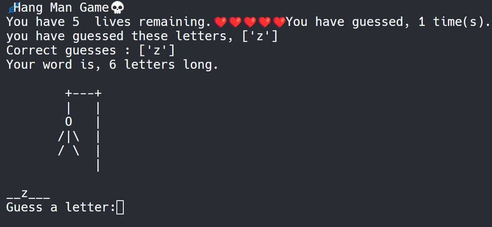
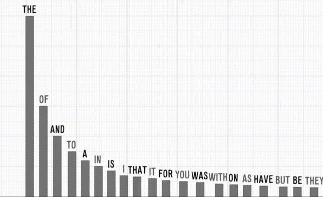
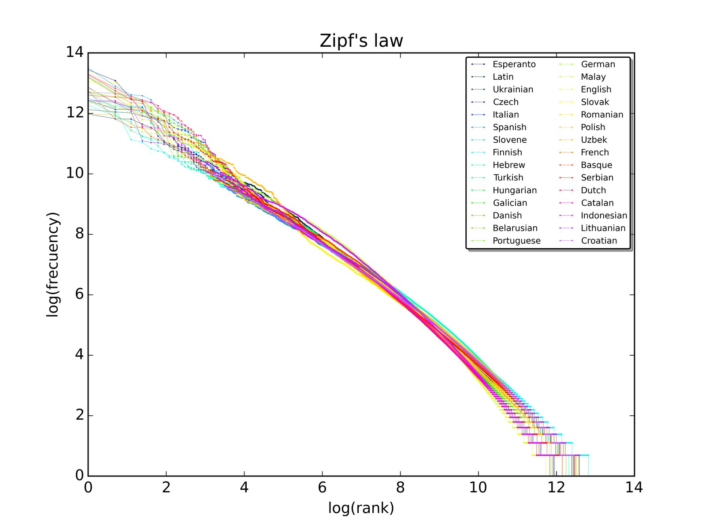
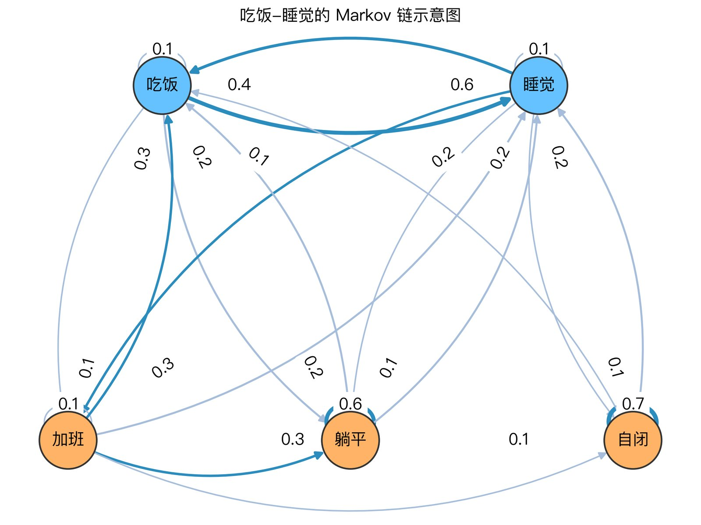
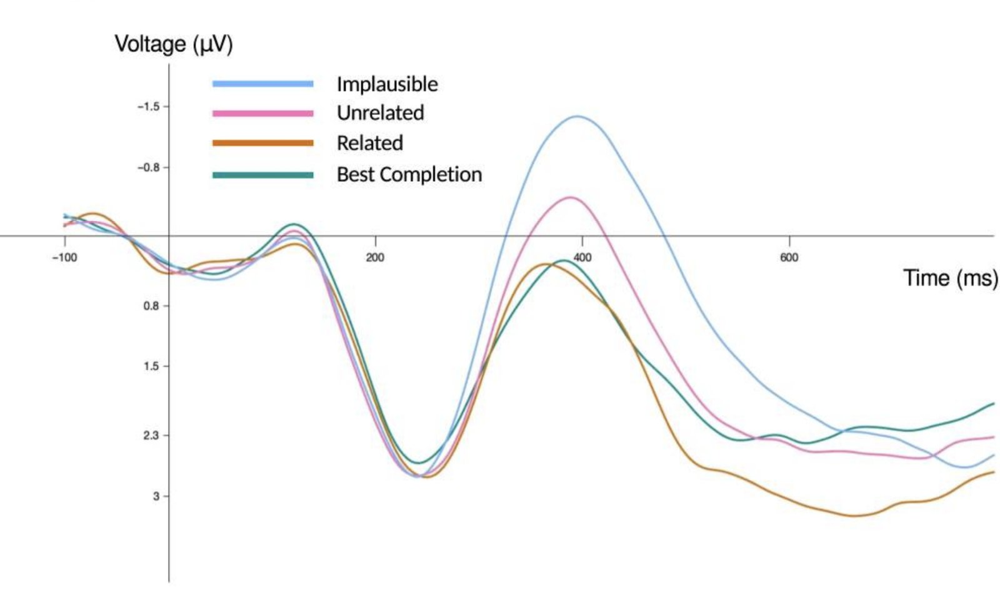

{: .img-fluid .d-block .mx-auto style="max-height:70vh;"}

_图 1　男人一生的四个阶段。来源：Reddit。_

上图中的句子来自福州失恋博物馆，据说有四种读法。聪明的你，请告诉我，你脑中最先浮现的是哪种读法？没错，大胆一点，我知道不是第二种。其实，这句话完美体现了**语言的歧义现象**。别急，虽说一句话可能有四种解释，就像“茴”字有六种写法，但是我们仔细想一下，每一种的可能性是不一样的，大脑似乎会自动帮我们选择概率最高的答案。

这说明语言本身或者语言处理的机制具有某种概率性。上一篇文章我们介绍的是“互动对齐理论”的词汇层面，但是在继续介绍句法层面之前，有必要先介绍一下**语言的概率模型**。了解过语言感知和语言生成的概率性，在探讨句法对齐时才能有讨论的基础。

在此我们不讨论“上帝掷不掷骰子”的高深哲学——毕竟连爱因斯坦和海森堡都没搞清楚。**我们说语言具有概率性，是基于我们的自身体验以及观察到的大量语言现象和统计规律而做出的**。

## Hangman 游戏：字母的频率

{: .img-fluid .d-block .mx-auto style="max-height:70vh;"}

_图 2　Hangman 游戏。来源：Replit。_

先从语言运用的基本单位词汇谈起。大家在学英语的时候有没有玩过一种叫 **Hangman** 的猜词游戏？出题人脑海中想一个词，告诉你词的长度，参与者一次猜一个字母，如果谜底词有这个字母，出题人就在单词的相应位置写出这个字母，直到全部猜对；如果没有这个字母，出题人就画一笔，直到画出一个“自挂东南枝”的小人后，Game Over。

那么，你会从哪个字母开始猜？对了，老司机都先猜 E、A、T，上来就猜 X、Z 的多半儿第一次玩。为啥？因为我们潜意识里知道：**语言中的字母使用频率并不一样**。四级单词书永远只记得 abandon，四级都考完了，A 字头还没背了。

莫说英文，我们中文母语者都有感觉，汉语中词汇的使用频率是不同的，你可以一句不离“是”，但是很难每句都有“屎”，**语言里似乎藏着某种“概率结构”**。

## Zipf 定律: 统计结构的普遍性

{: .img-fluid .d-block .mx-auto style="max-height:70vh;"}

_图 3　英语高频词与排名的关系。来源：himani23blog（WordPress）。_

19 世纪中叶，一些欧洲语言学家开始用概率和统计的方法分析**词长与写作风格**的关系。19 世纪末，世界上出现了第一本系统的**词频词典**。但词长、词频之间的数学关系，一直到 20 世纪上半叶才被更科学、系统地研究。尤其是在 1930 年代，美国语言学家**齐夫（ George Kingsley Zipf）**基于对大规模英语文本的研究，发现词频存在一个惊人的规律——后来被称为 Zipf 定律。

**Zipf 定律**的核心内容是：在很多自然语言语料里，把所有词按频率从高到低排序，则排名第 $$r$$ 位的词的出现频率 $$f(r)$$ 与其排名 $$r$$ 大致成反比。也就是说：

> “最常用的一个词，出现次数约为第二常用词的两倍，第三常用词的三倍……”
> {: style="margin-bottom:0.6em;"}

呈现在图像里就是，排名靠前的高频词“挤”在左边的头部，而低频词拖着“长尾”似乎无穷无尽……。此外，**高频词汇往往较短，而低频词汇较长**。对此，Zipf 给出一个“最小努力原则”（principle of least effort）的解释：说话人希望自己说话尽量简短，听话人也希望理解容易，这样大家都省力，于是高频词汇往往较短。

{: .img-fluid .d-block .mx-auto style="max-height:70vh;"}

_图 4　基于30种语言的词汇排名与词频对数关系。来源：Wikimedia Commons。_

虽然 Zipf 定律是经验规律，不是严格的理论定律，但是**这一统计模式在所有自然语言中几乎普遍出现**，这说明概率结构是语言使用的一个特征，而非偶然。

## Markov 链：局部依赖与序列建模

{: .img-fluid .d-block .mx-auto style="max-height:70vh;"}

_图 5　Markov 链的状态与转换概率示意。_

然而，我们平常说话并不是一个字一个字往外蹦的，而是一串一串按句子说的。比如，“喜欢上一个人”就是一个**字符串**，英文叫 string；或者称为**符号序列**，英文叫 sequence。语言符号这种序列是时间线性的，也就是说，这一秒说什么词是由上一秒说出的词决定的。在听到下一秒的词之前，你的理解只能基于当前和过去听到的词，**语言符号序列是关于时间的函数**。既然是函数，就得数学家来解。于是，俄罗斯数学家**马尔可夫（Andrey Markov）**登场了。

马尔可夫在 1913 年以普希金的长诗《欧根·奥涅金》为语料，研究了**元音和辅音之间的排列频率**。研究发现：如果字母是元音，下一位仍是元音的概率并不等于“单个字母是元音”的概率平方——也就是说，字母之间并不是独立出现，而存在“当前字母”影响“下一字母”的关系。

用数学语言翻译翻译，马尔可夫所研究的对象称为**随机过程（stochastic process）**——在离散时间里，一个系统会处于某个**状态（state）**——在语言情景里，可以把“当前词/字母”看作状态），每一步（每个时间点）系统有概率从一个状态**转移（transition）**到另一个状态，而**下一个状态的概率分布只依赖于当前状态，而不是更早之前的状态**。他把这一类依赖结构抽象为“链”（chain）——每一个状态（如“元音”或“辅音”）后面有特定概率转向另一状态。这就形成了后来被称为 **“马尔可夫链（Markov chain）”** 的数学模型。

简单理解就是：我只与我爸爸有关，而与我爷爷无关。有趣的是，金庸先生早在他的第一部武侠小说《书剑恩仇录》里就说了“乾隆只与他爸爸有关，而与康熙无关”；最近又有一些人出来论证“连康熙也只与他爸爸有关，与皇太极无关”。对此，我只能祭出那句著名的“在理想主义者眼中，什么都是马尔科夫链。”

慢着，你可能要问了：我下个词该说什么话怎么能只凭上一个词？我还考虑了前面一整句话和整个语境呢。没错，我们上面讨论的“如果当前词是 $$X$$，下一个词最可能是什么”叫做**一阶马尔可夫链**，你也可以构造二阶、三阶、四阶、$$N$$ 阶马尔可夫链来建模前面二三四乃至 $$N$$ 个词的语境，用来计算下一个词的概率。但是，**随着阶数增多，计算复杂度和算力成本是爆炸式增长的**。在深度学习出现之前，谷歌翻译也只是使用四阶或五阶模型来进行预。

我会在以后的文章中详细介绍如何用一阶马尔可夫链（也就是 bi-gram 方法）进行语言建模，你将直观感受到计算的复杂度。现在，你只需了解**马尔可夫链是现代 AI 最早的祖先。从 n-gram，到神经网络语言模型，再到今天的 GPT、Qwen、DeepSeek，本质都是在预测“下一个词是什么”。**

## Shannon 信息论: 语言概率的定量工具

{: .img-fluid .d-block .mx-auto style="max-height:70vh;"}

_图 6　N400效应图。来源：PubMed Central。_

Zipf 告诉我们词汇是有概率的；Markov 告诉我们词汇的组合是一种概率的链条，一句话在某种语言中出现的可能性是可以用链式法则计算出来的。形式语法的掌门人我们伟大的 **Noam Chomsky** 就出来反对了—— Chomsky 在 1957 年出版的 《Syntactic Structures》中，举出一个他自己造出来的经典句子：

> “Colorless green ideas sleep furiously.”
> {: style="margin-bottom:0.6em;"}
>
> (没有颜色的绿色想法暴怒地睡觉。)
> {: style="margin-bottom:0.6em;"}

Chomsky 用这个例子指出：**如果语言仅仅是概率模型，那么语料里没出现过的这类句子就会被认为是“极低概率”，甚至等同于不可能**，因为任何两个连续的词几乎都不可能同时出现。但事实上，英语母语者大多认为这句话“语法上没问题”。因此，Chomsky 认为，仅凭 “词汇的接续概率” 或 “当前词 → 下一词的状态转移” ，是不足以解释人类语言的结构性与 **“生成能力”** 的。

但是，**一个句子“合语法”并不意味着“有意义”**，语言毕竟是用来交流信息的。现在，我们经常听到“哎呀，你这句话信息量很大呀”。那么，**“信息量”**如何度量呢？我们就不得不提信息论的奠基人**香农（Claude Shannon）**了。

Shannon 在 1948 年发表了经典论文《A Mathematical Theory of Communication》，开创了**信息论 (Information Theory)** 这门学问。信息论的一个基本概念叫做**自信息（self-information）**，也就是一个事件 x 自身蕴含多少信息。

吴军老师在《数学之美》中给出了一个有趣的例子来解释自信息，我现在借用一下：**假设 2026 年世界杯依然只有 32 支队伍参加，一个足球知识为 0 的人最少需要几次能够猜中冠军是谁？**如果换作是你，你一定先猜法国、巴西、阿根廷，因为你的**先验知识告诉你这些球队的夺冠几率大**。但是，对于一个足球知识为 0 的人，每个球队夺冠的概率是一样的，都是 1/32。那么该如何猜呢？最好的办法是：把 32 支球队分别编号，从 1 至 32，然后每次猜其中一半。比如，“是 1-16 号吗”。如果是，再切一半，“是 1-8 号吗”，以此类推。那么，至多 5 次，一定猜对。为什么是 5 ？对了，因为 32 是 2 的 5 次方，每次切一半，相当于 $$log_2(32)$$。

Shannon 把以上推理过程抽象成了自信息的数学公式：

$$
I(x) = -\log_2 P(x)
$$

自信息 $$I(x)$$ 表示事件 $$x$$ 的信息量，**概率越小信息量越大**；对数以 2 为底时单位是**比特（bit）**。因此，对于一个足球知识为 0 的人来说，“2026 年世界杯谁夺冠”这个事件的信息量就是 5 比特。

其实，在语言学领域，自信息还有一个名字，叫**惊奇度 (surprisal)**。很好理解，**当我们听到某个词时，如果它在语境里出现的概率越低，那么我们会越“惊奇”**。同时，也就意味着“信息量”很大，我们的大脑需要较长的时间来处理。

惊奇度有一个最直接的神经生物学证据。当人们读到或听到出人意料的词汇时，脑电图在 300-400 毫秒后显示一个负相位偏转，称为 **N400 成分**。

比如：

> “他喝咖啡加糖” —— N400 较小，因为“糖”很容易预测，惊奇度低。
> {: style="margin-bottom:0.6em;"}
>
> “他喝咖啡加狗” —— N400 显著更大，因为“狗”很难预测，惊奇度高。
> {: style="margin-bottom:0.6em;"}

研究表明，**N400 的幅度与信息论中的“惊奇度”直接关联，这意味着人脑在处理语言时是在计算词汇的条件概率**。

因此，信息论告诉我们：**不管句子是否出现过，我们都可以衡量它的概率，衡量其与典型语言使用的距离**。这样就为“生成能力”与“概率模型”提供了桥梁。当然，信息论与语言概率性的关系远远不止“自信息”，在以后的文章中，我们还会介绍“互信息（Mutual Information）”、信息熵（Information Entropy）与“交叉熵”（Cross Entropy）等等。

## 小结

在了解了 Zipf 定律、Markov 链和 surprisal 这些概念以后，让我们用语言概率模型的观点再看一看“喜欢上一个人”的例子。

- 同一字符串，多种合法的读法：词汇或句法边界有概率，本身允许歧义。
- 大脑自动选“看起来最自然”的那一个：所谓“自然”，其实就是在你个人语料库里条件概率最高的那个版本。
- 幽默往往来自强行激活一个平时认为“低概率”的读法：当说话人故意按冷门断句念出来时，听众的预测模型被打破，惊讶 + 违和就变成了笑点。

最后，留一个课后作业：如何理解 **“如果世界上女人没有了男人就不活了”**这句话？欢迎在评论区留言。

## 参考资料

Griffiths, T. L. (2011). Rethinking language: How probabilities shape the words we use. *Proceedings of the National Academy of Sciences of the United States of America, 108*(10), 3825–3826.

Michaelov, J. A., Bardolph, M. D., Van Petten, C. K., Bergen, B. K., & Coulson, S. (2024). Strong prediction: Language model surprisal explains multiple N400 effects. *Neurobiology of Language, 5*(1), 107–135.

Shannon, C. E. (1948). A mathematical theory of communication. *Bell System Technical Journal, 27*(3), 379–423; *27*(4), 623–656.

Zipf, G. K. (1949). *Human behavior and the principle of least effort: An introduction to human ecology*. Addison-Wesley Press.

冯志伟. (2017). *自然语言计算机形式分析的理论与方法*. 科学技术大学出版社.

吴军. (2012). *数学之美*. 人民邮电出版社.

---

*本文首发于微信公众号「元语言」，[阅读原文](https://mp.weixin.qq.com/s/4bSq_mthaLTppAwdxDI76g)。*
