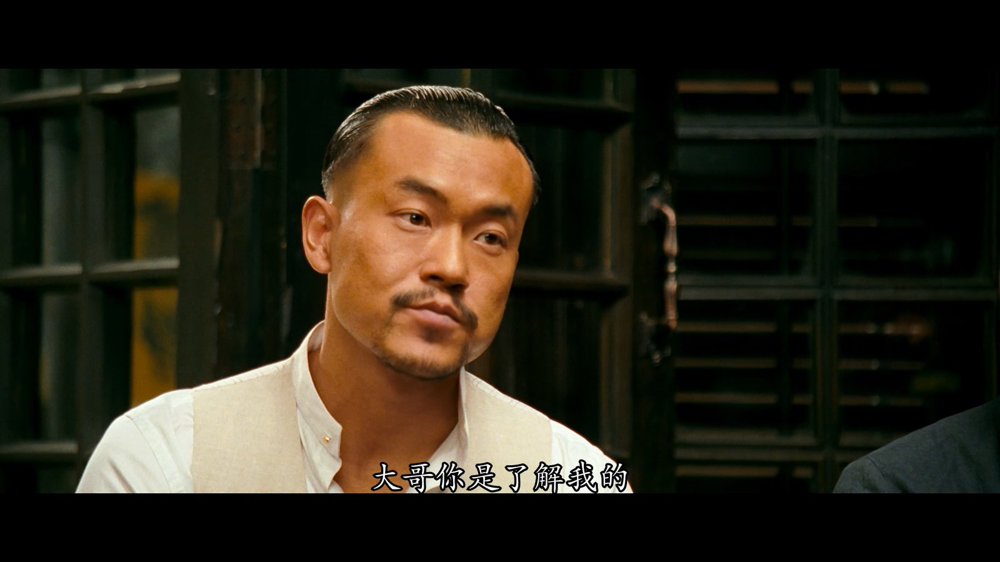
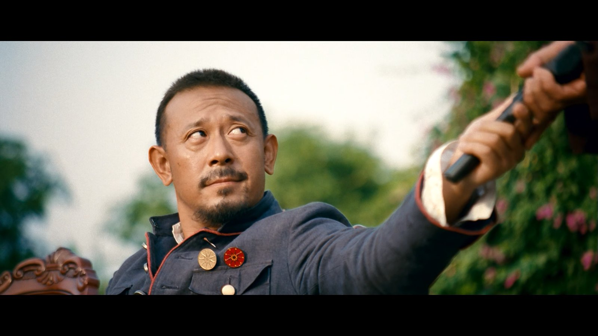
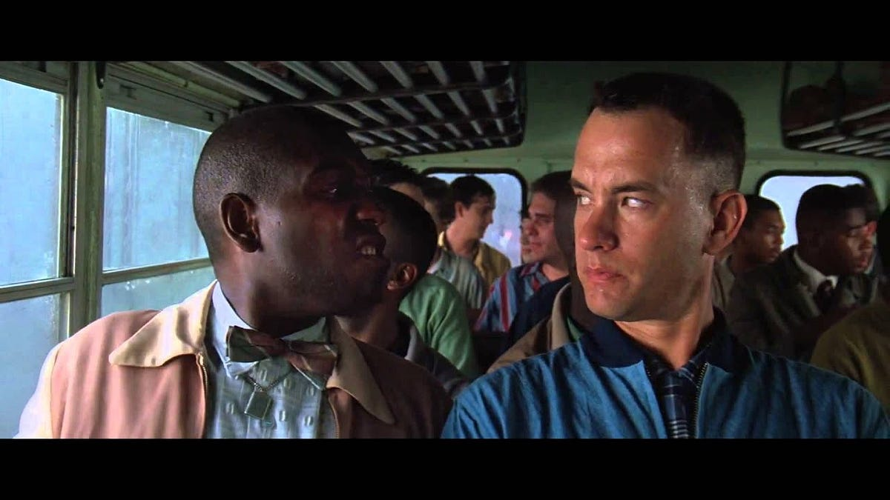
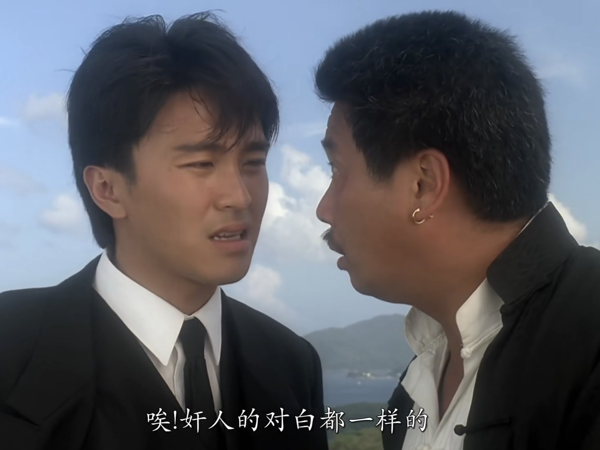

> 老七：大哥你是了解我的，我从来不做仗势欺人的事，我喜欢被动。
> {: style="margin-bottom:0.6em;"}
>
> 老三：大哥你是了解我的，以我的习惯，万事不求人。
> {: style="margin-bottom:0.6em;"}
>
> 老四：大哥你是了解我的，如果是我，不会有人活着来告状。
> {: style="margin-bottom:0.6em;"}
>
> 老五：大哥你是了解我的，我老五虽然岁数最大，我、我至今……俗称处男。
> {: style="margin-bottom:0.6em;"}
>
> 老二：别看著我呀？大哥，你是了解我的，如果我出手，那趴在桌上的，应该是他老公。
> {: style="margin-bottom:0.6em;"}
>
> 张麻子：我听出来了，你们都个个身怀绝技。
> {: style="margin-bottom:0.6em;"}
>
> ——电影《让子弹飞》
> {: style="text-align:right;margin-bottom:0.6em;"}

{: .img-fluid .d-block .mx-auto style="max-height:70vh;"}

_图 1　大哥你是了解我的（对话片段）。_

一周以来醉心与 Gemini 3 一起 vibe coding ，更新慢了。书接上回，既然我们已经对**语言的概率性**有了一定了解，接下来就可以丝滑地讨论 **“互动对齐”理论** 在句法层面的有趣发现。我们先从《让》学的经典片段谈起。

黄四郎派胡百假扮张麻子一伙儿夜闯鹅城百姓家里，搞了 NTR。第二天百姓告状，张麻子审问众弟兄，发生了“大哥你是了解我的”这么一段对话。你可能要问了，既然麻匪兄弟们各个“身怀绝技”，为什么像复读机似的重复了一样的句式呢？除了戏剧效果以外，是不是还隐藏着 **语言生成机制** 更深层的秘密呢？我们先来做个实验。

## 句法启动实验

> 例句：张麻子把两颗钻石给了汤师爷
> {: style="margin-bottom:0.6em;"}

请各位先把上面的例句在心里默读三遍。然后闭上眼睛，等待 3 秒，接着看下面的图片，并用一句话描述出来。准备好了吗？开始！

{: .img-fluid .d-block .mx-auto style="max-height:70vh;"}

_图 2　张麻子递枪（实验示意）。_

现在，告诉我您的答案是什么？是 **“张麻子把枪给了黄四郎”**，还是 **“张麻子给了黄四郎一把枪”** ？我猜可能是前边儿一句。

如果我对了，说明**您在句法结构上已经跟例句对齐**了 —— 这正是 **Kathryn Bock** 在 1986 年的论文《Syntactic Persistence in Language Production》中做的实验。

### 实验范式

Bock（1986）采用了一个巧妙的实验范式：以"记忆测试"的名义，实际观察的是语言产出。被试需要分组朗读以下两种类型的句子，称作 prime 句子。朗读完 p**rime 句子**后，被试会看到一张 **target 图片**（例如，画面上是“女孩递给男人画笔”的一幅图），然后用自己的方式描述图片。

> Prime 句子
> {: style="margin-bottom:0.6em;"}
>
> PO 句式（介宾结构）：The rock star sold some cocaine to an undercover agent（摇滚明星把可卡因卖给了卧底特工）
> {: style="margin-bottom:0.6em;"}
>
> DO 句式（双宾结构）：The rock star sold an undercover agent some cocaine（摇滚明星卖给了卧底特工可卡因）
> {: style="margin-bottom:0.6em;"}

### 关键发现

通过上述实验，Bock 发现了明显的**结构重复效应**： 看过 PO 句式的被试倾向于用 PO 结构描述图片（The girl handed a paintbrush to the man）;而看过 DO 句式的被试则倾向于用 DO 结构描述图片（The girl handed the man a paintbrush）。重要的是，**prime 句子与 target 图片在语义上毫无关联，也不形成连贯的上下文，但结构影响仍然存在**。Bock 把这种现象称为 **“句法启动”（syntactic priming）**。

## 句法启动为何出现？

为什么我们不久前接触过什么句法结构，接下来似乎就更有可能重复同样的结构呢 Pickering 与 Bock 给出了**两种不同的理论视角：残留激活与隐性学习**。让我们先来看一个残留激活的句子。

### 残留激活

> **Bubba**: My given name is Benjamin Buford Blue. People call me Bubba.
> {: style="margin-bottom:0.6em;"}
>
> **叭吧**：我的名字是本杰明·比尔福德·布鲁，大家都叫我“叭吧”。
> {: style="margin-bottom:0.6em;"}
>
> **Forrest**: My name is Forrest Gump. People call me Forrest Gump.
> {: style="margin-bottom:0.6em;"}
>
> **阿甘**：我的名字是福瑞斯特·甘，大家都叫我“福瑞斯特·甘”。
> {: style="margin-bottom:0.6em;"}
>
> ——电影《阿甘正传》
> {: style="text-align:right;margin-bottom:0.6em;"}

{: .img-fluid .d-block .mx-auto style="max-height:70vh;"}

_图 3　阿甘正传（Bubba 引语示例）。_

我们都知道阿甘的智力水平低于常人，从小就会不由自主地对许多引起他注意的事物进行模仿 —— 模仿过猫王跳舞，模仿过校长“呐喊”，还模仿过 Bubba 说话。在上面的例子中，阿甘完全复制了 Bubba 的句法框架。注意，这里与“大哥你是了解我的”不同，阿甘并**不是逐字逐句地重复，而是复制了句法结构**，填充了他自己想说的词汇内容。用 Pickering 的观点看，以阿甘的智力水平，一定不是有意识地模仿别人说话，以显示自己幽默，而是因为 Bubba 话音未落，阿甘的大脑里还残留着这句话的拓扑结构，在接下来的对话里，直接激活了这个句法形式 —— 此正所谓 **“残留激活”（Residual Activation）**。

**残留激活是一种短期机制**。当说话人**最近听到或说出了某种句法结构时，该结构在大脑中会保持短期的残留激活状态，从而增加说话人在后续话语生成中选择使用该结构的概率**。因为，思考是要“费劲儿”的，人类是“懒惰”的，刚见过的句子是还有个“残影儿”在脑子里的，为啥不趁热拿来用呢？Menenti（2011）的神经影像学研究也证明了这一点：只要重复了相同句法结构，相应脑区的激活就会减弱。

然而，既然是“残影儿”，必然很快从记忆里消失，但 Bock（2000）的研究发现，这种 **“句法启动”效应能够在经过至少 10 个不相关的句子后仍然发挥作用**，这说明“句法启动”必然有一种长期的、隐性的激活。

### 隐性学习

> 【周星祖和周大福站在远处，看黄金贵和丁力交谈】
> {: style="margin-bottom:0.6em;"}
>
> 周星祖：喂，你不要敬酒不吃吃罚酒。
> {: style="margin-bottom:0.6em;"}
>
> 黄金贵：你不要敬酒不吃吃罚酒。
> {: style="margin-bottom:0.6em;"}
>
> 丁力：你敢和我丁力说这种话？
> {: style="margin-bottom:0.6em;"}
>
> 周星祖：哈哈哈哈哈……
> {: style="margin-bottom:0.6em;"}
>
> 黄金贵：哈哈哈哈哈……
> {: style="margin-bottom:0.6em;"}
>
> 周星祖：你有种，我们走！
> {: style="margin-bottom:0.6em;"}
>
> 黄金贵：你有种，我们走！
> {: style="margin-bottom:0.6em;"}
>
> 周大福：哇！这么厉害，他想说什么你全都知道。
> {: style="margin-bottom:0.6em;"}
>
> 周星祖：唉！奸人的对白都是一样的。
> {: style="margin-bottom:0.6em;"}
>
> —— 电影《赌侠之上海滩赌圣》
> {: style="text-align:right;margin-bottom:0.6em;"}

{: .img-fluid .d-block .mx-auto style="max-height:70vh;"}

_图 4　上海滩赌圣（对话示例）。_

让我们先从大脑的 **“言语预测”（speech prediction）**谈起。近二三十年的认知神经科学已经证明，**大脑是一台无时无刻不在做预测的机器**。预测未来是大脑的一个“被动技能”，比如，你边低头看手机边走路，却撞不到人，这是因为大脑会提前预判路况。大脑在产出语言时也一样：**在对话中，你一边听别人说，一边理解，一边预测别人下一句说什么，一边规划自己该怎样回应**。如果别人说的话全部都能被你猜到会怎么样？那就会出现《赌侠之上海滩赌圣》电影里这个名场面。

但是，预判错了怎么办？也就是说，大脑实际处理的语言结构与**预期不符**，出现了**预测误差（prediction error）**。这时，大脑会随着类似句法结构的不断出现而调整对该结构的**概率期望**，从而增加在未来使用这些结构的可能性。举个例子，**“把”字句**是汉语里常见的句法结构，大部分情况下可以与 **“主谓宾”（SVO）**结构转换，比如“你读了文章”、“你点了赞”，也可以说成“你把文章读了”、“你把赞点了”。但是，很多外语里只有 SVO，没有 SBaOV，“把”字句对许多学中文的外国人来说，就很容易产生预测误差。这个预测误差就会驱动小老外的大脑去**学习和适应**“把”字句结构 —— 正是所谓的 **隐性学习（Implicit Learning）**。于是，你就会读到这样的小作文：

> “今天早上，我把床起了，把脸洗了，把早饭吃了，把车骑了，把学校去了。”
> {: style="margin-bottom:0.6em;"}

隐性学习是一种长期机制，反映了**大脑的语言处理系统对当前语言环境统计特性的适应**，只不过这个小老外还没有适应好罢了。如果你对机器学习有了解，就会发现这个学习过程其实就是降低损失函数，优化参数的过程。上面的例子里小老外学过头了，属于模型“过拟合”，需要新的训练数据继续适应；而周星祖的例子则展现了预测误差为 0 的情况，属于用训练集的数据进行测试了。

所以，“句法启动”的机制到底是“残留激活”还是“隐性学习”呢？越来越多的学者们用实验证明了——是两种机制的结合。现在，我们终于可以回到“句法对齐”上来了：根据 Pickering 和 Garrod （2004）的 **“互动对齐”模型（Interactive Alignment Model, IAM），** 句法对齐的根本动力就是“句法启动”机制。句法对齐并非源于说话者的有意识决策或复杂的心理推理，而是一种**自发的、自动的**语言处理现象。

## 句法对齐的主要特点

通过上面几个例子，我们多少已经感受到了“句法对齐”的一些特点，下面再做进一步总结和补充：

### 1. 自动性与非意识性

句法对齐是**高度自动化的过程，不需要有意识的努力或特别的注意力**。参与者通常对自己正在对齐说话伙伴的句法结构毫无察觉。Branigan (2010)的实验表明，即使说话者与计算机而非真人互动，句法对齐仍然会显著发生。

### 2. 抽象性与结构独立性

句法对齐发生于**抽象结构层面**，而非具体词汇重复。比如，即使句子中使用的动词完全不同，抽象的句法结构仍然会产生对齐。不过，重复的词汇能加强对齐的效果，这被称为**词汇提升效应（Lexical Boost）**。

### 3. 短期与长期效应的双重性

- **抽象结构对齐**的效果持久，可在 10 个插入项之后仍然被检测到，反映了隐性学习机制。
- **词汇提升效应**衰减迅速，只在短期内显著发生，反映了残留激活机制。

### 4. 逆频率效应

相对罕见的句法结构能产生更强的对齐效应。例如，本文里外国人学“把”字句的例子，以及**英语被动句**的例子 —— 英语中被动句不太常见，会产生显著的对齐效应，而主动句极其常见，几乎产生不了对齐效应。

### 5. 互动依赖性

研究发现，当参与者与真人互动时，句法对齐比仅听录音或单人完成任务时更强，这表明**互动语境本身会增强对齐效应**。

### 6. 非伙伴特异性

颇为有趣的是，研究发现句法对齐基本上是**非伙伴特异性的** —— 这意味着说话者学习的是**整个语言环境的统计特性**，而非针对个别说话者进行动态调整。

### 7. 多层级联性

“互动对齐”模型的核心洞见是对齐**不仅发生在单个层面，还会在多个语言表征层级之间级联传播，不同层级的对齐会相互促进**。本文已经提到了词汇提升效应，下一篇文章我们将讨论**音韵层面**的“互动对齐”。

如果各位有“句法对齐”的有趣例子，欢迎留言分享，我们下次见！

## 参考资料

Bock, K. (1986). Syntactic persistence in language production. *Cognitive Psychology, 18*(3), 355–387.

Bock, K., & Griffin, Z. M. (2000). The persistence of structural priming: Transient activation or implicit learning? *Journal of Experimental Psychology: General, 129*(2), 177.

Branigan, H. P., Pickering, M. J., Pearson, J., & McLean, J. F. (2010). Linguistic alignment between people and computers. *Journal of Pragmatics, 42*(9), 2355–2368.

Jaeger, T. F., & Snider, N. E. (2013). Alignment as a consequence of expectation adaptation: Syntactic priming is affected by the prime's prediction error given both prior and recent experience. *Cognition, 127*(1), 57–83.

Menenti, L., Gierhan, S. M., Segaert, K., & Hagoort, P. (2011). Shared language: Overlap and segregation of the neuronal infrastructure for speaking and listening revealed by functional MRI. *Psychological Science, 22*(9), 1173–1182.

Ostrand, R., & Ferreira, V. S. (2019). Repeat after us: Syntactic alignment is not partner-specific. *Journal of Memory and Language, 108*, 104037.

Pickering, M. J., & Branigan, H. P. (1998). The representation of verbs: Evidence from syntactic priming in language production. *Journal of Memory and Language, 39*(4), 633–651.

Pickering, M. J., & Garrod, S. (2004). Toward a mechanistic psychology of dialogue. *Behavioral and Brain Sciences, 27*(2), 169–190.

---

*本文首发于微信公众号「元语言」，[阅读原文](https://mp.weixin.qq.com/s/oL4uD5i1JSoTpq2tJqq4cg)。*
