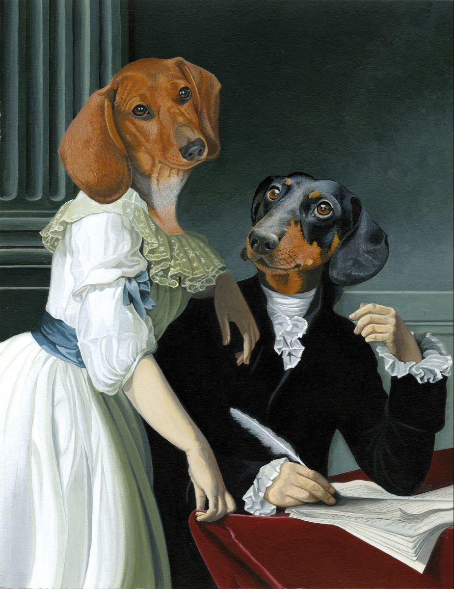
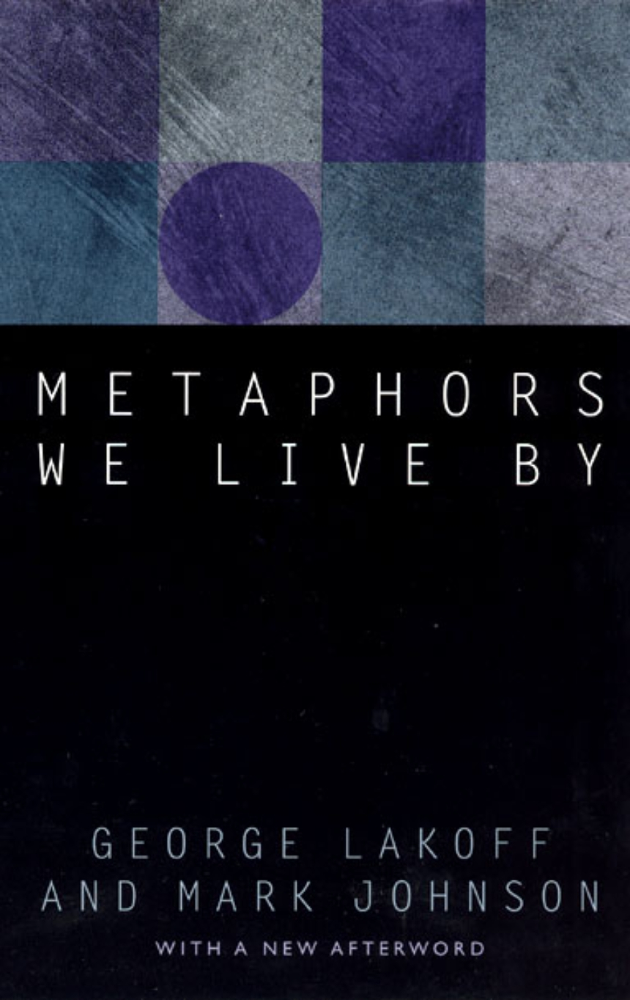
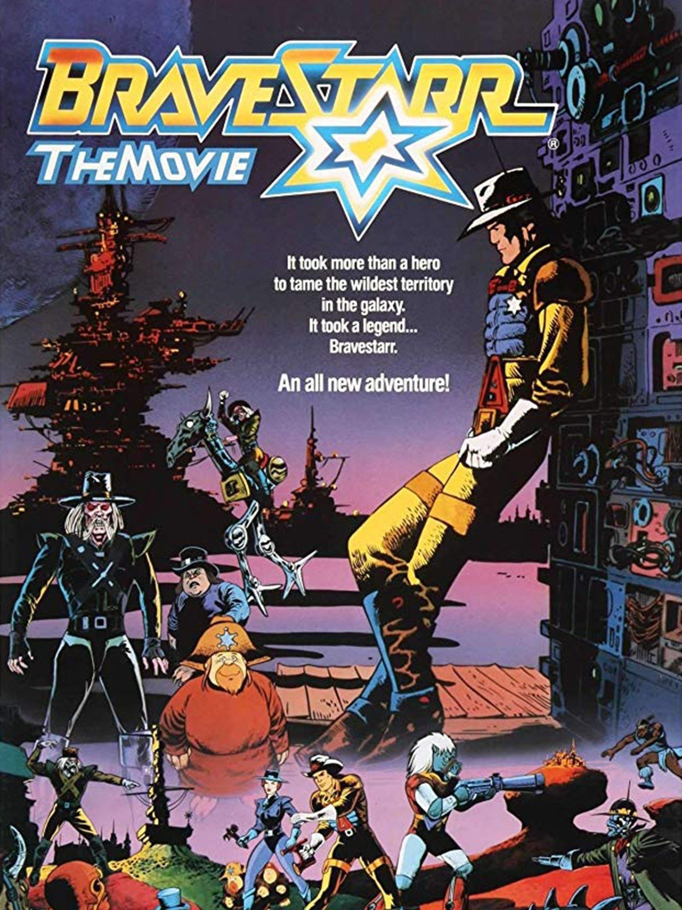
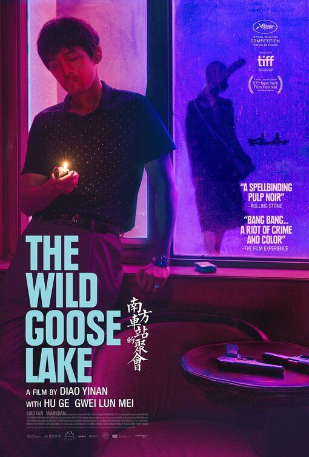
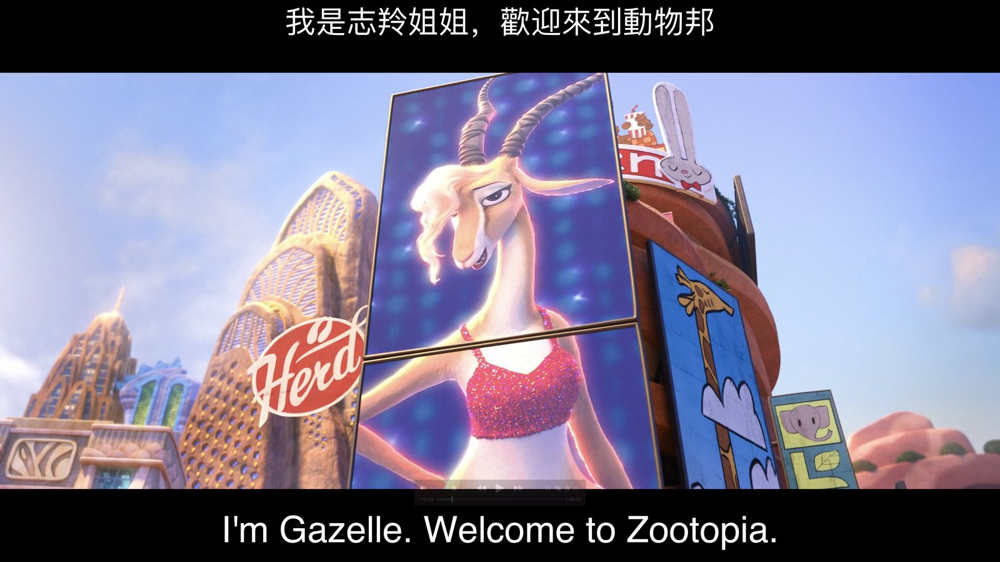

> “很久很久以前，在新德克萨斯星球上有一位警长，他叫布雷斯塔。他拥有鹰的眼睛，狼的耳朵，豹的速度，熊的力量！”
> {: style="margin-bottom:0.6em;"}
>
> —— 动画片《布雷斯塔警长》开场白
> {: style="text-align:right;margin-bottom:0.6em;"}

趁着《疯狂动物城 2》（Zootopia 2）的热映，咱们聊一期动物话题。这年头，饭圈儿哥哥妹妹的评论区里唇枪舌剑，政圈儿首相总统的留言区里子弹上膛，只有宠物圈儿的弹幕一片祥和——动物人人爱嘛。公园里大爷遛狗要摸上一摸，抖音上妹子逗猫要吸上一吸，“猫主子”和“狗儿子”给人们提供了多大的情绪价值呀，难怪它们的家庭地位一路攀升。

## 从“拟人化”到“拟兽化”

{: .img-fluid .d-block .mx-auto style="max-height:70vh;"}

_图 1　拟人化艺术示例 — 将动物形象赋予人类特征。来源：Pinterest。_

其实，“猫主子”和“狗儿子”本身就是一种**拟人化（Anthropomorphism）**表达。拟人化是指**将人类的特征、情感或行为赋予非人类实体**的现象，在文学、艺术和日常语言中广泛存在。我相信你一定看过“戴珍珠耳环的喵”和“穿将军服的狗”这两张油画；也相信你一定读过伊索寓言（Aesop's Fables）中的龟兔赛跑，格林童话（Grimm's Fairy Tales）中的狼外婆，以及乔治·奥威尔（George Orwell）的《动物农场》（Animal Farm）。**两千五百多年来，拟人化艺术通过赋予动物人类的特征，传达道德教育和社会价值观，帮助人们理解复杂的情感和社会关系，乃至隐喻地对政治和社会体制进行批判**。

《疯狂动物城》当然也是拟人化艺术。电影里，狐狸尼克（Nick Wilde）和兔子朱迪（Judy Hopps）不是“兔死狐悲”的天敌关系，反而结成了“狐朋兔友”，甚至“狐兔 CP”，一起打怪升级。电影也通过这对 CP 的眼睛，照见了**现实社会中的偏见、多样性和包容性**等隐藏在笑声背后的严肃主题。

不过，我们今天不主要讨论拟人化，相反，我想要谈谈拟人化的反义词 —— **“拟兽化” (Zoomorphism)**。这个术语乍一听挺唬人的，其实你对它非常熟悉。许多成语和俗语都是用动物来形容人，比如形容一个人长相猥琐可以说“贼眉鼠眼”，形容一个人体格健壮可以说“虎背熊腰”；形容一个人做事畏缩可以说“胆小如鼠”；形容一个人胆大妄为可以说“吃了熊心豹子胆”；形容一个人半途而废可以说“虎头蛇尾”，形容一个人事业腾飞可以说“大展鸿图”；形容一个野蛮人充文化人可以说他是“衣冠禽兽”、“沐猴而冠”，形容一个虚伪的人做残忍的事可以说他是“人面兽心”、“禽兽不如”，凡此种种。其实，单单兔子和狐狸的“拟兽化”表达都能说出一长串，其中有**褒义**的比如“动如脱兔”，“一狐之腋”，也有**贬义**的比如“狡兔三窟”、“狐假虎威”。

**“拟兽化”表达是人类语言的普遍现象，在不同的语言和文化中都存在。**比如，形容一个人狡猾奸诈，汉语里叫做 **“老狐狸”**，英语里也有 **“as sly as as a fox"** （像狐狸一样狡猾）；形容一举两得，汉语里有 **“一箭双雕”**，英语里也有 **“kill two birds with one stone”**（一石二鸟）—— 这种情况下，动物的形象和背后的内涵在两种语言里都是一样或接近的。但是，也有很多时候同样的**内涵**在汉语和英语中却用了不同的动物**形象**来指代。这里，我要感谢我伟大的初中英语老师，是他课堂上的段子让我永远记住了 **“rain cats and dogs”**的意思是 **“倾盆大雨”**，而不是“天上下些猫儿狗儿” —— 汉语里意思最接近的表达可能要属 **“落汤鸡”**了。那么，**到底是什么机制让抽象的概念与具体的动物形象建立了联系呢？**认知语言学告诉我们，“拟兽化”现象属于**概念隐喻理论 (Conceptual Metaphor Theory, CMT)**的范畴。

## 何为隐喻？

**隐喻（Metaphor）**是一种古老的修辞技巧。“扈江离与辟芷兮，纫秋兰以为佩”，《离骚》中便有以香芷喻忠臣，臭草喻奸佞，美人喻明君的手法。自亚里士多德以降，学人都将隐喻视为一种“语言的装饰”，多用于诗歌。到了 1980 年代，认知语言学家 **George Lakoff 和 Mark Johnson** 破陈腐旧套，提出了现代的隐喻理论 —— **隐喻不仅仅是语言现象，更是思维方式的一部分**。

> The locus of metaphor is not in language at all, but in the way we conceptualize one mental domain in terms of another。
> {: style="margin-bottom:0.6em;"}
>
> 隐喻发生的地方不在语言之中，而在我们利用一个心理领域去概念化另一个心理领域（的过程中）。
> {: style="margin-bottom:0.6em;"}
>
> —— Lakoff (1993)
> {: style="text-align:right;margin-bottom:0.6em;"}

Lakoff 这句话的意思就是说，**隐喻通过将熟悉的概念与不熟悉的概念联系起来，使人们能够更容易地理解和处理信息**。人类的思维倾向于用具体的、可感知的**源域 (Source Domain)** 来理解抽象的、复杂的**对象域 (Target Domain)**。因此，隐喻用数学语言表达就是**跨域映射（cross-domain mapping）**，公式如下：

$$
f(\text{源域}) \rightarrow \text{对象域}
$$

代入动物隐喻，公式就变成了：

$$
f(\text{动物的显著特征}) \rightarrow \text{人类的抽象品质}
$$

代入狐狸，可以得到：

$$ f\left( \begin{pmatrix} \text{视觉} & \text{尖脸} \\ \text{行为} & \text{夜行} \\ \text{文化} & \text{诡计者} \end{pmatrix} \right) \rightarrow \text{狡猾} $$

{: .img-fluid .d-block .mx-auto style="max-height:70vh;"}

_图 2　《Metaphors We Live By》封面 — 概念隐喻理论的代表作。来源：University of Chicago Press。_

## 隐喻的具身根基

为什么人类会选择动物的某些显著特征来隐喻人类的抽象品质呢？Lakoff 认为，隐喻的**具身根基 (embodied basis)** 在于人类的感知和经验。**人类通过感官体验世界，形成对事物特征的认知，这些认知成为隐喻映射的基础**。

**例 1：MORE IS UP**

- **经验基础**：倒液体进容器时，液位上升；堆物品时，越堆越高
- **隐喻映射**：数量增加（MORE）与空间位置上升（UP）之间的联系
- **语言表达**：英语中常用“prices are going up”（价格上涨）来表达数量的增加

**例 2：KNOWING IS SEEING**

- **经验基础**：知识主要来自视觉；眼见为实
- **隐喻映射**：知识获取（KNOWING）与视觉感知（SEEING）之间的联系
- **语言表达**：英语中常用“I see what you mean”（我明白你的意思）来表达理解；用“His answer is unclear”（他的回答不清楚）来表达不解

**例 3：PURPOSES ARE DESTINATIONS / ACTIONS ARE PATHS**

- **经验基础**：人类的大部分日常行为目的要么是运动到某地，要么是获得某物，因此目的和行动常与空间位置和运动相关联
- **隐喻映射**：目的（PURPOSES）与目的地（DESTINATIONS）；行动（ACTIONS）与路径（PATHS）之间的联系
- **语言表达**：英语中常用“We're on the right track”（我们在正确的道路上）来表达目标的实现

{: .img-fluid .d-block .mx-auto style="max-height:70vh;"}

_图 3　《布雷斯塔警长》（Bravestarr）动画电影海报。来源：Flixster。_

**以上这些经验和事件每天都在发生，潜移默化地影响着人类的认知模式，而且没有文化差异。**这些隐喻不仅仅是头脑中的概念，还在**现实生活中被制度化，成为下一代人的经验基础**：比如温度计的刻度是从下到上升高的，表示温度的升高；股票市场的图表也是从下到上升高的，表示股价的上涨；**“Time is money”**（时间就是金钱）在工业革命时被制度化，人们开始按工作时间赚钱，语言里也有了“wasting time”（浪费时间）和“saving time”（节省时间）这样的表达。

因此，**动物隐喻的形成也是基于人类对动物特征的感知和经验**。例如，狐狸“狡猾”，老虎“勇猛”，而猪则“懒惰”，人们**自然地将动物的这些特征映射到人类的行为和性格上**。说到此处，我不由地想起小时候看《布雷斯塔警长》（Bravestarr）动画片时的热血沸腾：“很久很久以前，在新德克萨斯星球上有一位警长，他叫布雷斯塔。他拥有鹰的眼睛，狼的耳朵，豹的速度，熊的力量！”

## 动物隐喻的实证研究

那么，什么样的动物特征对应什么样的人类品质呢？美国心理学家 Robert Sommer 和 Barbara Sommer 在 2011 年发表的论文 **《拟兽化：人格的动物隐喻研究》**（Zoomorphy: Animal Metaphors for Human Personality）中，对这一问题进行了实证研究。研究发现，在 36 种常见哺乳动物的隐喻用法中，**多数（~60%）被用于贬义的人类特征**，而反向映射（用人类特征比喻动物）几乎不存在。

{: .img-fluid .d-block .mx-auto style="max-height:70vh;"}

_图 4　“存在巨链”示意图 — 阶层化宇宙观示例。来源：Wikimedia Commons。_

这种向下映射而不向上映射的现象，反映了 **"存在巨链"(Great Chain of Being)**的作用 —— 一种将所有存在物按等级排列的宇宙观。在这种观念中，人类被视为高等生物，而动物则处于较低的地位。因此，人类倾向于用动物的负面特征来隐喻人类的缺点，而不会用人类的正面特征来隐喻动物的优点。

$$
\text{神} > \text{人} > \text{动物} > \text{植物} > \text{矿物}
$$

此外，这篇论文还提出了一个 **“缺失的品质”假设** —— 研究发现，有些人类品质几乎没有对应的动物特征来进行隐喻。例如，**利他主义 (altruism)、神经质 (neuroticism)、残忍性 (cruelty)、诚实 (honesty)、开放性 (openness)、创意 (creativeness)**等等。这项发现同“单向映射”现象相呼应，深刻反映了根植于语言之中的 **“人类中心主义”(Anthropocentrism)** 思维模式。人类虽然在科学上接纳了进化论（Darwinian theories），但日常语言仍体现了**人与动物的等级差异**。

不过，有趣的是该研究还发现“动物隐喻”竟然竟然也有性别差异：整整 13 种动物被评为“男性化”（同意度高达 70%），而只有猫和鹿被评为“女性化” —— 结果呢？贬低人的动物大多被贴上男性标签，而褒扬的则温柔地归为女性。

## 动物隐喻的文化差异

必须指出，Sommer 和 Sommer (2011) 的研究样本主要是美国大学生，因此其结论可能不完全适用于其他文化。不同文化对动物的象征意义和隐喻用法固然有很大共性，但差异也不可忽视，在从事翻译和文化交流时需要特别注意。在文章的末尾，我再举几个英语和汉语中常见的动物隐喻表达，以供读友们思考比较：

| 英语表达            | 源域         | 对象域       | 汉语近似表达 | 异同 |
| ------------------- | ------------ | ------------ | ------------ | ---- |
| hold your horses    | 拉住你的马   | 且慢行事     | 悬崖勒马     | 相似 |
| ants in one's pants | 裤子里的蚂蚁 | 坐立不安     | 热锅上的蚂蚁 | 相似 |
| black sheep         | 黑羊         | 家族中的败类 | 害群之马     | 相似 |
| when pigs fly       | 猪会飞       | 不可能的事   | 母猪会上树   | 相似 |
| scaredy-cat         | 胆小的猫     | 胆小鬼       | 胆小如鼠     | 不同 |
| sitting duck        | 坐着的鸭子   | 易受攻击的人 | 板上鱼肉     | 不同 |
| eager beaver        | 热心的海狸   | 勤奋工作的人 | 老黄牛       | 不同 |
| fishy               | 有鱼腥味的   | 令人怀疑的   | 满腹狐疑     | 不同 |

另外，还有一些动物隐喻在英语中有，但汉语中没有对应表达，反之亦然。《疯狂动物城》里就有一个 “elephant in the room” 的例子：这个俚语指的是“明显存在但被忽视的问题”，就像房间里有一头大象，但大家都假装没看见它一样。只不过，《疯狂动物城》跟观众开了个玩笑，当警长说“房间里有大象”时，画面上真的出现了一头大象，而且还是个当天要过生日的大象警员。这个笑点在汉语里就不好传达了，因为汉语里没有类似的隐喻。

{: .img-fluid .d-block .mx-auto style="max-height:70vh;"}

_图 5　《南方车站的聚会》（The Wild Goose Lake）电影海报。来源：方格子（vocus）。_

写到这里，我想到了另一个例子 —— “wild goose chase”，字面意思是“追逐野鹅”，引申义是“一场徒劳无功的追逐”。这是五百年前莎士比亚在《罗密欧与朱丽叶》（Romeo and Juliet）中创造的用法，汉语至今也没有类似的动物隐喻。不过，五百年后有一部叫《南方车站的聚会》的黑色电影，它的英文标题正是“The Wild Goose Lake”，电影里警匪双方在一个叫“野鸭湖”的地方展开了一场旷日持久而心惊肉跳的追逐，这是不是导演有意为之呢？

话说回来，语言是随着文化和社会不断演变的。一种文化中没有的隐喻表达，可能由于另一种强势文化的影响而被引入。比如，英文中 “dog days of summer”（夏天的狗）是指三伏天，如今中文里也有了“热成狗”；“fish in the sea”（海里的鱼），意思是可以选择的婚恋对象有很多，而如今中文里也有了“养鱼”、“海王”之类的说法。不得不让我感叹，“三条腿的蛤蟆不好找，两腿的人有的是”啊！

## 结语

今天我们从《疯狂动物城》聊到了拟人化艺术，再从拟人化聊到了拟兽化隐喻，最后又从隐喻理论聊到了文化差异。**语言中的动物隐喻不仅反映了人类对动物特征的认知和经验，还揭示了人类思维本身的等级和文化差异**。通过理解这些隐喻，我们可以更好地理解语言背后的文化内涵和认知模式。

{: .img-fluid .d-block .mx-auto style="max-height:70vh;"}

_图 6　志羚姐姐喊你去观影。_

好了。文章的最后，让我祭出志羚姐姐的海报，祝大家观影愉快！以后我们找机会继续聊聊这部动画里的隐喻和象征意义吧。

## 参考资料

Lakoff, G. (1993). The contemporary theory of metaphor. In A. Ortony (Ed.), *Metaphor and thought* (2nd ed., pp. 202–251). Cambridge University Press.

Lakoff, G., & Johnson, M. (2024). *Metaphors we live by*. University of Chicago Press.

Sommer, R., & Sommer, B. A. (2011). Zoomorphy: Animal metaphors for human personality. *Anthrozoös, 24*(3), 237–248.

*Animal idioms*. (n.d.). English Club.

*Animal idioms vocabulary list*. (n.d.). Merriam-Webster.

*Zootopia wants to teach kids about prejudice. Is it accidentally sending the wrong message?* (2016, March 7). Vox.

---

*本文首发于微信公众号「元语言」，[阅读原文](https://mp.weixin.qq.com/s/UbfS0cF065jkB6pEgvjWTA)。*
