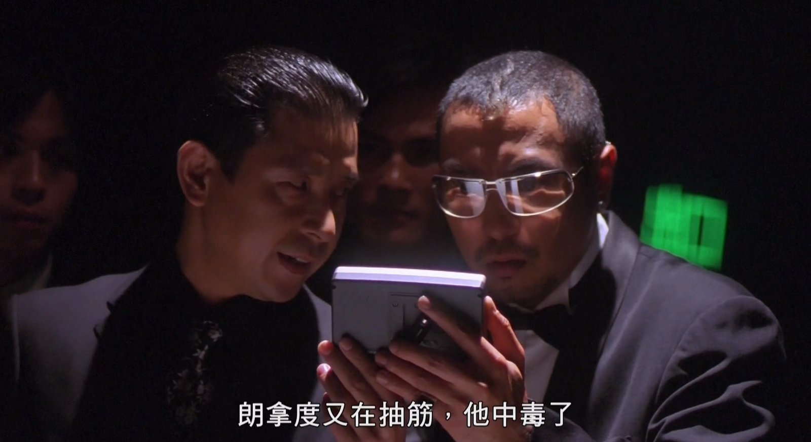
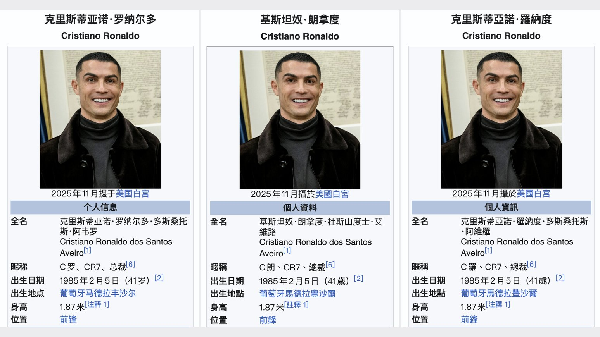
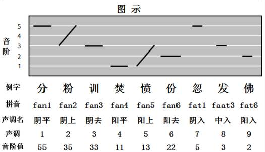
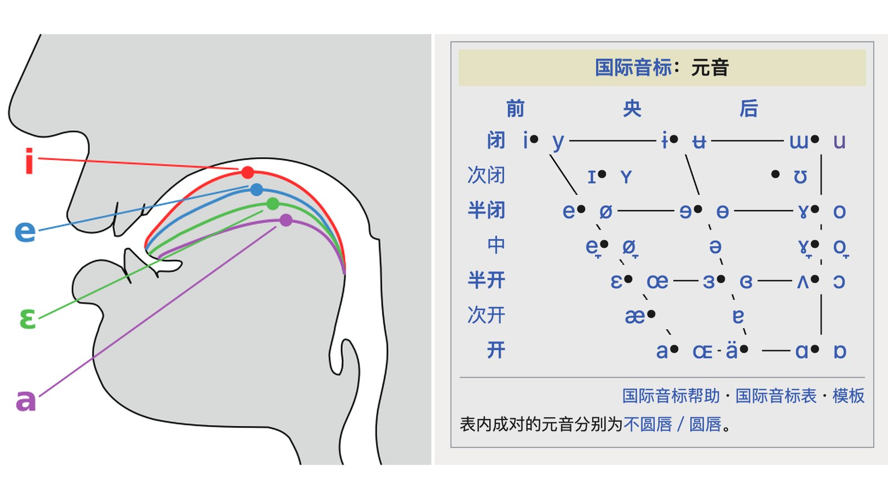
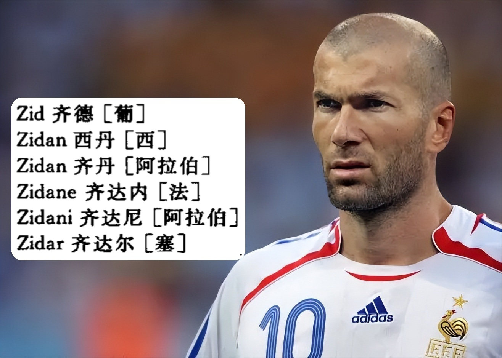

2026 年世界杯正激战正酣，相信很多球迷都在熬夜看球。在等待球赛开始的时间，网友们纷纷秉承范大将军“聊球玩梗”的精神，努力整活，文体两开花——比如**球星名字的翻译**，就和政治人物以及电影片名一样，两岸三地版本的不同经常能够引起热议。

最近，我很喜欢的UP主“寻找中国功夫”连续出了两期视频来讨论这个话题。我深受启发，立即提笔也写一文，聊一下寻哥没有聊到的、关于**翻译和语音**的趣味知识。毕竟这是我的老本行。

足球无国界，但是语言有国界。 如果你在和一位香港朋友聊球，听到他口中说的**美斯、C朗、麦巴比**，你能知道他说的都是谁吗？没错，就是**梅西、C罗和姆巴佩**。特别是C朗，这个“朗”字在香港的网络和老港片中可是大大的有名。

{: .img-fluid .d-block .mx-auto style="max-height:70vh;"}

_图 1　《赌侠2002》"朗拿度又抽筋了，他中毒了"截图。_

## “朗拿度”是谁？——源语、通行语和目的语

这个“朗”字的全称是朗拿度，也就是 Ronaldo。香港有个著名的梗，叫做**“朗拿度又抽筋了”**。说的就是 1998 年法国世界杯的时候，**巴西著名球星大罗（Ronaldo Luís Nazário de Lima）**在决赛前突发抽搐、一度失去意识，导致最终以极差的状态出战决赛。这件事至今仍是足坛未解之谜之一，各种猜测层出不穷，甚至有阴谋论说他是被人下毒，香港电影《赌侠2002》里就调侃了这个“黑手党操纵”的梗。

20 多年过去，当我们再提到 Ronaldo 的时候，我们的第一反应则是 C 罗，**克里斯蒂亚诺·罗纳尔多（Cristiano Ronaldo dos Santos Aveiro）**。C 罗的球迷们都知道，两岸三地对这个名字的翻译也是精彩纷呈。

- ⚽ 大陆：克里斯蒂亚诺·罗纳尔多
- ⚽ 香港：基斯坦奴·朗拿度
- ⚽ 台湾：克里斯蒂亚诺·罗纳度

为什么同一个人会有这么多不同的翻译呢？这牵扯到一个球星姓名背后的三种语言：

- ⚽ 出生地/祖籍国家语言的发音——源语
- ⚽ 国际通行语英语的发音——通行语
- ⚽ 翻译所在地当地语言或方言的读音习惯——目的语

我们不妨先聚焦 Ronaldo 本身，看看它在这三种语言系统里的形式和发音。Ronaldo 这个名字起源于挪威语“Rǫgnvaldr”，可以翻译作**“明智的君王”**，英语对应的人名则是 Ronald 。下表用国际音标（IPA）统一标注了它在几种语言/译名系统里的真实读音和声调：

{: .img-fluid .d-block .mx-auto style="max-height:70vh;"}

_图 2　大陆 / 香港 / 台湾三地「C罗」译名对比（维基百科截图拼接）。_

| 语言 | 文本 | IPA |
|:--|:--|:--|
| 葡萄牙语 | Ronaldo | /ʁuˈnaldu/ |
| 英语 | Ronaldo | /rəˈnældəʊ/ (UK) |
| 普通话 | 罗纳尔多 | /luɔ³⁵ na⁵¹ aɻ²¹⁴ tuɔ⁵⁵/ |
| 粤语 | 朗拿度 | /lɔŋ¹³ na²¹ tou²/ |
| 台译 | 罗纳度 | /luɔ³⁵ na⁵¹ tu⁵¹/ |

对比之下能看出几个有意思的细节。葡语原音 [ʁ] 开头是小舌音（就是学法语的同学天天又是吐痰又是漱口练习的那个发音），英语读法换成了普通的龈近音 [ɹ]，而华语世界则读成边音 [l]，三者听感已经不一样了。粤语“朗”的韵尾 [ŋ] 反而比大陆、台湾的“罗”更贴近葡语 [ʁu] 那个圆唇后元音的质感。要我说，如果非要按照葡萄牙语来译，C罗改姓胡梅尔斯（Mats Hummels）的“胡”更合适，全名叫做“胡纳尔都”，就和宇文成都一样，一听就是匈奴鲜卑血统。

再看最后一个音节，台湾的“度”与大陆的“多”，一个收于 [u]、一个收于 [uɔ]，谁更接近葡语词尾的 [u]，一听便知；粤语的“度”呢，发音更像普通话的“窦”，不难推测，粤语翻译其实是按照英语的读法来的。五种发音中，只有普通话是四个音节，其他三种都符合葡语的三个音节。普通话为何清一色？我们继续讨论。

## “碧咸”不是避嫌——入声、发音变体与元音实现

上文的表格告诉我们，球星粤语发音与普通话大不一样。如果“美斯”和“麦巴比”让你大感诧异，就应该多想一步——事出反常必有妖。试着用粤语读一下就会发现，“美斯”（IPA 标注为 /mei13 si5/ ）听起来和 Messi（西语原音 /ˈme si/）已经相当接近；而“麦巴比”（IPA 为 /mak2 pa5 pei35/）的节奏感也和法语 Mbappé（ IPA 为 /m͡ba pe/ ，[m͡b] 为前鼻化辅音）遥相呼应。

不过说起港译，最出名的恐怕是“碧咸”。如果不是资深球迷，谁能想到这是**大卫·贝克汉姆（David Beckham）**的香港名字，说不好还以为是雪碧新出了个海盐口味。提起小贝，不得不说是 8090 后球迷心中的一代偶像，甚至可以说是无数女球迷看球的唯一理由，是那个年代足球从球迷走向大众的形象代言人。虽然如今早已从“小贝”变成“老贝”，本次世界杯期间每次现身看台，还是能引起老一代球迷们的青春回忆。

{: .img-fluid .d-block .mx-auto style="max-height:70vh;"}

_图 3　香港古早直播评论“碧咸”（贝克汉姆）截图。_

让我们把目光拉回语音学：为什么 Beckham 普通话要翻译成四个音节的“贝克汉姆”，而粤语却只用两个音节“碧咸”就搞定了？答案要到 David Beckham 的出生地英国来寻找。

对于 Beckham，剑桥词典给出的标准英式发音是 /ˈbɛk əm/，只有两个音节，中间的 H 完全不发音，你可以用普通话近似读成“掰啃”。粤语译名“碧咸”的 IPA 音标为 /pɪk5 ham21/，恰好也是两个音节，用粤语特有的**入声**（也叫促声）韵尾 [-k] 模拟英语里那个被吞掉的辅音停顿感，听感上和原词的节奏几乎完全对齐。要实现这种听感，便要如前文所说，用粤语发音，千万不能按照普通话读成“避嫌”，而要读成类似“杯罕”的感觉。其实古代汉语是有入声的，可惜现代汉语普通话并没有保留，大部分官话方言中也找不到它的影子，所以自小学习普通话的我们对入声并不熟悉。不过粤语、闽语、客家话以及不少方言片区和少数民族语言还是保留了**[-p]、[-t]、[-k]、[ʔ]** 中的一种或多种入声韵。

{: .img-fluid .d-block .mx-auto style="max-height:70vh;"}

_图 4　粤语九声六调示意图。来源：君万学JWX港粤语。_

尤其是最后一个 [ʔ] 比较有意思，长得和哈兰德（Erling Haaland）一样有特点。这个音叫**喉塞音（glottal stop）**，怎么发呢？可能大家都知道一个调侃标准英音（RP）和伦敦土话（Cockney English）的梗——“水”（water）这个词该怎么读。标准英音读作  
/ˈwɔːtə/ (“窝忒”)，而伦敦土话读作 /ˈwɒʔə/ （“唔儿”）。区别的关键就在于发完第一个音节后停顿一下，把手放在喉头，舌头不要大动，体会喉头阻住气流的感觉，然后再放松，让气流从口腔流出，发出“儿”字。这种戛然而止的听感，就是入声的精髓了。其实吴语区的朋友对这个 [ʔ] 应该说相当熟悉，比如上海的朋友跟你一个劲儿摆手，讲“弗灵”（ /faʔ21 leŋ5/）。

至于 [-p]、[-t]、[-k] 做入声韵，就简单多了——当你想发[p]、[t]、[k]的时候，不发出声音，戛然而止就可以了。 还拿大家比较熟悉的香港人名举例，比如，**叶问（ /jip2 mɐn2/）、徐克（/tsʰɵy21  hɐk5/）**，也无怪于他们的英文名会翻译成 Yip Man 和 Tsui Hark。

回看普通话，**因为没有入声韵尾，声母和韵母必须组合成完整的、可以拖长的音节**，没法“戛然而止”。于是英语原本两个音节的 Beckham，就必须读成“贝 /peɪ51/-克 /kʰɤ51/ -汉 /xan51/ -姆 /mu214/ ”四个音节，而台湾国语翻译的“贝克汉”则采取了一个中间策略。

那么问题来了：既然英语原词里 H 不发音，“汉”字或者“咸”字又是从哪冒出来的 H 呢？这其实和 Beckham 这个词本身在英语内部的变体有关——就像 Birmingham（伯明翰）这个词一样，**同一个拼写，在不同的英语变体之间，H 到底发不发音，说法并不统一**。

除了音节数量之外，**元音本身的实现方式**也值得细看。英语标准发音 /ˈbɛk əm/ 里，首个音节中间的元音是 [ɛ]，类似普通话的“哎”，一个嘴巴不太张开、舌位偏前的元音；到了粤语的“碧”，这个位置的韵母用的是 [ɪ]，发音介于“衣”和“哎”之间，比较短促；再到普通话的“贝”，同一个位置变成了双元音 [eɪ]，听起来更加饱满悠长。

{: .img-fluid .d-block .mx-auto style="max-height:70vh;"}

_图 5　元音舌位示意图（左：基础元音舌位；右：元音舌位分布）。来源：维基百科。_

再看词尾“ham”里的元音：英语里这个 a 其实已经被弱化成了一个含糊的央元音 [ə]，英语里叫 schwa，是最“偷懒”的元音，几乎不怎么用力发。你可以想象一个结束一天 996 的打工人，回到家舒服躺在沙发里发出的那一声“呃……”。而到了普通话的“汉”字，这个位置变成了一个开口度很大、发得很清楚的 [a]——原本英语里那个几乎一带而过的弱读音，被普通话译名重新“用力”读了出来。

现在，你体会到了吧：**同一个名字，落到不同的语音系统里，音节可以变多变少，元音可以变响变弱，这都是源语、通用语、目的语各个语音系统相互约束的结果**。

## “齐丹”终成“齐达内”——翻译由谁来定

聊了这么多，球星名字到底应该怎么译才对？

首先应该明确：**各个译名之间，本身并没有“孰正孰误”**。但如果看“规范化程度”，大陆的翻译体系确实更加制度化，长期以来有新华社译名室和外交部的规范指导。翻译时遵循几条核心原则，比如 **“名从主人”**，尽量按照当事人所在国的官方语言发音来译；**“约定俗成、旧译从旧”**，已经流行开的译名，即便不够精确，通常也不会轻易更改；还有 **“音义兼顾”**等等。相比之下，据我所知香港、台湾并没有类似的官方译名审定机构，译名更多依靠媒体和民间长期的约定俗成，这也是为什么香港译名常常显得更灵活、更贴近粤语口语，却也容易出现同一个人多个译名并存的情况。

不过，“有规范”是不是就等于“更准确”呢？经过前面几节的对比，相信各位读者心里已经有了自己的判断。这里想补充一个更微妙的例子——齐达内（Zinedine Zidane）。

{: .img-fluid .d-block .mx-auto style="max-height:70vh;"}

_图 6　齐达内（Zinedine Zidane）与新华社译名规范对照。来源：搜狐网。_

Zidane 这个姓氏，其实并不是一个标准的法语姓氏，而是源自齐达内本人的**阿尔及利亚卡拜尔（Kabyle）血统**背景，法国人在读这个姓氏的时候，本身就带着一层“外来语”的不确定性。有意思的是，齐达内本人在接受采访时，把自己的名字读作 /zi dan/，这么看香港的译名“施丹”（/si5 tan5/ ）和台湾的译名“席丹”（/ɕi35 tan55/ ），从听感上看反而比大陆现在通行的“齐达内”更贴近这个“本族发音”版本。

更有意思的是，在齐达内成名之前，很多大陆媒体也一度叫他“齐丹”，后来才逐渐统一为“齐达内”。甚至新华社的译名规范还为齐祖单开了一个词条，规定 Zidane 如果按照法语翻译，就是“齐达内”，阿拉伯语就译作“齐丹”。这背后也折射出一个有趣的现象：**译名的“标准化”过程，有时也会随着一个人知名度的上升，而被重新讨论、重新固定下来**。所以，在这届世界杯上，你可以看到继承了老爸名字的阿尔及利亚门将卢卡·齐达内（Luca Zidane）；然而没有一个好爹的伊拉克中场 Zidane Iqbal 就只能叫做“齐丹·伊克巴勒”。王侯将相，宁有种乎？

{: .img-fluid .d-block .mx-auto style="max-height:70vh;"}

_图 7　左：阿尔及利亚门将卢卡·齐达内（Luca Zidane）；右：伊拉克中场齐丹·伊克巴勒（Zidane Iqbal）。来源：新华社。_

好了，本期内容就到这里。当然，受限于笔者水平（毕竟笔者所有的粤语知识都来自于港片），本文涉及的语音学细节和历史考证难免有疏漏之处，欢迎大家在评论区讨论、指正、补充你知道的更多例子。最后，留个问题：香港足球评论员口中的“夏兰特”和“尼玛”是谁，你能猜出来吗？

## 参考资料

*Cristiano Ronaldo*. (n.d.). In *Wikipedia*.

*談談粵語的入聲*. (n.d.). macaudata.mo.

*【译名杂谈】确定译名时 要遵循哪些规则？* (2020, August 25). ttplus.cn.

澎湃网. (n.d.). *粤语这么好听，这么难学的原因竟是.......*

新华社. (2026, June 23). *追光丨今年世界杯，怎么还有"齐达内"和"济科"*. 新华网.

中国新闻网. (2024, February 2). *美斯、C朗、碧咸……这些球星的港式译名你都知道吗？*

---

*本文首发于微信公众号「元语言」，[阅读原文](https://mp.weixin.qq.com/s/8RMI8wNbV_s6M5HLKhgchw)。*
