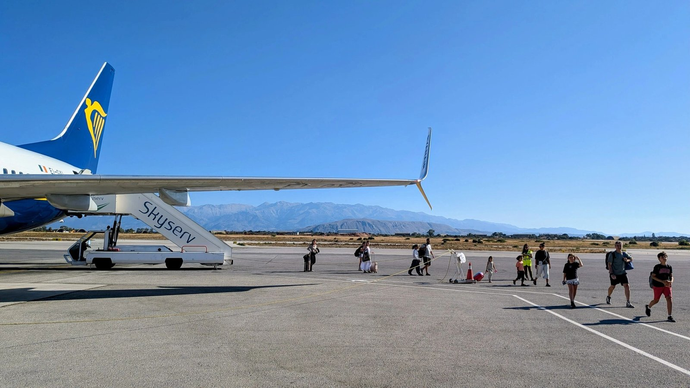
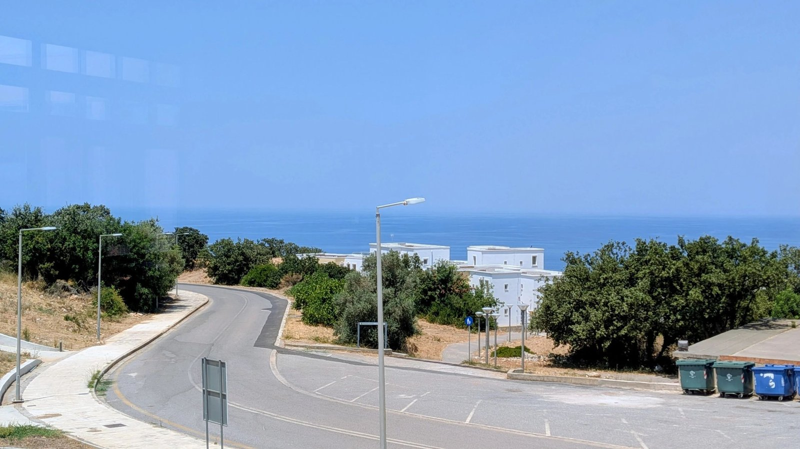
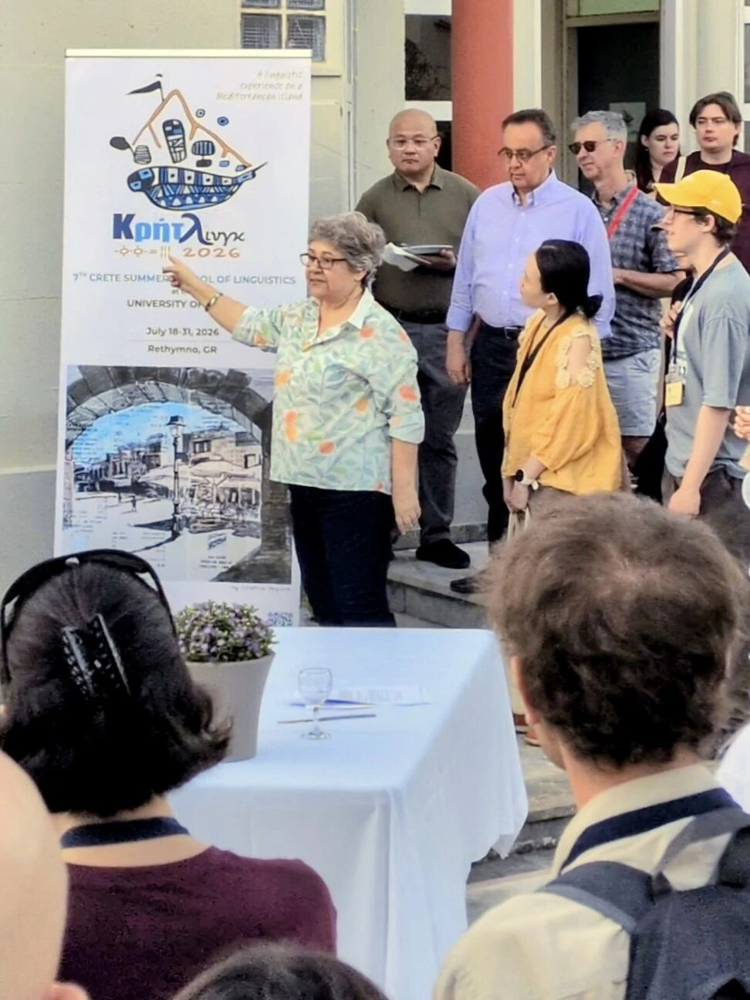
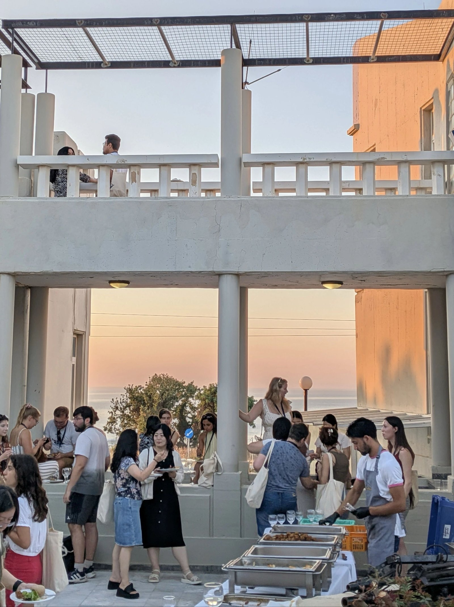
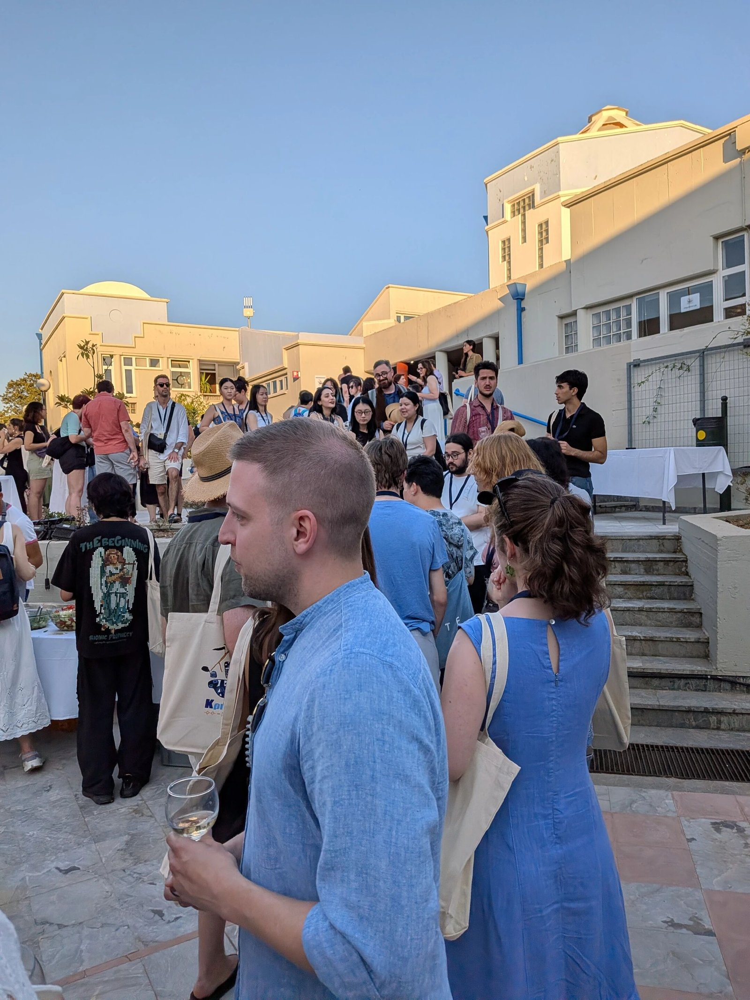
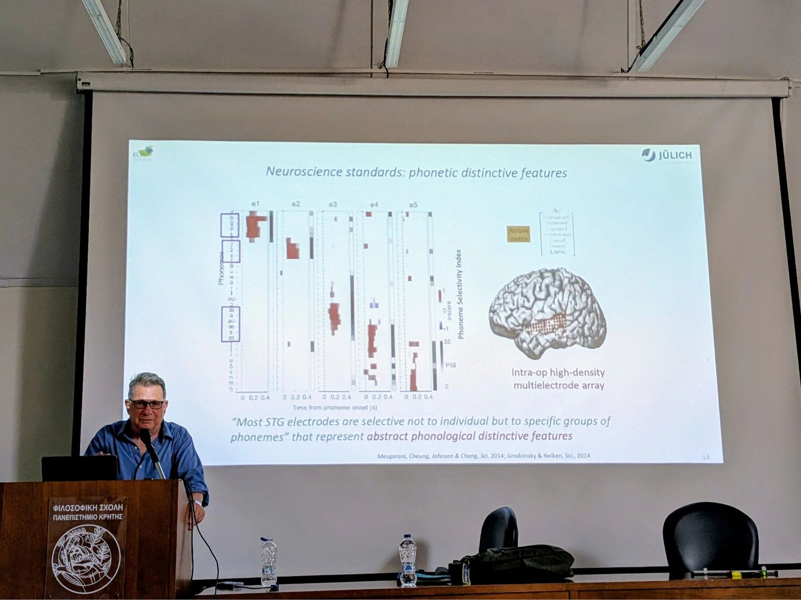
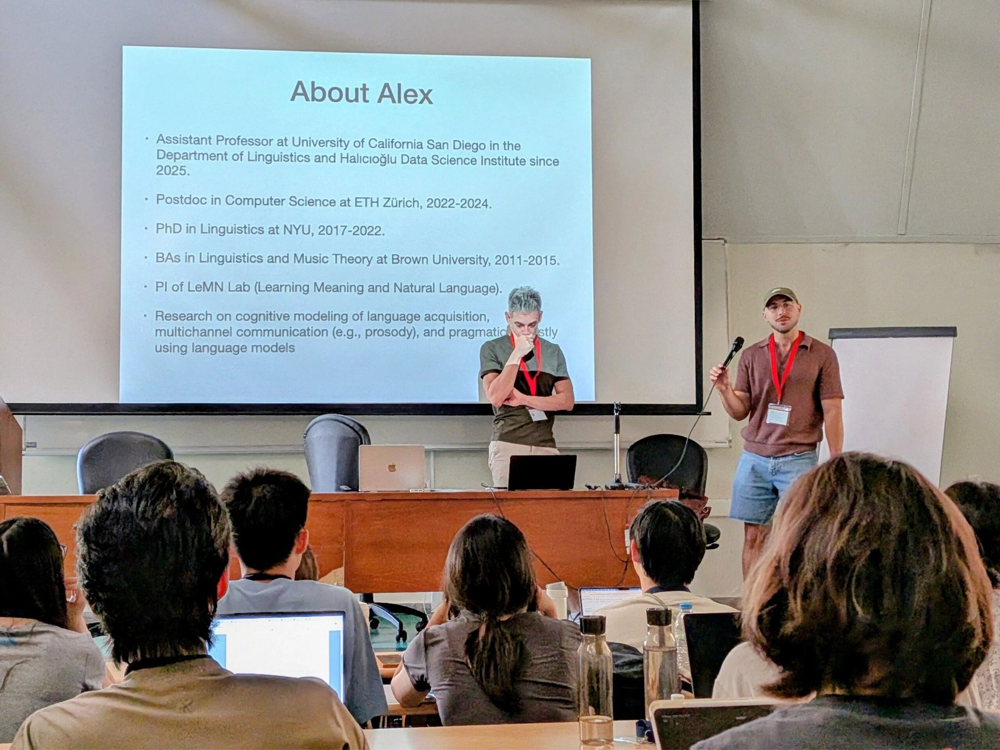
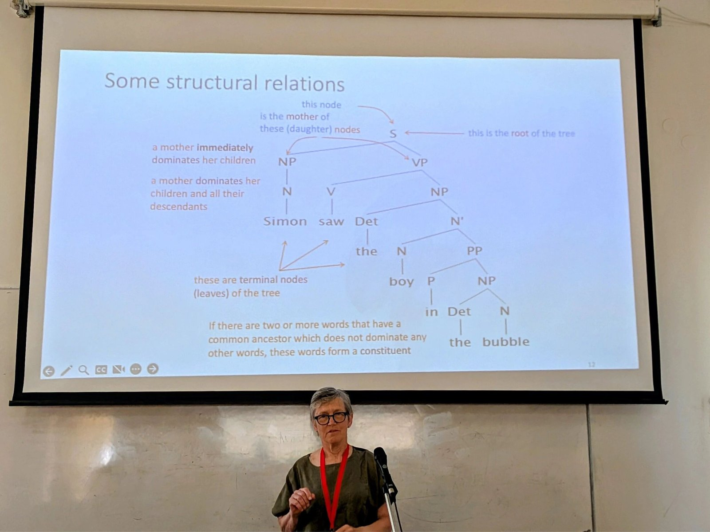
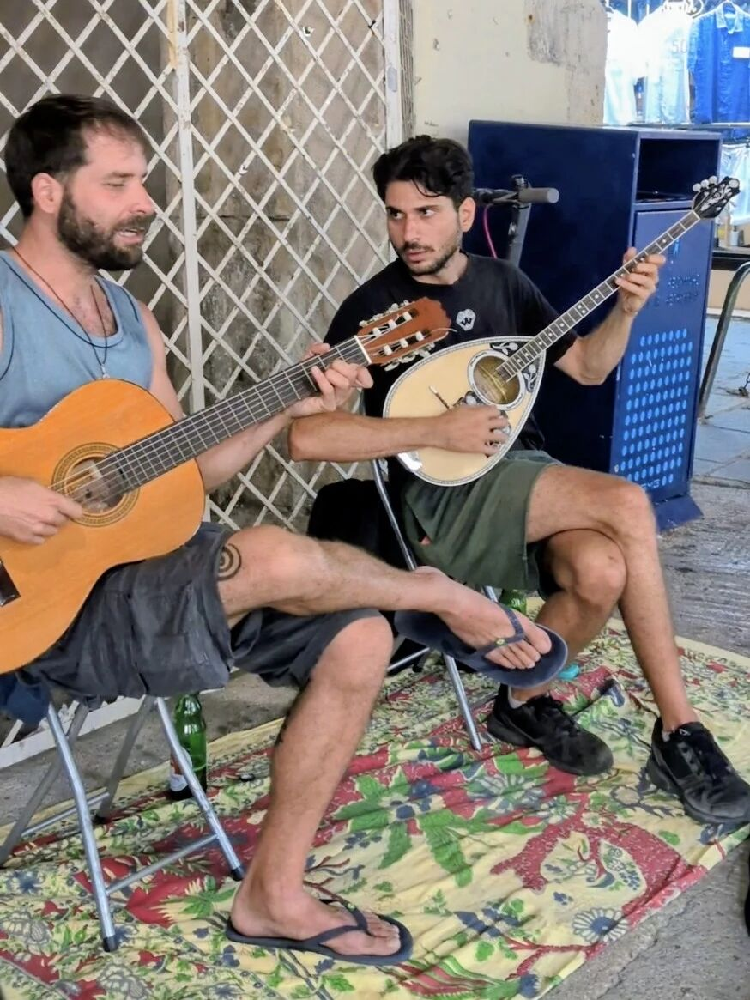
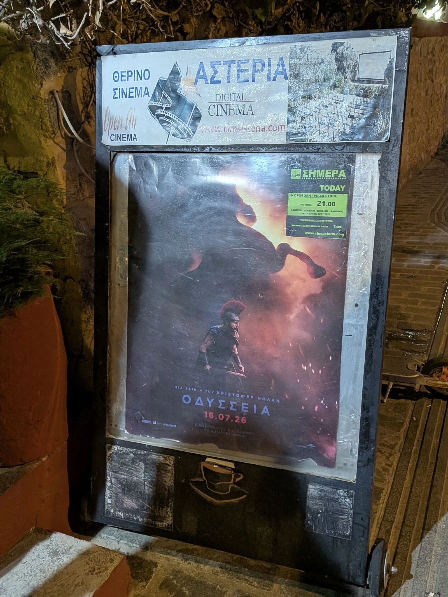

{: .img-fluid .d-block .mx-auto style="max-height:70vh;"}

{: .img-fluid .d-block .mx-auto style="max-height:70vh;"}

{: .img-fluid .d-block .mx-auto style="max-height:70vh;"}

{: .img-fluid .d-block .mx-auto style="max-height:70vh;"}

{: .img-fluid .d-block .mx-auto style="max-height:70vh;"}

{: .img-fluid .d-block .mx-auto style="max-height:70vh;"}

{: .img-fluid .d-block .mx-auto style="max-height:70vh;"}

{: .img-fluid .d-block .mx-auto style="max-height:70vh;"}

{: .img-fluid .d-block .mx-auto style="max-height:70vh;"}

{: .img-fluid .d-block .mx-auto style="max-height:70vh;"}

{: .img-fluid .d-block .mx-auto style="max-height:70vh;"}

{: .img-fluid .d-block .mx-auto style="max-height:70vh;"}

這兩周，馬里奧我在希臘克里特島的雷西姆農(Rethimno)參加 CreteLing 2026 語言學暑期學校。在如此古典的地方，就用繁體字吧。白天的課，群星璀璨，屋外烈日流火，屋內大道清心；傍晚走出校園，就是海風、山城和愛琴海溫柔的霞光。

讀萬卷書，行萬里路。讀書和旅行，都是和語言共舞。語言學研究的，正是人如何理解世界、如何彼此溝通；而每到異國旅行，我們都會被新的文字、聲音與人群提醒：有趣的語言現象可真多呀。

所以，也借這次遊學，官宣一下：

「元語言」從今天起，嘗試一週兩更。

馬里奧準備一學金庸先生當年“左手時評，右手武俠”的精神，未必日寫千字，但希望筆耕不輟，持續把對語言、數學、認知與 AI 的有趣思考與君同饗。

下一篇，或許就從這裡的一堂課、一次討論，或者一個腦洞大開的問題開始。

---

*本文首发于微信公众号「元语言」，[阅读原文](https://mp.weixin.qq.com/s/a9h9o61i7cVTH2CrdXUC5A)。*
