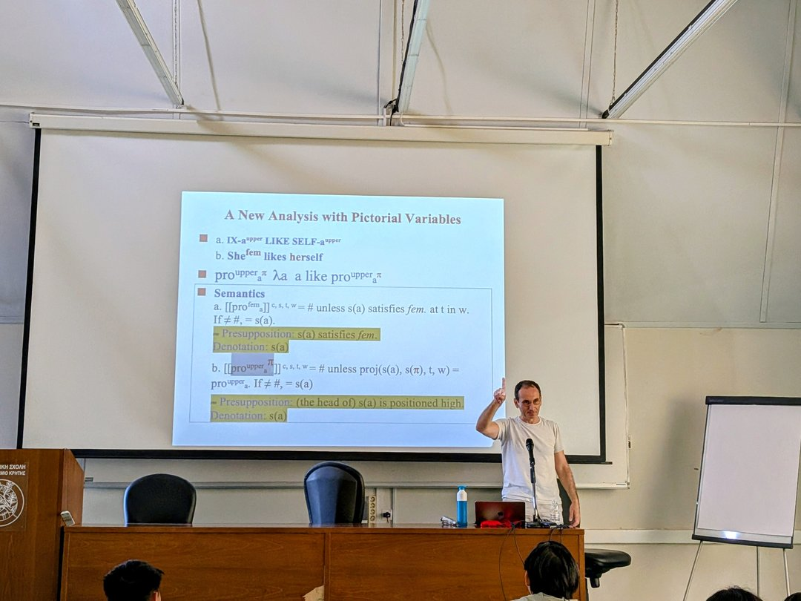
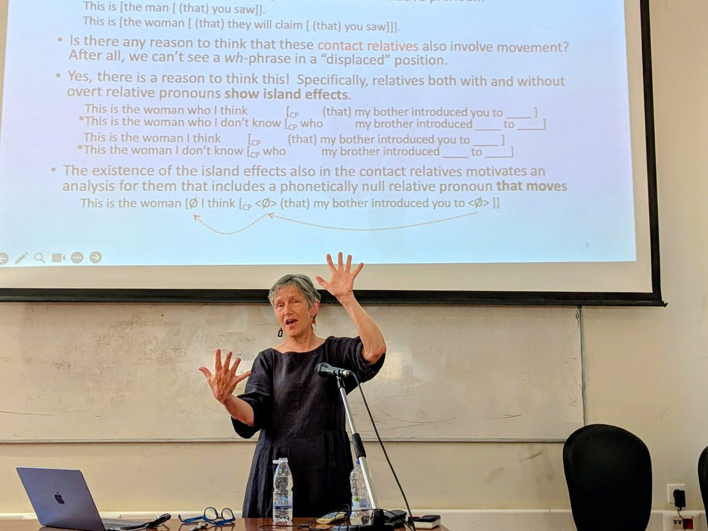
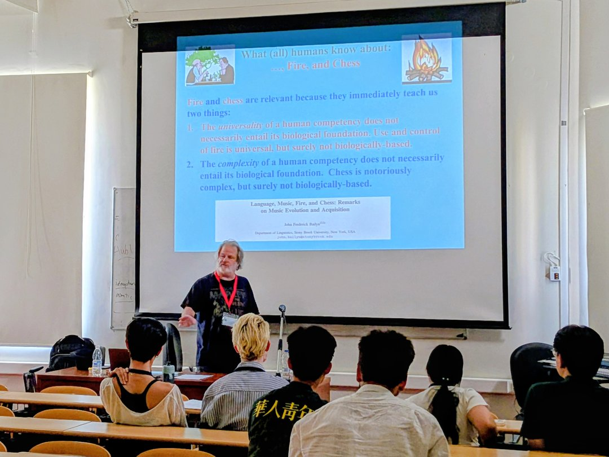
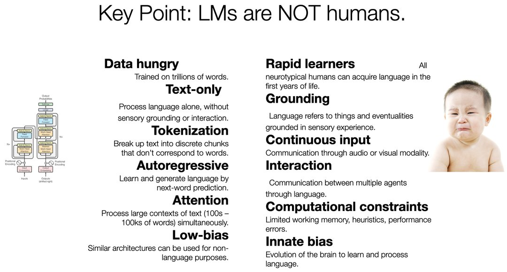
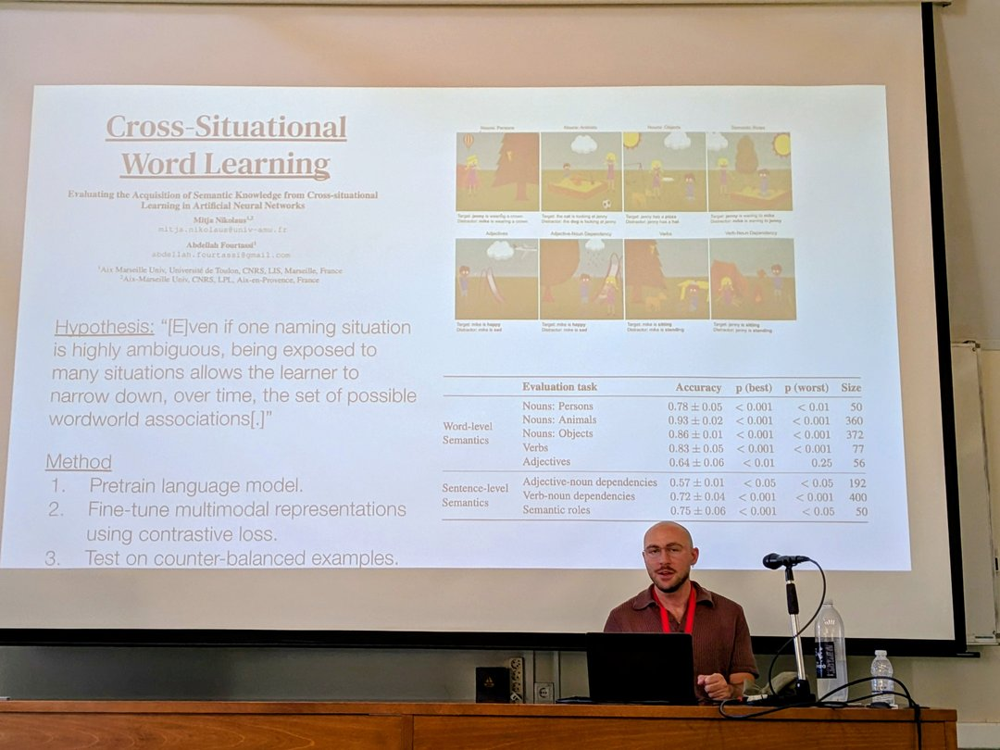
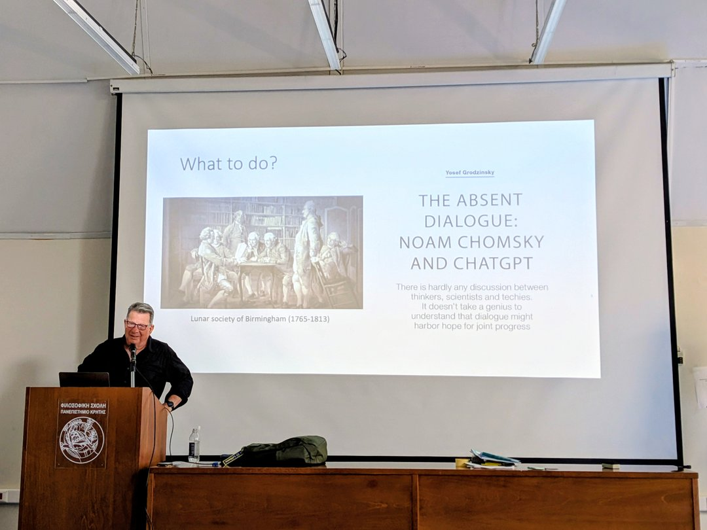
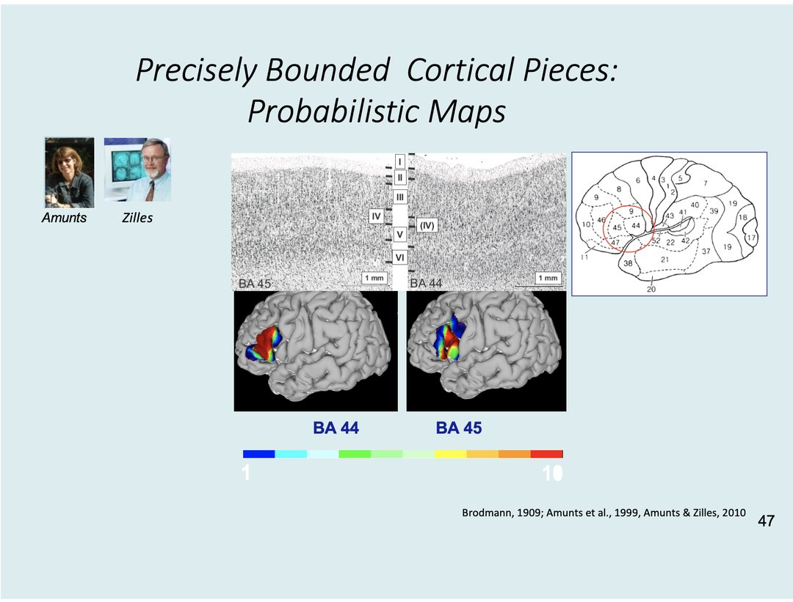
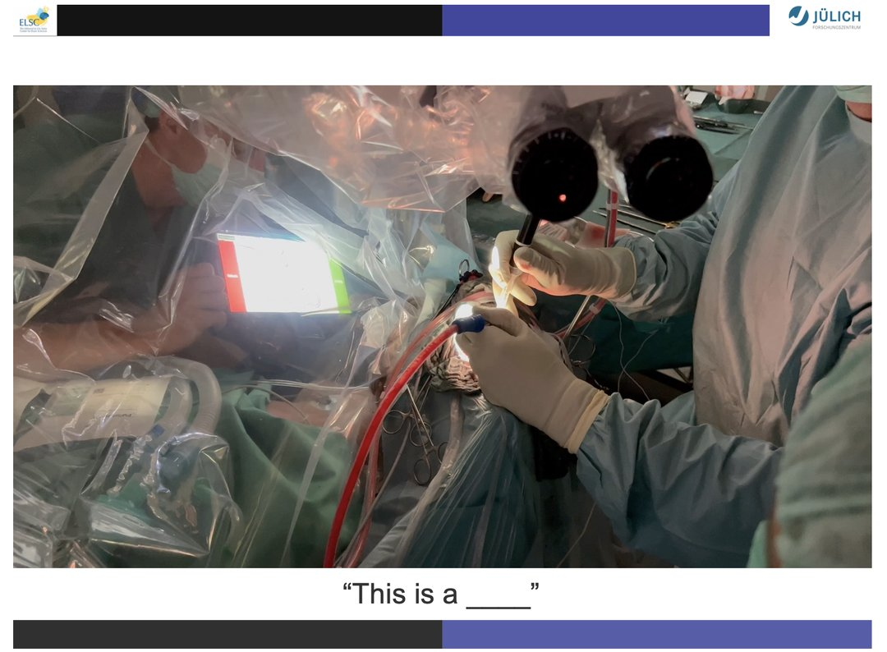

"My dreams are worthless, my plans are dust, my goals are impossible. All are of no value unless they are followed by action."

— Og Mandino, The Greatest Salesman in the World

两周以来白天听课、晚上看海的克里特语言学暑期学校（CreteLing）结束了。

这些时光，我想记住的不只是与世界各地的伙伴共同"Yamas"（干杯）的时刻，不只是课堂上与一位位学界名宿的思想碰撞，不只是爱琴海傍晚时分粉色的霞光和翻涌的碧浪，不只是克里特岛上随处可遇的向你撒娇的猫儿，我更想记录这个人工智能时代，语言学该向何处去的珍贵思考。

以下是我的粗浅感想。

## 一、语言的多模态性
语言是多模态的（multimodal）：不仅有文本、语音、图像，还有手语（sign language），还可以边说话、边做手势（co-speech gestures）——留意一下，我们日常说话时其实都伴随着手势，尤其是经常被人拿来作梗的意大利人。

{: .img-fluid .d-block .mx-auto style="max-height:70vh;"}

_图 1　Philippe Schlenker 教授在"超级语言学"课堂上讲解语言与手势。_

为什么这样呢？语言是用来传递信息的，而信息的编码方式可以不同。说话、写字、做手势都是不同的编码方式。为了交流方便，编码方式可以混用。从这个层面看，语码转换（code switching）也属于切换编码方式————就像香港人说话往往会要夹杂几个英语单词一样。

🏛️  🏛️  🏛️

## 二、语言学分支各自为政
虽然语言是多模态的，但我们在研究语言学时经常发现各个分支之间各自为政：做文本的不关心语音；做语音的不关心手势；做手势的不关心手势的神经机制；做神经机制的不关心大脑是怎么计算的；而做计算的，除了刷榜，什么都不关心。

我这么说，并不是否认语言学各分支之间存在交叉研究——而且，在自己的分支里做深入、做成体系是进行交叉的前提——但就语言多模态的本质来讲，这样的交叉研究太少了！

{: .img-fluid .d-block .mx-auto style="max-height:70vh;"}

_图 2　Caroline Heycock 教授的"句法学入门"课。_

我可以给出一个跨学科的例子：生成句法中的成分（constituent）、句法树（syntactic tree）、X-阶标理论（X-bar theory）、投射（projection）与移动（movement）、岛屿约束（island constraints），同计算机科学中的类型化树结构（typed tree structures）、受限图路径（constrained graph paths），心理语言学中的工作记忆负荷（working memory load），以及神经科学中的额颞网络活动（frontotemporal network activity），可以建立一个分层模型：句法理论给出合法结构空间，计算模型给出算法与复杂度，心理语言学给出处理代价，神经科学检验实现机制。

📜 📜 📜

## 三、语言、音乐、火与象棋
语言学研究语言的结构与规律。那么跳出语言，我们会发现音乐也有和语言相似的结构与规律。在"音乐与语言"（Music and Language）课堂上，John Bailyn 教授系统性地对比了语言与音乐在多个层面的结构性平行。例如，层次结构——语言有句法树，音乐同样有层级组织，听者对音乐的感知也是层级性的：从节拍（beat）到小节（measure）到乐句（phrase），层层嵌套，就像句法中的词、短语、句子一样。举个例子，就是再五音不全的人，只要拥有健康的听力，都能分辨出来《两只老虎》、北伐军唱的《国民革命歌》和法国童谣《雅克兄弟》（Frère Jacques）其实是同一首歌。

{: .img-fluid .d-block .mx-auto style="max-height:70vh;"}

_图 3　John Bailyn 教授在"音乐与语言"课堂上。_

那么，这种相似性的范围是否可以扩大呢？比如，语言、音乐、象棋与生火都是全人类文明的普遍行为，是否可以推定这四者具有相同的起源和机制？依据 Bailyn 教授的研究，语言被视为受进化控制的生物本能，而音乐、象棋和生火则被归类为人类高阶文化成就，并非生物演化的直接产物。这一对比突显了语言与其他具有普遍性的人类行为在认知机理上的重大区别。

🎵🎵🎵

## 四、宇宙语言学
如果语言本身的结构和规律不被语言所独有，那么人类是否也肯能不是唯一的语言使用者和学习者呢？在"大语言模型与语言学"（LLMs and Linguistics）的课堂和工作坊中，Alex Warstadt 博士分享了他对宇宙语言学（Xenolinguistics）的看法。Alex 认为人类和大模型都是浩瀚宇宙中具有语言学习能力的所有实体集合的两个样本，但他们的学习机制可能千差万别。关于这一点，许多一线的人工智能研究者已经形成了共识：目前基于 Transformer 架构的 AI，其学习机制与人类的学习机制是异大与同的。

{: .img-fluid .d-block .mx-auto style="max-height:70vh;"}

_图 4　Warstadt 博士课件截图：LM与人类的对比。_

那么，人类与AI的语言习得是否具有某种相似性呢？几年前，Alex 与同事发起了"婴儿语言模型挑战赛"（BabyLM Challenge），探索如果只给语言模型与人类幼儿相似的数据量，在词汇、句法、语义学习上是否可以与人类进行类比。这个流派做出了大量有意义的工作，非常有力地回击了很多语言学家不去了解语言模型的运作规律，就一口否定语言模型研究不具有语言学上的可解释性和可信度的观点。

{: .img-fluid .d-block .mx-auto style="max-height:70vh;"}

_图 5　Alex Warstadt 博士介绍一篇使用神经网络进行语言研究的论文。_

课程结束后，我问 Alex："你觉得这样的方向现在还值得做吗？"（Is the party over？）Alex 笑了笑说："如果还是十年前那种随便找一条语言学的规律，然后用类似 BERT 的模型进行验证的工作，已经很难做出有影响力的研究了。"但我也与 Alex 讨论了，其实还有许多语言学与大模型结合的问题值得探索——比如目前的语言模型在韵律（prosody）、谐音（homophonic pun）以及幽默（humour）上表现糟糕，这就是非常值得探索的方向。

🤖 🤖 🤖

## 五、月光社的启示
在最后一节神经语言学课上，Yosef Grodzinsky 教授说，语言学家、心理学家、神经科学家、计算机科学家应该像工业革命时期的月光社（Lunar Society of Birmingham）一样进行合作研究。遥想250多年前，博尔顿（Matthew Boulton）、瓦特（ James Watt）、达尔文（Erasmus Darwin，查尔斯·达尔文的祖父），甚至后来还有富兰克林（Benjamin Franklin），这些大学问家以及许多当世知名的科学家、哲学家、工程师，每逢十五月圆便相聚一起，上谈科学，下谈人文，怎能不令人神往。后来的历史也证明了，这种跨学科思想碰撞极大促进了英国工业革命和启蒙运动的发展，据说也直接促成了蒸汽机的发明。

{: .img-fluid .d-block .mx-auto style="max-height:70vh;"}

_图 6　Grodzinsky 教授讲授讲月光社。_

Grodzinsky 教授的类比我非常认同。从上世纪50年代的人工智能肇始，到每个人都在用 ChatGPT 的今天，发生了无数语言学家与计算机科学家的论战。语言学家总是想要让人工智能有规则可解释；但语言学家参与设计的系统往往在表现上不如计算机科学家和工程师设计的纯粹基于统计和模式识别的系统。这才有了一个著名的公案——贾里尼克（Frederick Jelinek）所说的"每开除一个语言学家，我的语音识别系统表现就提升"。

"Every time I fire a linguist, the performance of the speech recognizer goes up."

— Frederick Jelinek

虽说贾里尼克后来专门辟谣，"我的很多朋友都是语言学家"，几年之前依然发生了乔姆斯基（Noam Chomsky）与辛顿（Geoffrey Hinton）关于大模型是否真正理解语言的论战。这就让我想起了一个经典的笑话：人为什么要生两只耳朵，只有一张嘴？就是为了让人们多听别人的意见而少讲废话。

对此，Grodzinsky 教授也说道，无意义的争论是没有用的，如果你能发现一个可以实证的问题，就做实验去验证它。历史的经验已经告诉我们，语言学家或者计算机科学家在各自的领域内用各自的语言自说自话，意义不大。两方真正要做的是放下成见，用对方领域的真知灼见去滋养自己的研究问题。如今，学科界限早已不再泾渭分明，时代呼唤更多的对话，更多的合作。

🌙 🌙 🌙

六、现在就行动  
那么，怎么才能让语言学与人工智能相结合，共同向前发展呢？

Grodzinsky 教授掷地有声，有了好的想法，就要马上付诸行动（"Do it, do it now"），因为科学研究往往意味着无数的失败与漫长的推翻重来。教授举了德国女学者 Katrin Amunts 的例子，这位神经科学家为了准确地描绘出布罗卡区（Broca's area）花了整整20年。

{: .img-fluid .d-block .mx-auto style="max-height:70vh;"}

_图 7　Grodzinsky 教授课件截图：Amunts教授关于布罗卡区的研究。_

当然，科学研究也有非常困难和相对容易的。我们要向那些敢于完成困难研究的科学家们致敬——比如那些研究神经机制，甚至在医院里面对正在做开颅手术的癫痫病人，还要做语言实验、收集数据的学者。可以想象，这样的研究是多么困难、多么花费巨大。

{: .img-fluid .d-block .mx-auto style="max-height:70vh;"}

_图 8　Grodzinsky 教授课件截图：术中语言实验。_

君为其易，吾为其难。如果选择了困难的道路，就更要马上付诸行动，就像星爷在《少林足球》中的那句经典台词：“已经没有时间了，太阳都下山了。有搞头就赶快做，时间是不等人地! 。”

最后请让我用奥格·曼狄诺（Og Mandino）《最伟大的推销员》中的话结尾：

我的幻想毫无价值，我的计划渺如尘埃，我的目标不可能达到。

一切的一切毫无意义——除非我们付诸行动。

---

*本文首发于微信公众号「元语言」，[阅读原文](https://mp.weixin.qq.com/s/9LgBbwaLk5cWQnVRXLNcTA)。*
