---

> It told you what you most want is what you most can't have. And what you most can't have is what you already had, and lost."
> {: style="margin-bottom:0.6em;"}
>
> —— 诺兰《奥德赛》电影
> {: style="text-align:right;margin-bottom:0.6em;"}

---

本文初稿写于一个月前，自启程赴希腊克里特岛参加语言学暑期学校至今日，恰满一月，谨以纪念难忘的雷西姆农之夏。

## 露天影院的穿越：这英语太出戏了

七月的克里特岛，晚上九点天才算真正黑下来。今天是16号，诺兰的 **《奥德赛》（The Odyssey）**上映的日子。在希腊欣赏这部古希腊史诗电影？一个字：绝！更绝的是雷西姆农（Rethymno）居然有露天影院——小时候被爸妈抱着在公园看露天电影的记忆一下全回来了。我踏着夜色排队买票，170分钟的电影，我怕看一半饿了，顺便在影院小卖部的老夫妇那里买了一支热狗、一瓶巴黎水还有一包世界杯限量版乐事薯片，看着碧咸大哥对着我乐呵呵笑。

银幕上，**奥德修斯（Odysseus）**劫波度尽终返故国的自我救赎之旅让人动容，**佩妮洛普（Penelope）**二十年的隐忍与爆发也充满张力，还有把人填嘴里嘎嘣咬掉脑袋的**独眼巨人波吕斐摩斯（the cyclops Polyphemus）**，像做陶艺一般把人捏成猪的**女巫喀耳刻（the witch Circe）**，以及一身银盔银甲杀人如砍瓜切菜般的**拉斯忒吕戈涅斯人（giant Laestrygonians）**……视觉、情绪、表演，无可挑剔。但只要角色一开口，完了，一股纽约布鲁克林街溜子味扑面而来。这个场面多少有点魔幻：**我在希腊的土地上，看一群好莱坞明星用现代美式英语演古希腊人**。这还是荷马笔下的古希腊吗？

电影散场，灯光亮起，我一边走一边思考语言、历史与文化刻板印象的关系，不经意间视线落在影院的海报上——

**ΟΔΥΣΣΕΙΑ**

我盯着这八个字母看了很久。作为一个整天和语言打交道的人，我突然意识到一个有点惭愧的事实：这些希腊字母，我在数学课上“念”了十几年，却从没真正考虑过一个问题 —— **这些字母拼成的单词该怎么读？**

于是，一个语言学研究者的识字奥德赛，就这么开始了。

---

## 克诺索斯：文字的两千年漂流

为了探究古希腊文字的起源，第二天一早，我拉上暑期学校的三位同学，自驾去了**克诺索斯（Knossos）**——克里特岛上最著名的考古遗址，传说中米诺斯王（King Minos）的王宫，也就是迷宫（Labyrinth）与牛头人弥诺陶洛斯（Minotaur）传说的发源地。站在修复后的宫殿废墟前，我想象三千多年前这里的模样：三层楼高的大殿，壁画上画着鲜花、蓝猴子和漂亮的姑娘。让我惊异的是，整座王宫竟没有一面围墙。

<figure markdown="0" style="margin:0;"><section style="display:inline-block;width:100%;vertical-align:top;overflow-x:auto;box-sizing:border-box;"><section style="width:200%;overflow-x:hidden;max-width:200% !important;box-sizing:border-box;"><section style="display:inline-block;vertical-align:top;width:50%;box-sizing:border-box;">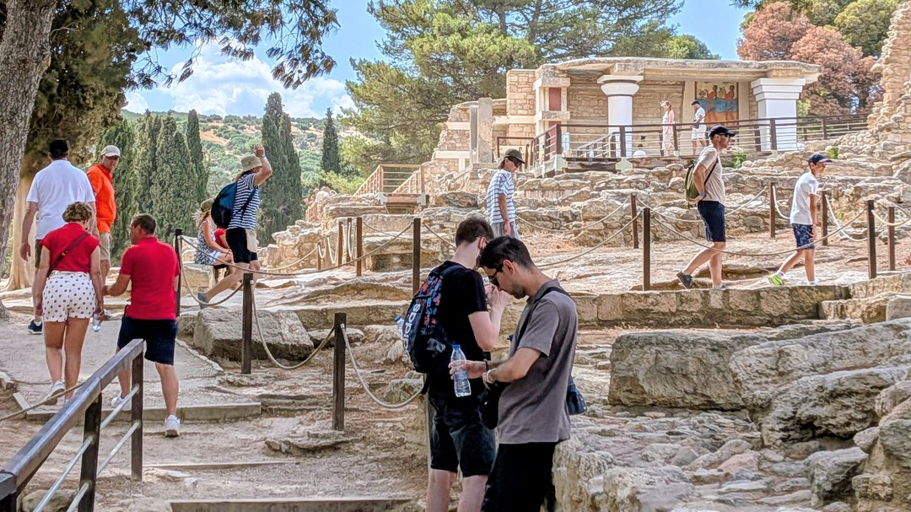</section><section style="display:inline-block;vertical-align:top;width:50%;box-sizing:border-box;">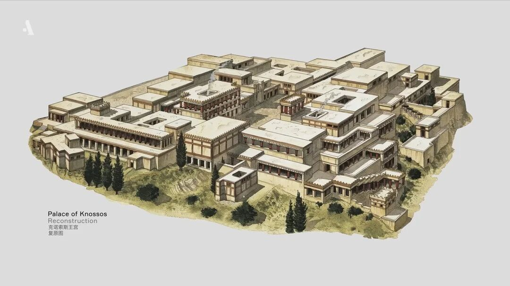</section></section></section>
← 向右滑动查看对比 →
</figure>

_图 1　克诺索斯今夕对比：左侧为克诺索斯遗址现状（马里奥拍摄），右侧为该宫殿的考古复原图。左右滑动，四千年光阴在一屏之间。来源：视频 Ancient Greece in 18 minutes。_

没有围墙，这是一个和平文明的标志。学者们叫它**米诺斯文明（Minoan civilization）**，活跃在爱琴海最南端的克里特岛上。他们有一支强大的海军，靠海上贸易致富，还发明了自己的文字——刻在泥板上的**线形文字 A（Linear A）**。只是，这套文字至今没有人能破译：我们不知道它记录的是哪种语言，甚至不知道它是不是一种语言。

约公元前 1450 年，一切戛然而止。圣托里尼（Santorini，古名 Thera）火山爆发，这是欧洲历史上最大的一次喷发，海啸高达百米，部分岛屿沉入海底。有人猜想，这就是柏拉图笔下**亚特兰蒂斯（Atlantis）**的原型。克里特从此一蹶不振，入侵者带着青铜武器和崭新的文字涌入。

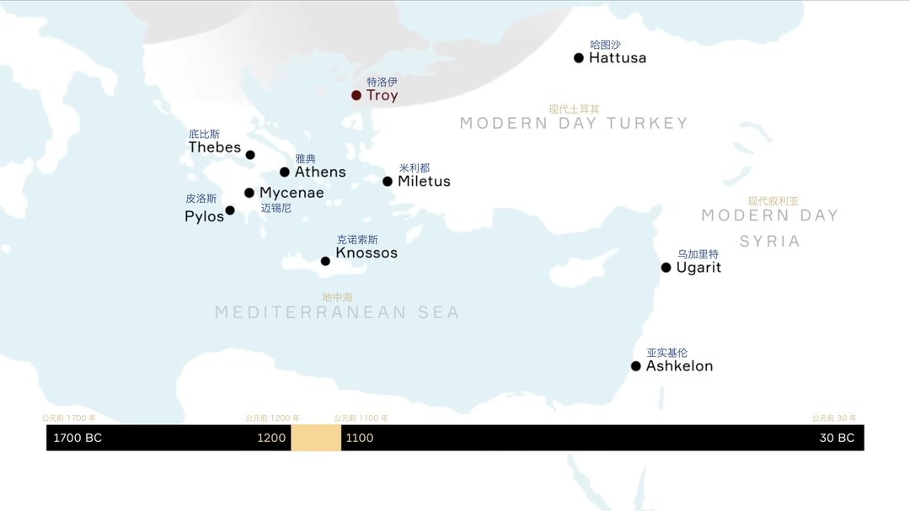{: .img-fluid .d-block .mx-auto style="max-height:70vh;"}

_图 2　古希腊关键地点地图（年代轴 1700 BC – 30 BC）。来源：Arthur Maps 视频 Ancient Greece in 18 minutes。_

新来的主人是**迈锡尼文明（Mycenaean civilization）**，活跃在希腊大陆南部的伯罗奔尼撒半岛（Peloponnese）。跟和平的克里特人完全不同，迈锡尼人把城市修在六米厚的城墙后面，是好战的武士。他们留下的文字叫**线形文字 B（Linear B）**，直到 1952 年才被 Michael Ventris 和 John Chadwick 破译。惊人之处在于，它记录的竟然是**希腊语**，比**荷马（Homer）**还要早几百年。你肯定想不到：迈锡尼出土的铭文，几乎全是**财务账目**——文字最早的用途，原来是记账。

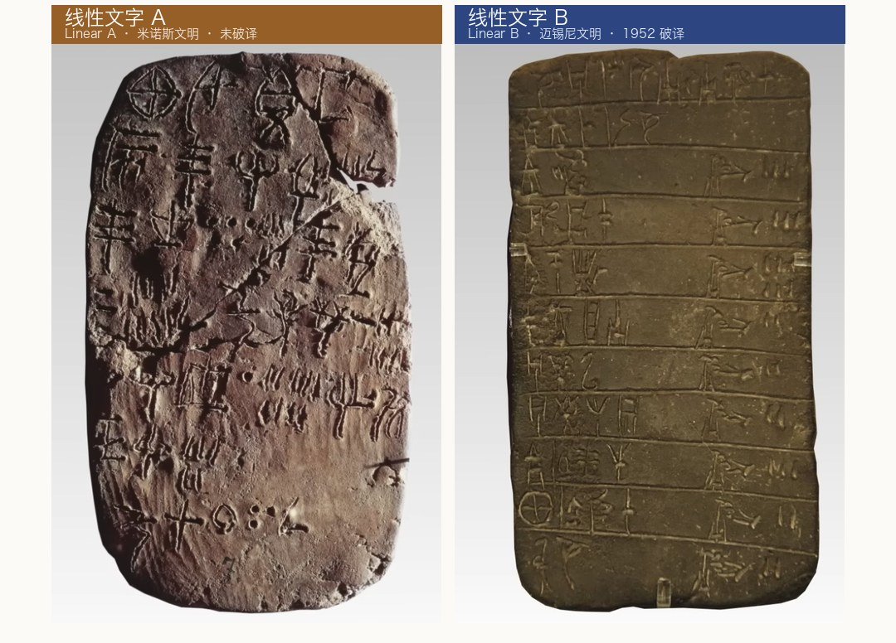{: .img-fluid .d-block .mx-auto style="max-height:70vh;"}

_图 3　线形文字 A vs B 对比图。来源：Ancient Greece in 18 minutes。_

迈锡尼时代也是**特洛伊战争（Trojan War）**的时代（约公元前 1194–1184 年）。这个故事被荷马写进 **《伊利亚特》（Iliad）**，一百五十年前还被当成神话，直到业余考古学家 **施里曼（Heinrich Schliemann）**真的挖出了迈锡尼和特洛伊的城墙。神话，变回了历史。

<figure markdown="0" style="margin:0;"><section style="display:inline-block;width:100%;vertical-align:top;overflow-x:auto;box-sizing:border-box;"><section style="width:400%;overflow-x:hidden;max-width:400% !important;box-sizing:border-box;"><section style="display:inline-block;vertical-align:top;width:25%;box-sizing:border-box;">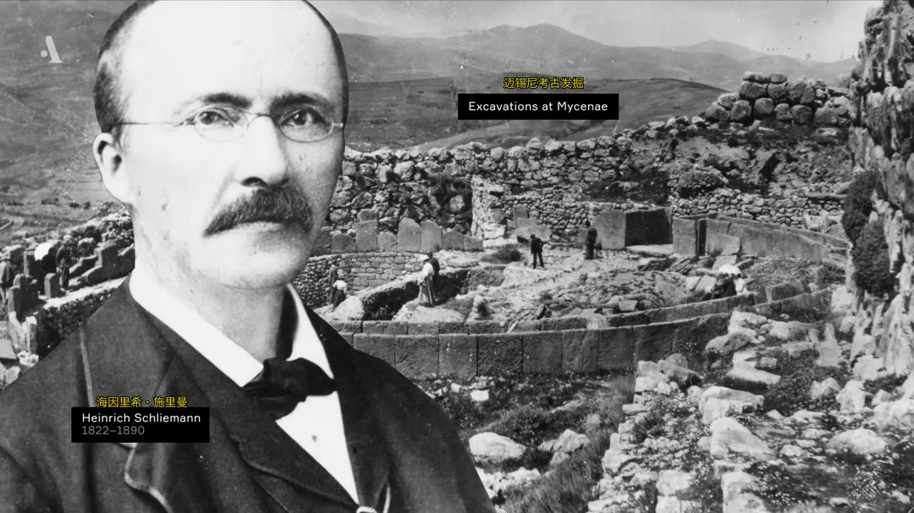</section><section style="display:inline-block;vertical-align:top;width:25%;box-sizing:border-box;">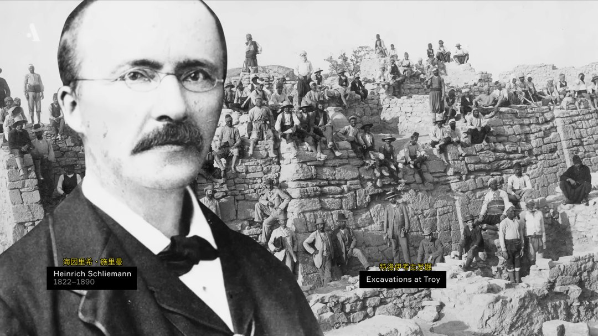</section><section style="display:inline-block;vertical-align:top;width:25%;box-sizing:border-box;">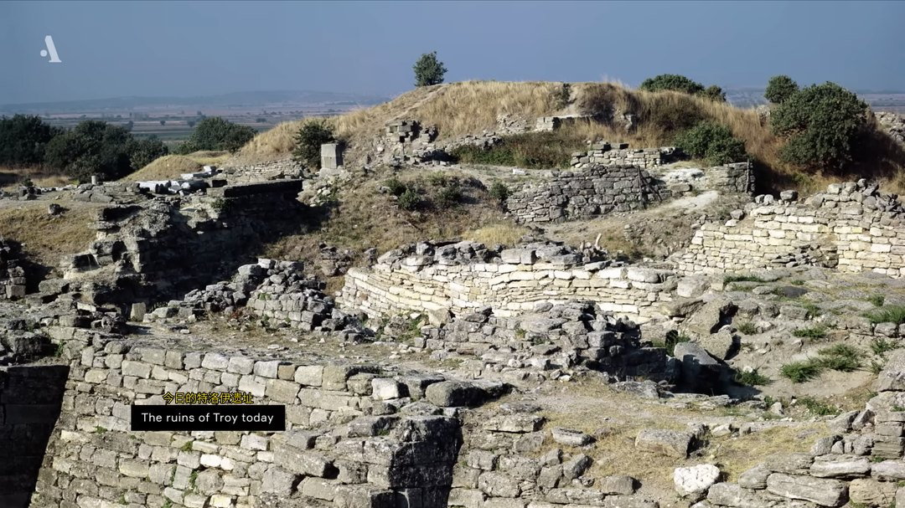</section><section style="display:inline-block;vertical-align:top;width:25%;box-sizing:border-box;">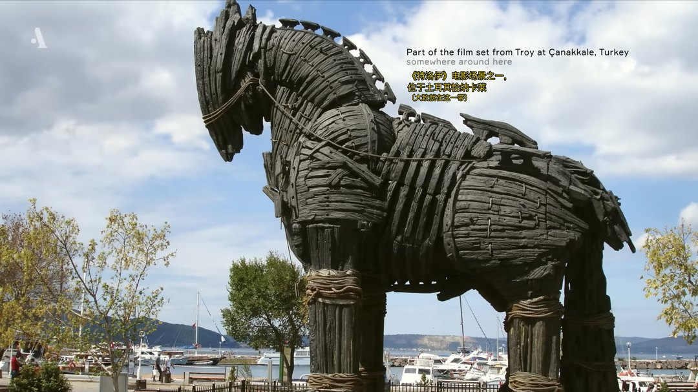</section></section></section>
← 左右滑动查看完整四联图 →
</figure>

_图 4　考古学家施里曼（Heinrich Schliemann, 1822–1890）与迈锡尼、特洛伊遗址。来源：Ancient Greece in 18 minutes。_

但迈锡尼自己也逃不过兴亡的宿命。摧毁它的，是一支好战的希腊部族——**多利安人（Dorians）**。此后的四百年被称为**黑暗时代（Dark Age）**：读写能力彻底失传，整个希腊陷入“文盲”状态。传说中的荷马，就生活在这个时代。荷马并不识字，他的史诗是口传的，直到几百年后才被写下来。

直到公元前 9 至 8 世纪，转机来了。在小亚细亚西海岸的**伊奥尼亚（Ionia）**——今天土耳其的西部沿海——希腊人从**腓尼基（Phoenicia）**商人那里借来了一套全新的字母。这套字母跟克里特和迈锡尼的线形文字几乎没有相似之处，却是现代希腊字母的直接祖先；它后来又变成了**拉丁字母和西里尔字母（Cyrillic alphabet）**的基础。欧洲两大字母体系，都从这一借而来。

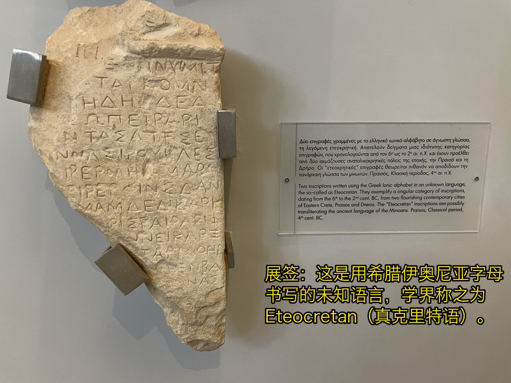{: .img-fluid .d-block .mx-auto style="max-height:70vh;"}

_图 5　Heraklion 考古博物馆的 Eteocretan（真克里特语）铭文石碑，马里奥拍摄。_

在 **Heraklion 考古博物馆（Heraklion Archaeological Museum）**里，我站在展柜前，看着那些泥板、碑刻和铜器，忽然明白了昨天海报上那七个字母的分量：**ΟΔΥΣΣΕΙΑ 不是八个孤零零的符号，它背后是一条两千年的文字漂流史**——从线形文字 A 的未解之谜，到线形文字 B 的破译，到黑暗时代的失传，再到腓尼基字母的重生。

我们需要思考一个朴素但经常混淆的事实：**语言、文字、语音，是三件完全不同的事**。语言所蕴含的意义活在人的脑袋里，是抽象的，文字和语音只是它的外在表现形式。如同人与衣服的关系，同一件衣服可以穿在不同的人身上，同一种文字也可以被不同的语言所使用，比如日语中就有许多汉字；再者，同一个人也也可以换好几套衣服，同一种语言在不同的历史时期也可以有不同的文字和语音。希腊语就是最好的例子：从线形文字 B，到腓尼基字母改造的希腊字母，再到现代希腊语——时装万变，美人依旧。

好吧，既然我们已经见到了现代希腊字母的祖先，那就来学一学希腊字母怎么读。

---

## 三种发音：咱学希腊普通话

就拿海报上 ΟΔΥΣΣΕΙΑ 里的字母来说，同一个字母，至少有**三种发音**：

- **重建的古希腊语**：语言学家根据音变规律还原出的荷马时代读音，比如 β 在古希腊发 /b/，η 发 /ɛː/ 这个长音。流派众多，并不统一。
- **现代希腊语**：今天的希腊人再读 β 已经变成了 /v/，η 则读 /i/。希腊普通话，读音确定。
- **数学惯例读法**：我们从老师那里学来的 “α-阿尔法”、“β-贝塔”、“γ-伽马”、“δ-德尔塔”、“η-依塔”、“θ-西塔”，这一套读法深受英语学术传统影响。

比如，π 在英语里念 “派”，可现代希腊人读“辟”，古希腊人读的也差不多是“辟”，唯独不读“派”。还有 χ，在统计学中我们习惯念“凯”，但它的现代名字读作“嘻”。

既然古希腊语目前尚无统一读音，我们不妨来学现代希腊语，这就相当于学说希腊普通话，发音总该是确定的吧？

于是，我给自己做了一张希腊字母发音表，每一行都包含五列信息：

<figure markdown="0" style="margin:0;"><section style="display:inline-block;width:100%;vertical-align:top;overflow-x:auto;box-sizing:border-box;"><section style="width:300%;overflow-x:hidden;max-width:300% !important;box-sizing:border-box;"><section style="display:inline-block;vertical-align:top;width:33.3333%;box-sizing:border-box;">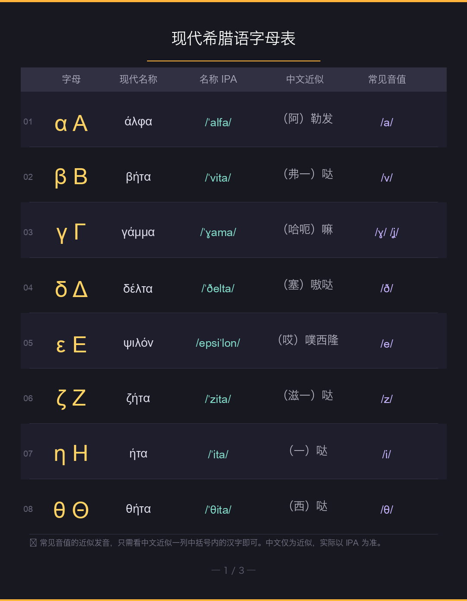</section><section style="display:inline-block;vertical-align:top;width:33.3333%;box-sizing:border-box;">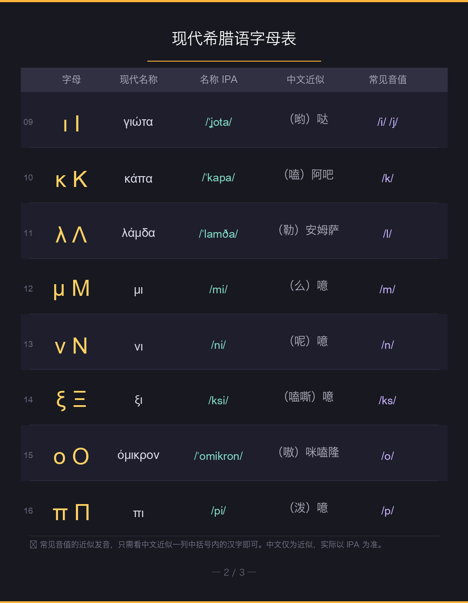</section><section style="display:inline-block;vertical-align:top;width:33.3333%;box-sizing:border-box;">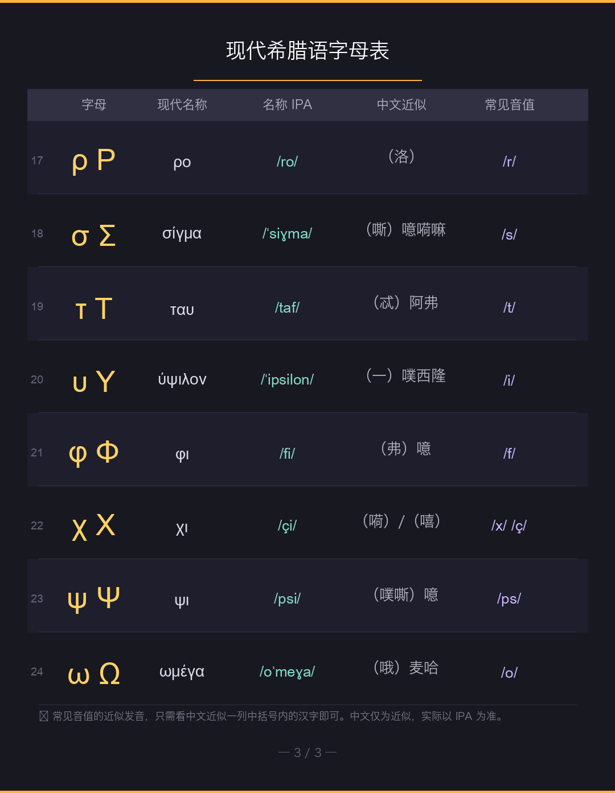</section></section></section>
← 左右滑动查看完整三联图 →
</figure>

_图 6　自制希腊字母发音图：大小写、现代名称、IPA、中文近似、常见音值五列对照。_

- **小写与大写**：比如 β / Β，得分别记。
- **现代字母名**： β 记作 βήτα。
- **国际音标（IPA）**：βήτα 读作 /ˈvita/。
- **中文近似**：按照汉字翻译的发音，不可能与原始发音严丝合缝，仅供入门参考。
- **常见音值**：字母在单词里实际发什么音，比如 β 发 /v/。

你可能会问，这个中文近似怎么读起来这么怪呀？比如，“西格玛”怎么成了“（嘶）噫嗬嘛”？这是我尽量按照现代希腊语的国际音标翻译过来的，并且考虑到了汉语的音调与国际音标轻重音的对应关系，读快一点，你就能感受到其中的味道了。博君一乐，不可较真呐。

学会了字母，整个克里特岛就变成了课堂。走在大街上，满眼都是免费的识字卡片。先看地名。来克里特岛旅行，离不开以下几个地方：

| 希腊语 | 常见英语形式 | 中文 | 注释 |
|--------|--------------|------|------|
| Κρήτη | Crete | 克里特岛 | 希腊最南端的大岛，古老而美丽 |
| Ρέθυμνο | Rethymno | 雷西姆农 | 克里特美丽的海滨城市，暑期语言学校举办地 |
| Χανιά | Chania | 哈尼亚 | 克里特两大国际机场之一所在地 |
| Ηράκλειο | Heraklion | 伊拉克利翁 | 克里特最大城市，另一国际机场所在地 |
| Κνωσός | Knossos | 克诺索斯 | 上文米诺斯文明遗址的所在地 |

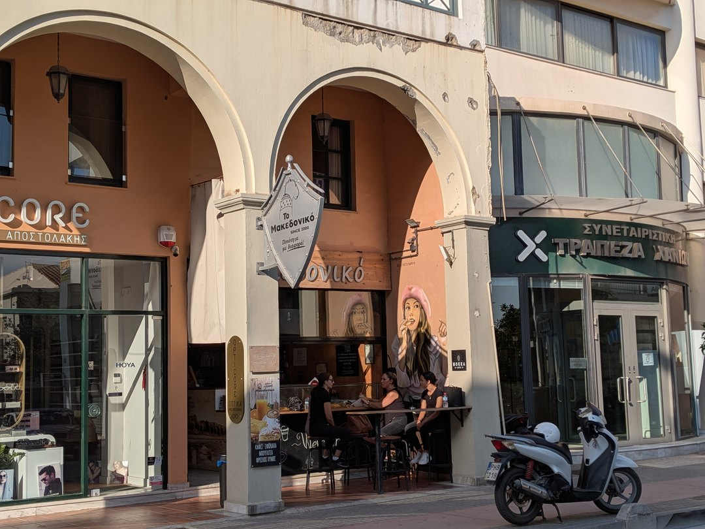{: .img-fluid .d-block .mx-auto style="max-height:70vh;"}

_图 7　雷西姆农街景中的希腊字母实例（马里奥拍摄）：Το Μακεδονικό（马其顿风味）、ΣΥΝΕΤΑΙΡΙΣΤΙΚΗ ΤΡΑΠΕΖΑ ΧΑΝΙΩΝ（哈尼亚合作社银行）等。_

这里有个值得留意的细节：第二列我标的是“常见英语形式”。为什么说“常见”？因为英语地名经常保留历史惯例，比如 Κρήτη 按现代读音转写应该是 **Kriti**，英语的 Crete 是从拉丁语 **Creta** 一路继承下来的。据说，在古希腊和古罗马时期，克里特岛确实因为出产高纯度、高质量的白色泥土（白垩/白粘土，Terra Creta）而名扬地中海。这种特殊的泥土不仅在当时被广泛应用于医药、美容、漂白，还在后世催生了现代地质学中的**“白垩纪（Cretaceous）”**一词。

看了路牌，再看餐桌。到希腊旅游，当然离不开实惠又好吃的旋转烤肉以及消食神器乌佐酒。点菜的过程，也是一堂词汇课：

| 希腊语 | 常见英语形式 | 中文 | 注释 |
|--------|--------------|------|------|
| γύρος | gyros | 旋转烤肉 | 全世界最著名的希腊街头美食，因“旋转”得名 |
| σουβλάκι | souvlaki | 烤猪肉串 | 希腊国民烧烤，小摊与餐厅处处可见，常配皮塔饼与薯条 |
| τζατζίκι | tzatziki | 酸奶黄瓜酱 | 希腊餐桌灵魂蘸酱，酸奶+黄瓜+蒜+橄榄油，配烤肉一绝 |
| ρακή | raki | 拉基酒 | 克里特传统烈酒（葡萄渣蒸馏），餐馆常免费招待，配小菜慢慢喝 |
| ούζο | ouzo | 乌佐酒 | 希腊茴香烈酒，加水变乳白色，是希腊的“国民酒” |

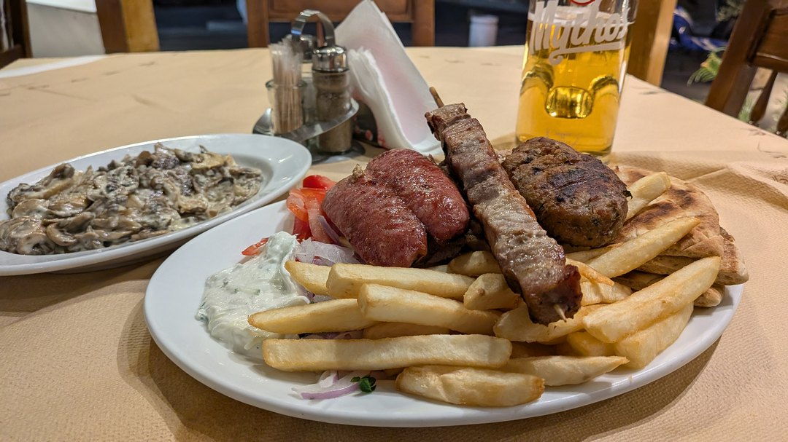{: .img-fluid .d-block .mx-auto style="max-height:70vh;"}

_图 8　克里特餐桌（马里奥拍摄）：烤肉串、薯条、沙拉与蘸酱，配 Mythos（神话）啤酒。_

拿 γύρος 来说，γ 在 υ 前面发 /ʝ/ 这个音（类似“叶”的声母但更摩擦），ύ 发 /i/，ρ 是个颤音，ος 是常见的阳性词尾。整个词读 /ˈʝiɾos/——没错，它跟英语 gyroscope（陀螺仪）同源，本意就是“旋转”。烤肉在签子上转，陀螺在地上转，三千年前是一家。

---

## 理解诺兰：历史、文化、战争与科学

跨越古今的识字之旅结束了，脑细胞死了一片，我心中却涌上了一眼活水。

本文刚开始的时候，我嘲笑诺兰的现代美语对白让人出戏。但在经历了这一段重学希腊字母的“奥德赛”之后，我明白了诺兰的选择。诺兰摒弃了好莱坞史诗片一贯的古代口吻，让奥德修斯去除了神性，回归凡人。十年归路留下的，是对自己做错事情的悔恨，是对自己放弃国家和妻儿的内疚。而他的回家之路，就是一场救赎。

这也正是这部电影最打动我的地方：**它告诉你，你最想要的，就是你最无法拥有的；而你最无法拥有的，正是你曾经拥有、却已经失去的东西。**

辉煌的古希腊文明，人类曾经拥有，却已失去。从失落的文明中，我们应该晓得什么是值得保存的灿烂文化——而古希腊留给我们的最辉煌的文化是什么呢？是荷马，是柏拉图，是伯里克利，是苏格拉底，是欧里庇得斯，是亚里士多德，是毕达哥拉斯，是滋养了东西方文明两千多年的思想、哲学、艺术与科学。

我从诺兰的《奥德赛》里看到的是：尊重历史、复兴文化、反对战争、崇尚科学。

---

**【文末小挑战】**

说起科学，2026 年菲尔兹奖（Fields Medal）刚刚揭晓，我们为王虹和邓煜骄傲之余，不妨看一看这枚奖章。奖章的正面，是一个头像，头像旁边刻着一行字：

**ΑΡΧΙΜΗΔΟΥΣ**

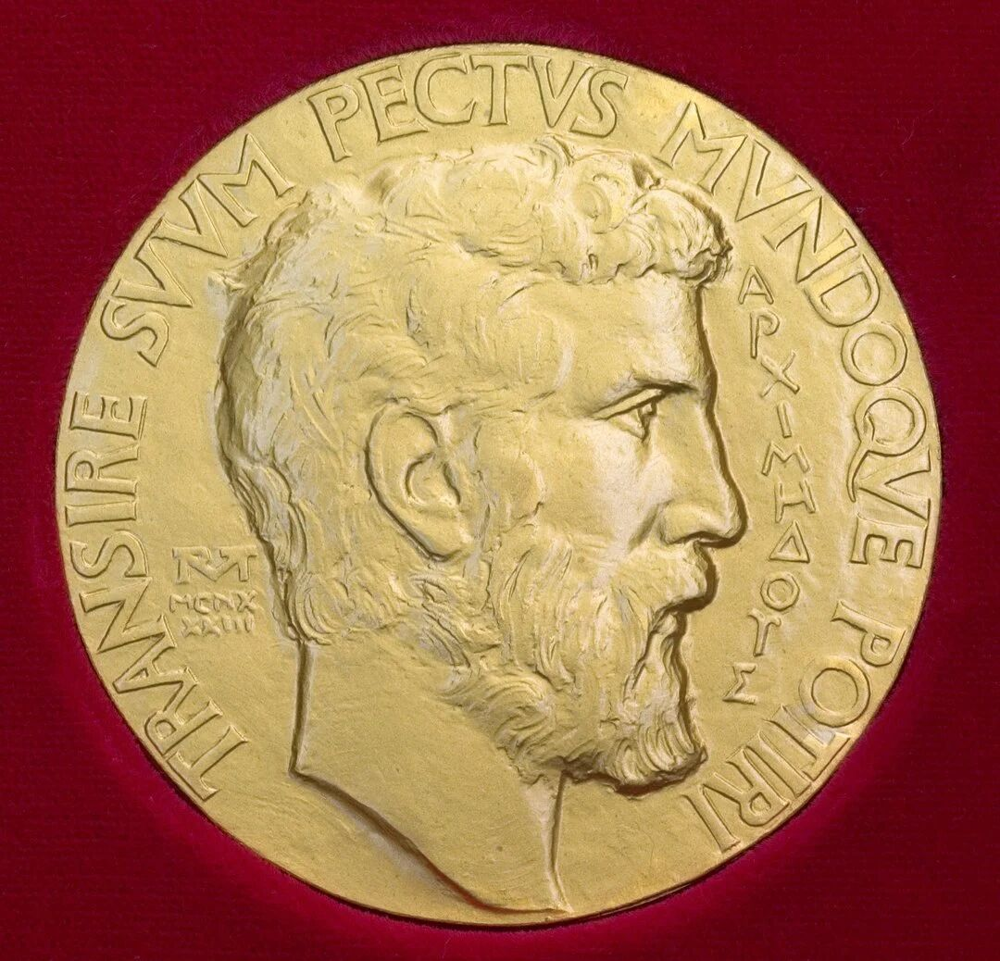{: .img-fluid .d-block .mx-auto style="max-height:70vh;"}

_图 9　菲尔兹奖章正面。来源：维基百科公版资源。_

再看外圈，还有一行更醒目的大写字母：

**TRANSIRE SVVM PECTVS MVNDOQVE POTIRI**

读者朋友，读完本文，你能回答以下问题吗？

1. 奖章正面哪一段才是希腊文？
2. 你能把 ΑΡΧΙΜΗΔΟΥΣ 改写成小写吗？
3. 它对应哪个数学家的名字？

别急着问 AI ，答案就藏在前面的字母表里。

---

## 参考资料

Arthur Maps. (n.d.). *Ancient Greece in 18 minutes* [Video]. YouTube.

Greekified. (n.d.). *The Greek alphabet in 11 minutes! How to read Greek* [Video]. YouTube.

*Greek alphabet chart*. (n.d.). greekalphabet.net.

The Professor with the Bow-Tie. (n.d.). *How to pronounce the ancient Greek alphabet* [Video].

*最想要的，是曾經擁有卻已失去的……諾蘭《奧德賽》給大人的5堂人生課*. (n.d.). 經理人.

---

*本文首发于微信公众号「元语言」，[阅读原文](https://mp.weixin.qq.com/s/VyH0VWxlQI5ra9pv9IwMAw)。*
