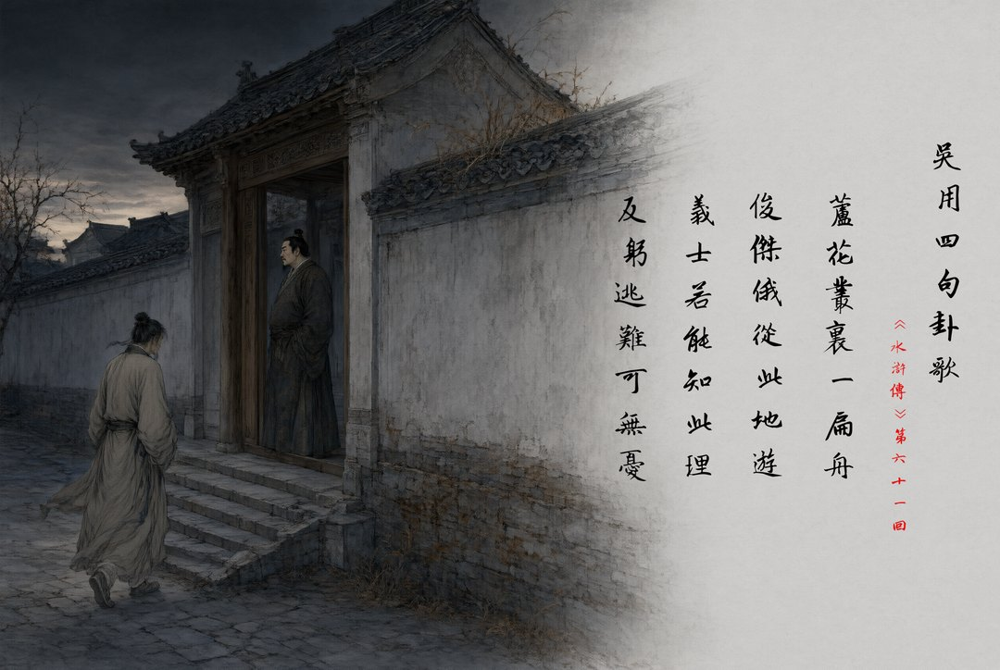

{: .img-fluid .d-block .mx-auto style="max-height:70vh;"}

{: .img-fluid .d-block .mx-auto style="max-height:70vh;"}

{: .img-fluid .d-block .mx-auto style="max-height:70vh;"}

{: .img-fluid .d-block .mx-auto style="max-height:70vh;"}

藏头诗，是嵌字文的一种特殊形式：诗句可以照常逐字而念，每一句的首字连起来，又会显出另一条隐藏的信息。鉴于此类信息不自明言，需得解读之人心领神会，常被明清以来的笑话、戏曲、通俗小说、民间故事等用来讽刺、请托、婉语、传情。

以上四图所记，乃四首鼎鼎有名的藏头诗文。苏轼把“郑容落籍，高莹从良”写进给太守许遵的赠别诗句首，替两位歌妓递出一份不便直说的请托；《水浒传》里，吴学究把“卢俊义反”四字藏在卦歌开头，略使小技便把河北玉麒麟赚上梁山；在后人的演义中，风流才子唐伯虎挥笔一首七绝诗，把“我爱秋香”这最直白的心意，藏进了四行看似写景的诗句里；到了金庸先生，甚至不必用诗来藏头，区区两行字便将十四部小说的书名压缩成一副顺口、好记、又自成江湖气象的对联。

藏头诗为什么受欢迎？从语篇功能上看，可以传递“言外之意”，是一套“作者设谜，读者解谜”的暗语系统；从文学技巧上看，属于“受限写作”，让作者戴着镣铐在措辞、选句、挑音上闪转腾挪，看似受限，往往能激发让读者意想不到的创造力；从审美趣味上看，藏头诗让同一套文本有了两个解读的维度，先读表层，再读言外；横看成岭，侧看成峰，妙不可言。正所谓：

> **藏**意不妨寄句端，  
> **头**行一转暗声传。  
> **嵌**得妙语觅新境，  
> **字**含机密见巧篇。  
> **弦**扫纵横诗成画，  
> **外**人何解苦变甜？  
> **有**心识得双重味，  
> **音**在无时更胜言。
> {: style="margin-bottom:0.6em;"}

---

*本文首发于微信公众号「元语言」，[阅读原文](https://mp.weixin.qq.com/s/BKNeMdvmUd_fhCj_sNTaIA)。*
