> "When angry, count four; when very angry, swear."
> {: style="margin-bottom:0.6em;"}
>
> —— Mark Twain, *Pudd'nhead Wilson* (1894)
> {: style="text-align:right;margin-bottom:0.6em;"}

据说以上这句话是美国大文豪马克·吐温（Mark Twain）为了讽刺“建国三杰”之一的托马斯·杰斐逊 （Thomas Jefferson） 而作的。杰斐逊在 1825 年 2 月 21 日写给教子的私人信件中写下了十句人生箴言，其中有这么一句：**“When angry, count ten, before you speak; if very angry, an hundred。”** 这句话本意是规劝退一步海阔天空，不要随便出口伤人；但是向来叛逆又幽默的马克·吐温认为，杰斐逊的建议有点太反人性、太虚伪了。于是他在小说里借威尔逊之口改成了：“生气的时候，先数到四；非常生气的时候，骂他全家死。”

连大文豪也说**脏话（profanity）**，可见脏话有用，至少可以泄愤，有益身心。**更有好事者说，脏话乃是语言的精华。学一门外语，必先学其脏话，否则被人骂了都不知道。**不论何种说法，脏话似乎和谎话一样：明知不好，我们却每天都不免说上几句，足见它承担着重要的**语用功能**。而与谎话不同的是，脏话往往更受**社会禁忌（taboo）**。几千年的人类发展经验表明，越是禁忌的事物，往往越在地下野蛮生长，甚至生出种种变体来。脏话的历史，由此可说是一部微缩版的语言文化演变史了。

本系列名曰“脏话语言学”，绝不是教诸位如何爆粗口，而是**揭开禁忌的面纱，研究它的演变、词源、心理和神经机制，以及它在各个文化中的表现。**这个先导篇，我们先从英语谈起。

---

## 一、数据说话

说起英语世界里的“国骂”，你最先想到的是哪个词？意大利语言学家 Gabriele Azzaro 在《Four-letter Films: Taboo Language in Movies》（2005）一书中做了统计研究：收集自电影诞生以来至 2000 年代初共 352 部英语电影剧本，总计超过 800 万词，再对其中所有禁忌词做词形（form）出现次数的统计。其中频次最高的 15 个词绘图如下：

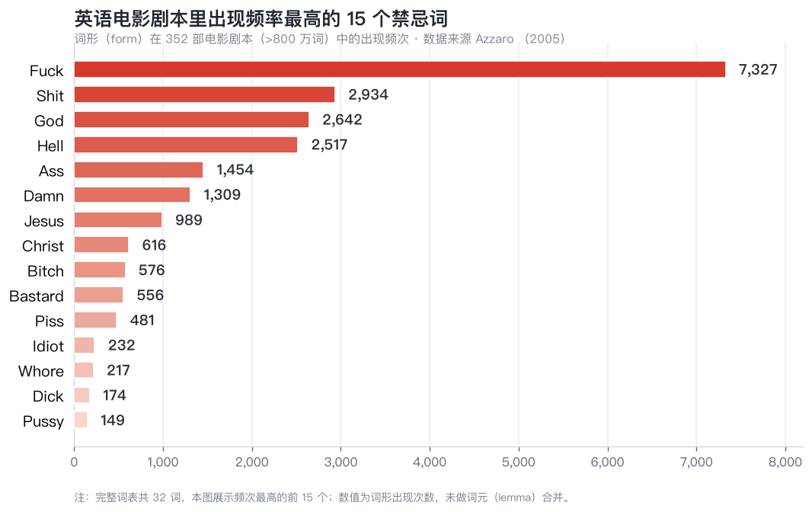{: .img-fluid .d-block .mx-auto style="max-height:70vh;"}

_图 1　352部 英语电影中高频禁忌语（节选）。来源：Azzaro，2005。_

不出所料，*fuck* 独占鳌头， *shit* 紧随其后；第三、第四名是 *God* 和 *hell*。如果说在这 15 个禁忌词里，屎尿屁和下三路占了多数不足为奇，为什么宗教词汇也如此高频呢？我们先卖个关子。

电影来源于生活。既然 fuck 在生活中如此频繁地抛头露面，我们可以大胆猜测电影里也是如此。果不其然，根据 Azzaro 的研究，**世界银幕上最早出现的脏话**，是 1945 年意大利影片《劫掠萨宾妇女》（Il ratto delle Sabine ，导演 Mario Bonnard）里的一句 vaffanculo ，大致相当于英语的 fuck off 。**英语电影中最出现 “fuck” 的**，是 1967 年的两部英国片：分别是 Joseph Strick 执导的《尤利西斯》（Ulysses）以及 Michael Winner 导演的《永志不忘》（I'll Never Forget What's'isname）。

<figure markdown="0" style="margin:0;"><section style="display:inline-block;width:100%;vertical-align:top;overflow-x:auto;box-sizing:border-box;"><section style="width:300%;overflow-x:hidden;max-width:300% !important;box-sizing:border-box;"><section style="display:inline-block;vertical-align:top;width:33.3333%;box-sizing:border-box;">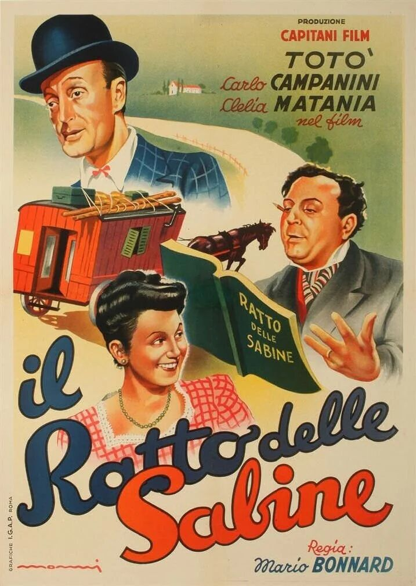</section><section style="display:inline-block;vertical-align:top;width:33.3333%;box-sizing:border-box;">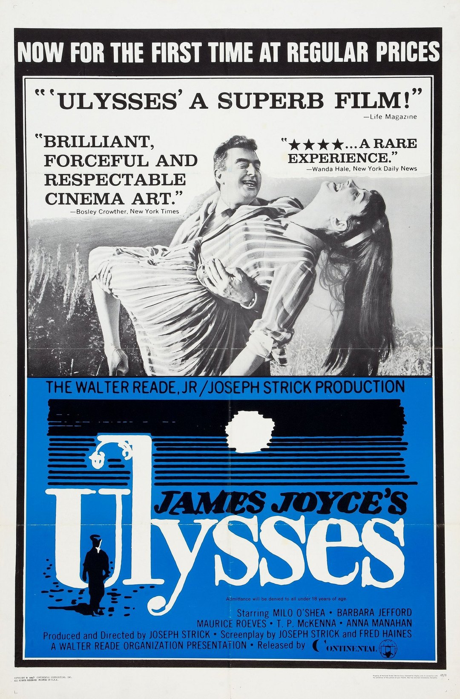</section><section style="display:inline-block;vertical-align:top;width:33.3333%;box-sizing:border-box;">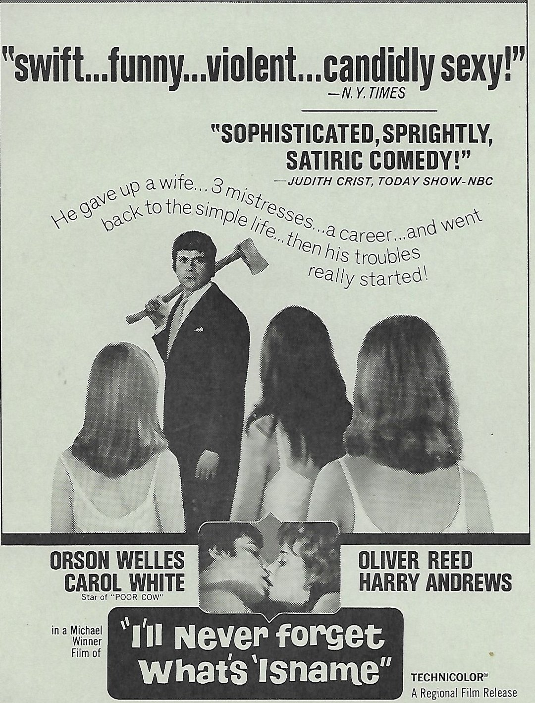</section></section></section></figure>

_图 2　《劫掠萨宾妇女》、《尤利西斯》、《永志不忘》海报（滑动观看）。_

那么，世界影史上脏话最多的电影是哪一部？或许我们会很自然地猜测，是马丁·斯科塞斯（Martin Scorsese）或是鬼才导演昆汀·塔伦蒂诺（Quentin Tarantino）的电影。毕竟这二位导演都是拍黑帮片出了名的。**语言的使用往往和说话人的身份阶层息息相关**，如果古惑仔满口之乎者也，不是变成 gentleman 了吗？

<figure markdown="0" style="margin:0;"><section style="display:inline-block;width:100%;vertical-align:top;overflow-x:auto;box-sizing:border-box;"><section style="width:400%;overflow-x:hidden;max-width:400% !important;box-sizing:border-box;"><section style="display:inline-block;vertical-align:top;width:25%;box-sizing:border-box;">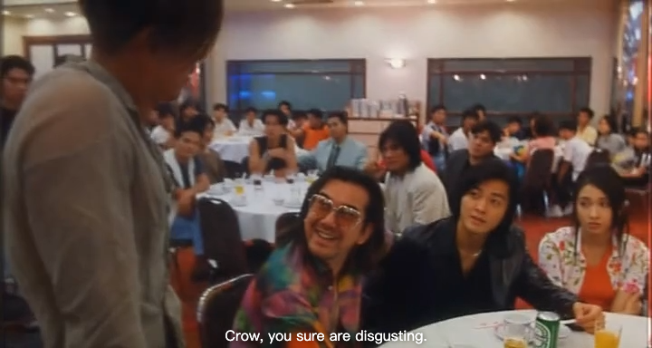</section><section style="display:inline-block;vertical-align:top;width:25%;box-sizing:border-box;">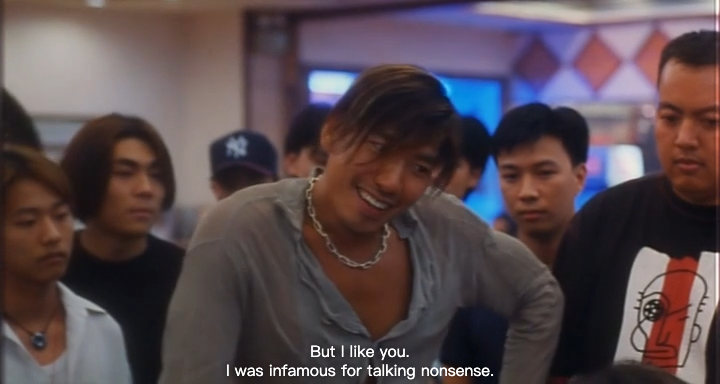</section><section style="display:inline-block;vertical-align:top;width:25%;box-sizing:border-box;">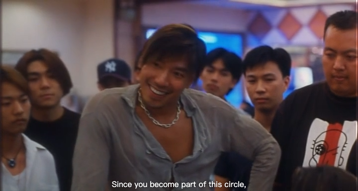</section><section style="display:inline-block;vertical-align:top;width:25%;box-sizing:border-box;">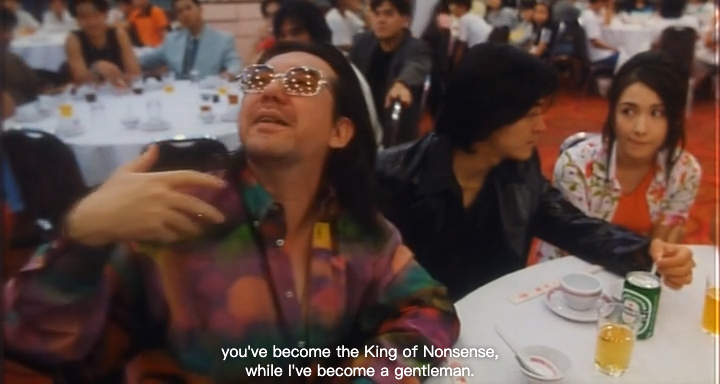</section></section></section></figure>

_图 3　《古惑仔之只手遮天》剧照（滑动观看）。_

根据 Azzaro 的语料，他给出的“最烂十部”（most degenerate films）按禁忌词总条目数排，第一名是 2002 年根据说唱歌手 Eminem 真实经历改编的半自传电影《8 英里》（*8 Mile*，导演 Curtis Hanson），461 条 —— 这很正常，说唱是讽刺的艺术，从某种意义上说也就是粗口的艺术；我们的昆汀凭借其代表作《低俗小说》（*Pulp Fiction*，1994）中的 419 条粗口荣膺第三。

<figure markdown="0" style="margin:0;"><section style="display:inline-block;width:100%;vertical-align:top;overflow-x:auto;box-sizing:border-box;"><section style="width:200%;overflow-x:hidden;max-width:200% !important;box-sizing:border-box;"><section style="display:inline-block;vertical-align:top;width:50%;box-sizing:border-box;">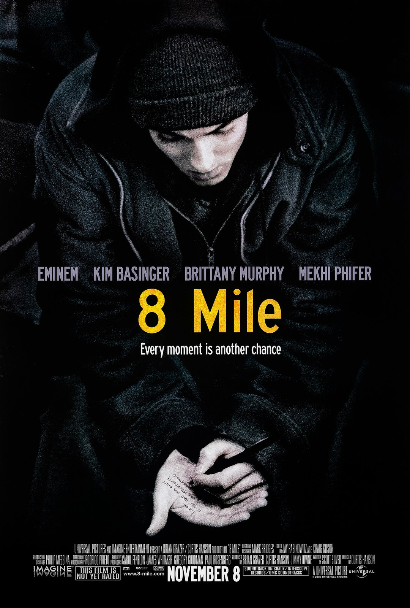</section><section style="display:inline-block;vertical-align:top;width:50%;box-sizing:border-box;">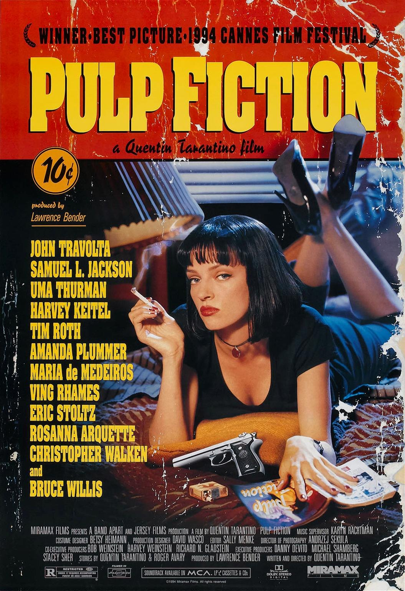</section></section></section></figure>

_图 4　《八英里》、《低俗小说》海报（滑动观看）。_

说起 1994 年，真可谓世界影史上的传奇。除了奇异诡谲、大俗若雅的《低俗小说》之外，还有浓缩了半部美国现代史的 **《阿甘正传》（Forrest Gump）**，有如今在各大电影排行榜上常年制霸的 **《肖申克的救赎》（The Shawshank Redemption）**，有让小鲜肉布拉德·皮特（Brad Pitt）大红大紫的 **《燃情岁月》（Legends of the Fall）**，还有开萝莉大叔 CP 之先河的 **《这个杀手不太冷》（Leon The Professional）**等等等等。

<figure markdown="0" style="margin:0;"><section style="display:inline-block;width:100%;vertical-align:top;overflow-x:auto;box-sizing:border-box;"><section style="width:400%;overflow-x:hidden;max-width:400% !important;box-sizing:border-box;"><section style="display:inline-block;vertical-align:top;width:25%;box-sizing:border-box;">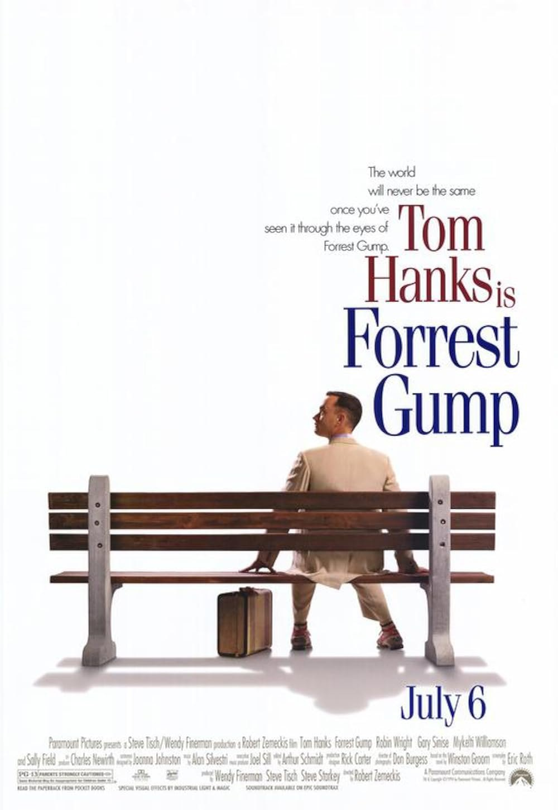</section><section style="display:inline-block;vertical-align:top;width:25%;box-sizing:border-box;">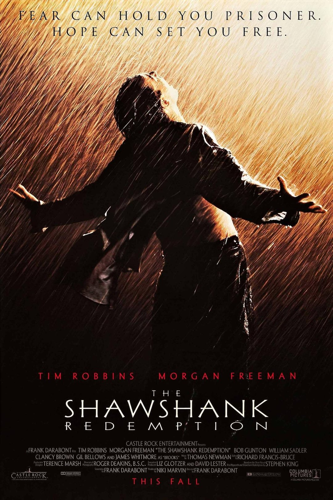</section><section style="display:inline-block;vertical-align:top;width:25%;box-sizing:border-box;">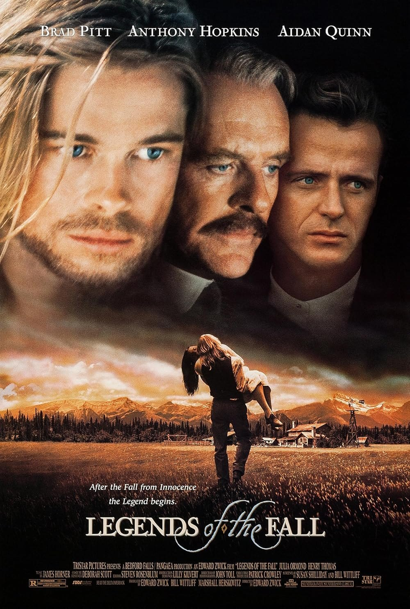</section><section style="display:inline-block;vertical-align:top;width:25%;box-sizing:border-box;">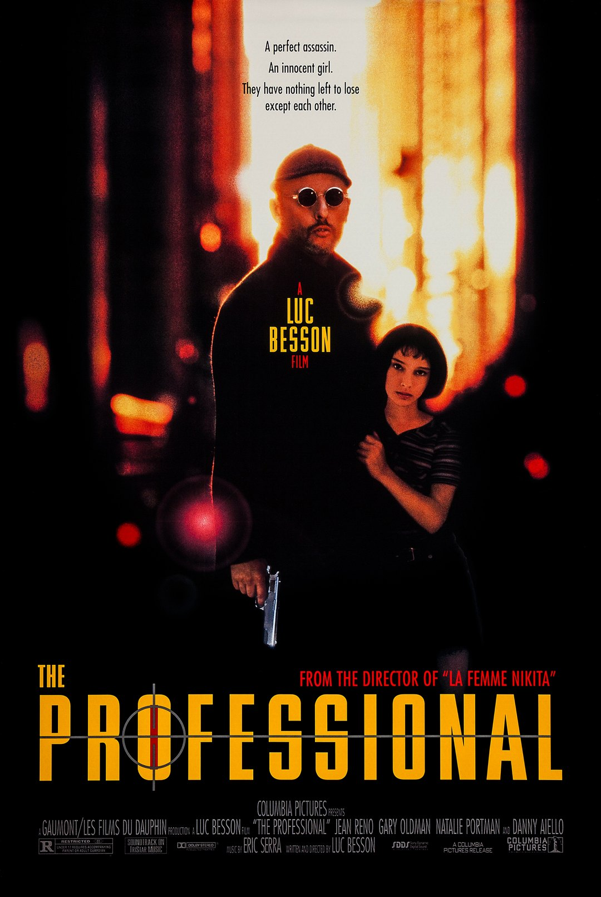</section></section></section></figure>

_图 5　《阿甘正传》、《肖申克的救赎》、《燃情岁月》、《这个杀手不太冷》海报（滑动观看）。_

写到这里，我忽然有了一个奇特的想法：如果我用 Azzaro 所列的 32 个词对 **1994 年的这五部电影做个共时研究**，统计不同风格的电影里的禁忌语，会得到什么结果？是否痞气十足的《低俗小说》一骑绝尘，而美国“红色主旋律电影”《阿甘正传》就一定用词清新呢？说干就干。以下是统计结果： 

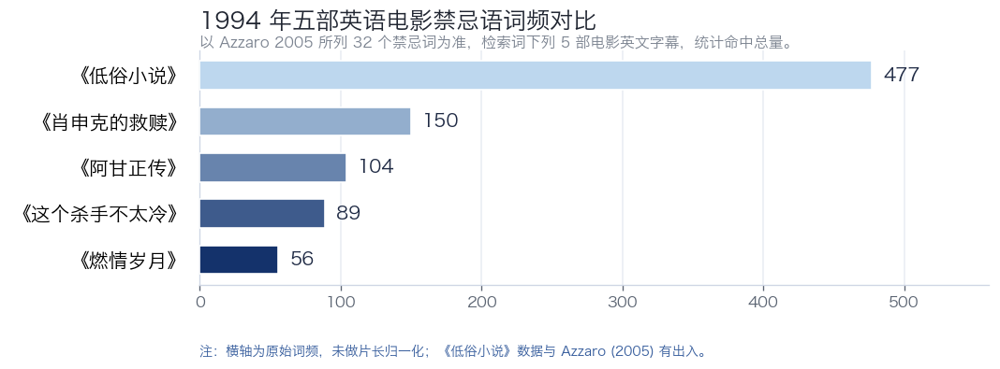{: .img-fluid .d-block .mx-auto style="max-height:70vh;"}

_图 6　1994 年五部电影禁忌语词频对比。_

由此可见，黑帮片《低俗小说》固然是三句不离脏字，励志片也不是纯洁的小白兔啊，就连《燃情岁月》这种反映美国保守时期的历史片，也免不了五十多条禁忌语。这么一看，爆粗口在我们的生活中就像呼吸与喝水一样是“人之大欲”。那么，**什么样的禁忌语人们可以接受，什么样的粗口人们绝对会勃然大怒呢？** 

英国通信管理局 Ofcom 在 2021 年委托民调机构做了最新一次**“观众对冒犯性语言的态度”研究**，研究对象是英国电视与广播节目。调查找来全英各地、各年龄段共计 368 位受访民众，给 186 个禁忌词按照 mild（轻微）、medium（中等）、strong（强烈）三个档位打**冒犯度（offensiveness）** 分数。下图是我在报告中筛选出的代表性例词：

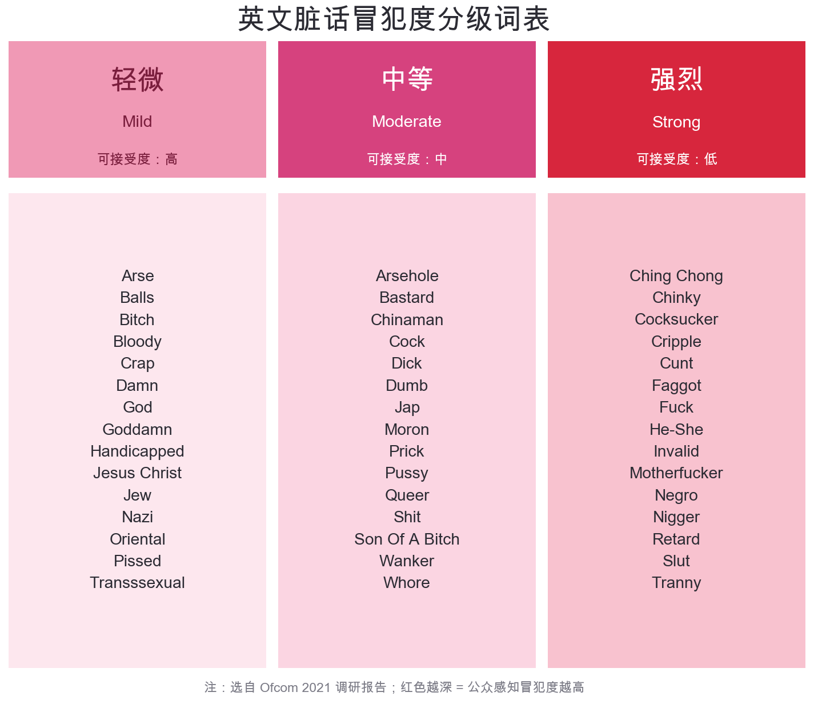{: .img-fluid .d-block .mx-auto style="max-height:70vh;"}

_图 7　Ofcom调研报告中禁忌语例词节选。_

对此图略加研读以后不难发现，这些禁忌词汇除了上文提到的有关宗教、排泄、性交的类别以外，还有一类**歧视性词汇（slur），即对人种、性别、种族、智力、残疾、性取向等加以贬损**。

更有意思的是，这类歧视性词汇在调查中是被认为侮辱性最强、最难以接受的。同时，与图一相比，高频的词汇并不一定是冒犯度最高的，而且宗教类禁忌语在现代语境中变得越来越温和了。这似乎说明：禁忌语也有着一个历史演变的过程。

---

## 二、脏话简史

禁忌语的历史可谓百转千折，引人入胜。**从历史上看，禁忌语大多起源于宗教**；在犹太-基督教与伊斯兰传统中，一旦宗教词汇被用在宗教语境之外，往往便成了脏话。但也有例外 —— 在古罗马，拉丁语中的禁忌与今日的英语似乎并无二致，关于性与排泄的禁忌占了绝大部分。

**到了中世纪，违心地说出的宗教誓言（religious oaths）成为了最主要的亵渎形式**。在中世纪，你在何时、以何种方式使用了上帝之名非常重要，以上帝之名起誓却出尔反尔口是心非，便是一种亵渎。**最严重的亵渎是以上帝的身体部位所起的誓言**。比方说，明明是你自己赌博输了，却偏要 *“以神的骨头（By God's bones）”*， *“以基督之伤（by God's wounds）”*， *“以基督之血（by the blood of Christ）*大发牢骚，咒骂不休 —— 这便是中世纪最脏的脏话。正因如此，英语里像 holy（神圣）、hell（地狱）、goddamn（上帝有罪），乃至 Jesus Christ（耶稣基督）这样的宗教词汇也在历史上也是骂人的话，即便按今天的标准来看这些词相当温和。

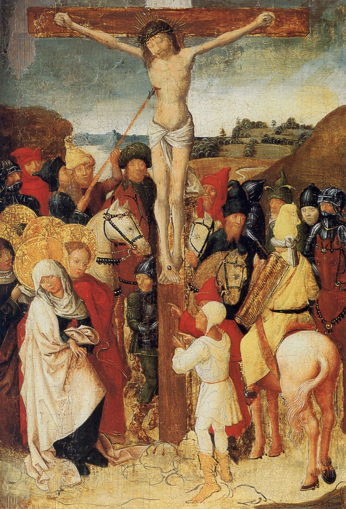{: .img-fluid .d-block .mx-auto style="max-height:70vh;"}

_图 8　《基督之血》木板画（Weingarten, 1489）。来源：公有领域（Public Domain）。_

**到了文艺复兴时期，禁忌语开始接近于现代**。那些在中世纪的医学论著中只是直白描述解剖结构的词（比如上表里提到的那个 C-word）成为了新的脏话。**这些带有性意味或污秽性质的脏话，在维多利亚时代达到了顶峰**。大约到 1860 年，人们的骂人方式已经基本上和现代一样了。也正是在这一时期，脏话基本从印刷品与人们的口中消失了，取而代之的是看上去更加礼貌的**委婉语（euphemisms —— 我们随后会单开一期讲委婉语）**。

然而，**到了 20 世纪之初，脏话又开始出现在人们的日常交流中了，而且变得更加公开**。在两次世界大战期间，战地记者试图忠实地报道士兵们每日的所言所行。从战壕到潜艇，他们原汁原味地记录下了战士们绘声绘色的语言，很多军官都是每句必称“F”。于是，脏话又开始渗入报纸与书籍。

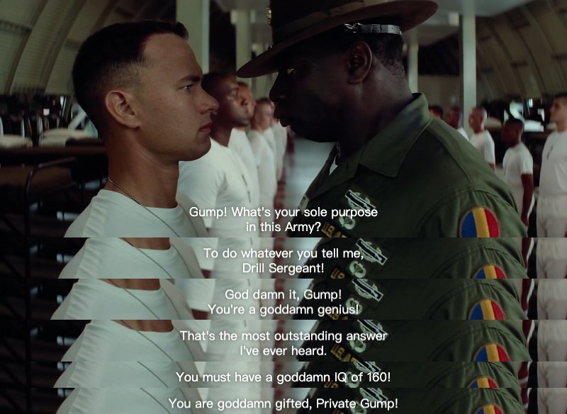{: .img-fluid .d-block .mx-auto style="max-height:70vh;"}

_图 9　电影《阿甘正传》：教官的训话几乎句句不离 “Goddamn”。_

进入二十一世纪，许多传统的禁忌语在年轻一代的认知里变得不再那么有侵犯性，甚至有些还演变成一种戏谑的流行文化。**尤其是最近十年，随着肤色平等、性别平等、性向平等各种平权运动再次兴起，侵犯性最高、最难以接受的词语，理所当然地变成了那些带有歧视性的词汇（slurs）**。

如果用一句话简单总结禁忌语的历史，那么就是：骂上帝、屎尿屁、NLGBT。 什么时候禁忌语又会蜕变成一种新的形式呢？恐怕要等到世界大同，平权运动不再只是政治正确的那一天吧。 

*（注：以上观点总结自语言学家 Benjamin Bergen 和文化学者 Melissa Mohr。）*

---

## 三、脏话不脏

回顾了两千多年的禁忌语历史，我们不难推断，脏话这玩意儿“存在即合理”。**除了发泄情绪以外，现代科学还验证了说脏话可以减轻痛苦，增加体力；甚至还可以建立人际纽带，成为社交的润滑剂**。真可谓，脏话未必脏。那么，我们是否可以随意说脏话呢？当然不是。多数词语之所以被禁忌，便是因为容易冒犯别人，让人感到不适。尤其是对于童言无忌的孩子，如果不对这类禁忌语加以限制，孩子们便很容易有样学样，造成啼笑皆非的局面，甚至大损身心健康。

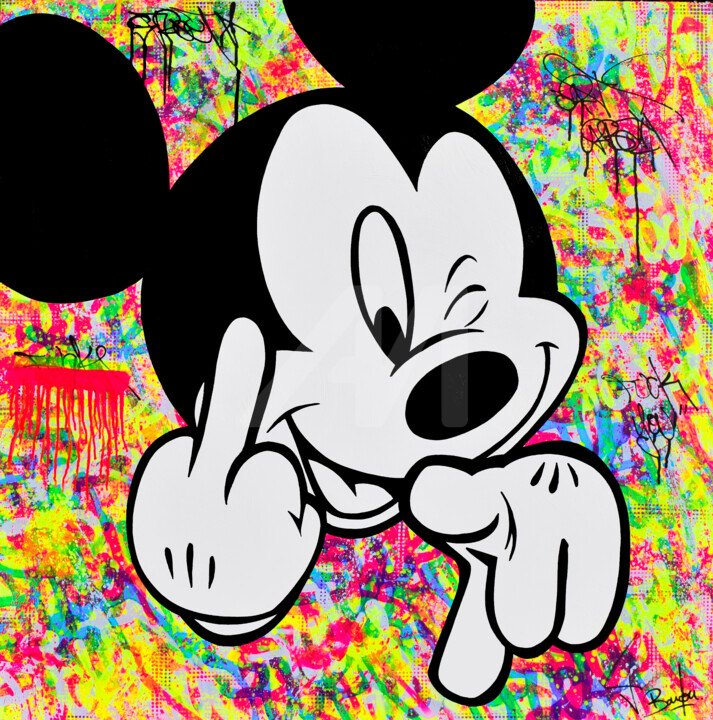{: .img-fluid .d-block .mx-auto style="max-height:70vh;"}

_图 10　《F\*CK YOU》(2018)，作者 Vincent Bardou。_

针对脏话在大众传媒中的消极影响，各国都采用了不同程度的管控措施。比如：**电影分级制度**，广播电视节目的播出时间**分水岭制度**（watershed，比如早 5 点至晚 9 点期间不得播出限制级内容），**星号遮蔽**、**哔声消音**以及**替代词**等形式对禁忌语进行处理。说来也奇怪，明明已经被星号和消音了，而我们神奇的大脑又可以自动补全原来的话；即使如此，人们却并没有觉得被冒犯。个中原因，我们等到机制篇再加以探讨。

说到这里，我有两个问题留给诸位：

- 英语里的 F-word、C-word 和 N-word 分别是指什么？
- 你能想到一些禁忌语的替代词吗？

下一期，我们将再次探访禁忌语的历史，聚焦那几个耳熟能详的英语“国骂”，探寻它们的词源，看看它们是如何一步步演变为今天的形式的。 

---

## 参考资料

Allan, K. (Ed.). (n.d.). *The Oxford handbook of taboo words and language*. Oxford University Press.

Discover Magazine. (n.d.). *The history of swear words: Where the &%@! do they come from?*

Ofcom. (n.d.). *Public attitudes towards offensive language on TV and radio*.

## 图片来源

电影海报及截图：版权归各片方所有，本文用于评论用途。

---

*本文首发于微信公众号「元语言」，[阅读原文](https://mp.weixin.qq.com/s/jOC5BnvvEgcmkIKfN0Q4-Q)。*
