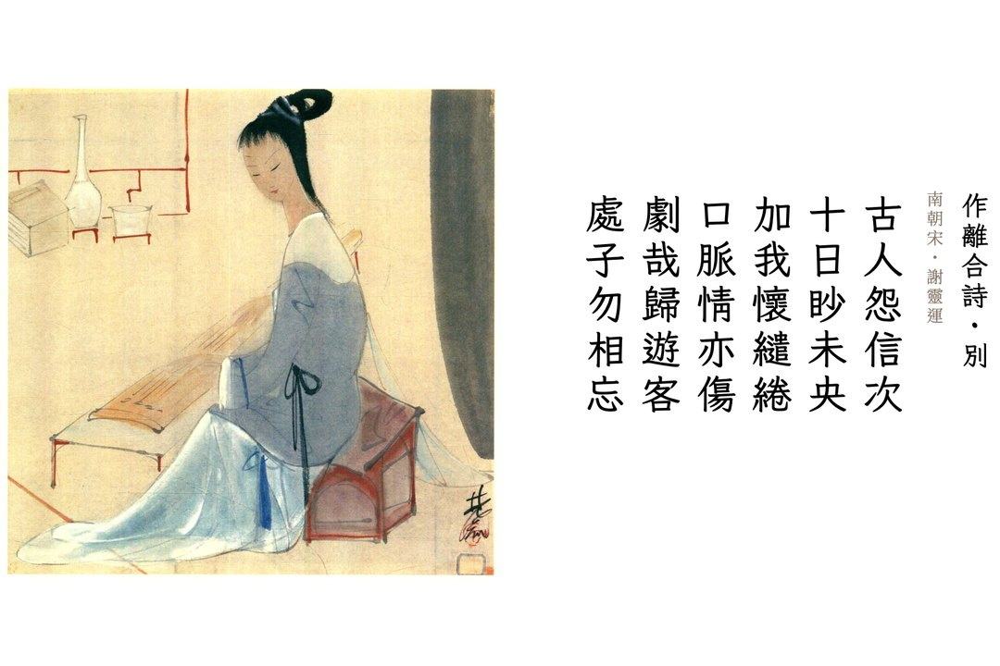
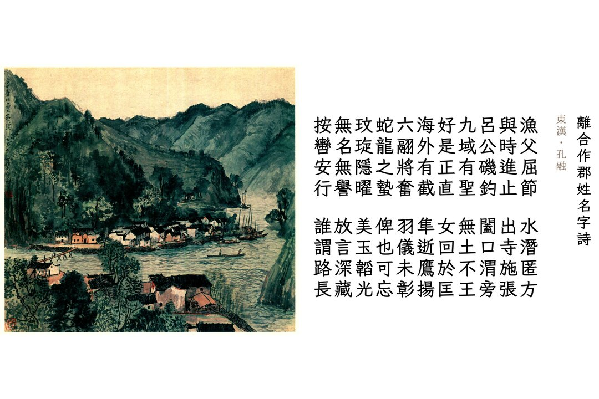
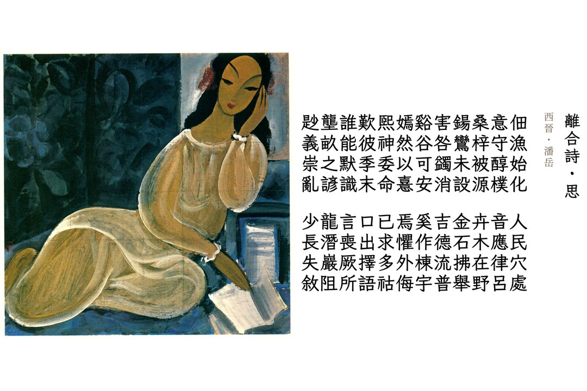
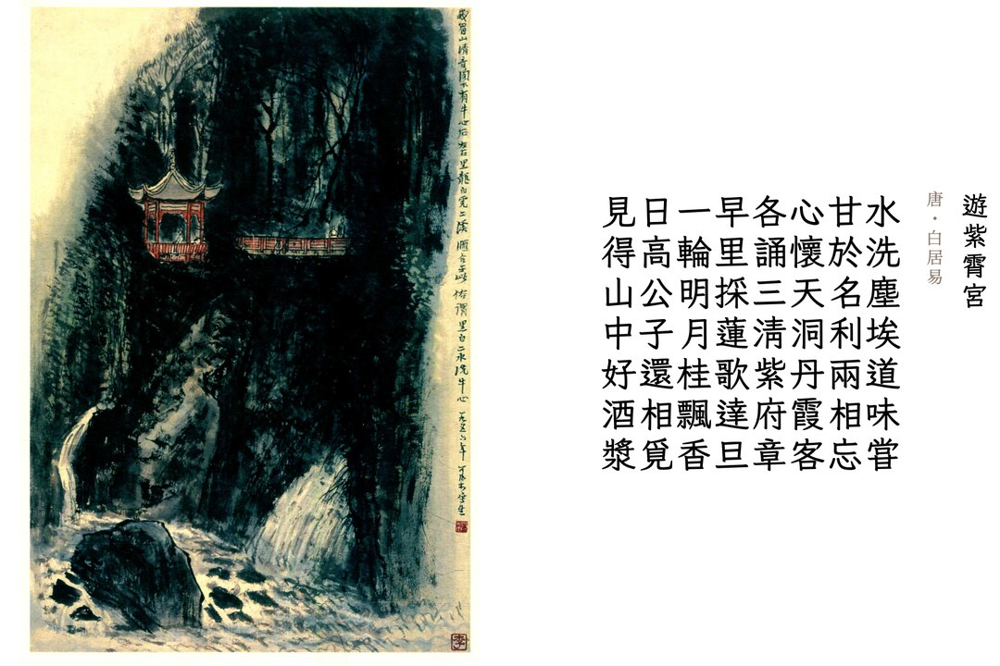

{: .img-fluid .d-block .mx-auto style="max-height:70vh;"}

{: .img-fluid .d-block .mx-auto style="max-height:70vh;"}

{: .img-fluid .d-block .mx-auto style="max-height:70vh;"}

{: .img-fluid .d-block .mx-auto style="max-height:70vh;"}

「千里草，何青青；十日卜，不得生。」读过《三国演义》的人，大概都记得这首童谣。《水浒传》里也有类似的谶语：「耗国因家木，刀兵点水工。」拆字拼字的游戏，相信各位一定不陌生，庙会、灯会上有的是啊。这种形式的诗文有个好听的名字 —— 离合诗。

所谓“离合”，即“借字联边”。且看孔融《離合作郡姓名字詩》前四句：「漁父屈節，水潛匿方，與時進止，出寺施張。」“漁”字把水隐匿，剩“鱼”；“時”字让“寺”出走，剩“日”；把“鱼”与“日”拼合，得「鲁」字。再看下四句：「呂公磯釣，闔口渭旁，九域有聖，無土不王。」“吕”字去“口”，仍剩一“口”；“域”字失“土”，余一“或”字，另“口”与“或”拼合，得「國」字。依此读完余篇，可拼出「魯國孔融文舉」六字，乃是作者的籍贯、姓名与表字，这篇诗文恐怕称得上史上最牛自我介绍了。

这便是离合诗的趣味：它比藏头诗更加婉转，诗人真正所想，并不直接出现在文字里，读者需要先读懂表层的谜面，做一番解析，才能发现隐藏的文字。这些谜面诗句也绝不单是谜底的陪衬，二者往往交相辉映，相互补充，达到一唱一和的效果。

史上第一好兄弟孔融的诗里有渔父、吕尚、潜藏、振翅、韬光，谜底虽是自报家门，谜面却也塑造了一个志向远大、静待时机、意欲有为的隐士形象。史上第一美男子潘岳（潘安）之诗反其道而行之，表面上充满老庄哲学，从人类开化写到礼崩乐坏，但真正的谜底是「思楊容姬難堪」，每一个字都是在疯狂表白——“老婆，我想你想得快受不了了。

再看南朝山水诗鼻祖谢灵运所写之诗，谜面描绘了一幅“游子在外奔波，与爱人痛苦分别、互相思念”的画面，而谜底正是一个「别」字。普通的离合诗，往往为了凑出谜底，使得表面意思生硬无味，但谢灵运这首诗真正做到了“表里合一”。

最后，白居易的这首《游紫宵宫》是一首非常绝妙的“离合藏头诗”：每句末字之一部，皆成次句首字；而全诗末字之一部，又兜回全诗首字，形成完美的闭环。此诗上半阙写出世之想，下半阙写山中之乐，意境极美之下，还能做到首尾相连、字字咬合，这种高超的文字控制力，无愧于李杜齐名。

各位看官，愿做孔融、乐天，抑或潘岳、谢公？正巧近日有一段风流公案，惹人唏嘘。于是试作离合诗一首，不点姓名，只藏其字，盼君慧眼识之：

> 晨鐘暮鼓合歸庭，  
> 有日無光待辨明。
> {: style="margin-bottom:0.6em;"}
>
> 涼薄何須拍眾案。  
> 水流廿載意難平。
> {: style="margin-bottom:0.6em;"}
>
> 舍下私言休作市，  
> 人去樓空兩不知。
> {: style="margin-bottom:0.6em;"}
>
> 甚有勞燕相競食，  
> 匹夫何解情與痴。
> {: style="margin-bottom:0.6em;"}

***

---

*本文首发于微信公众号「元语言」，[阅读原文](https://mp.weixin.qq.com/s/H06tBSEoUxdKIaq-Xyhr9g)。*
