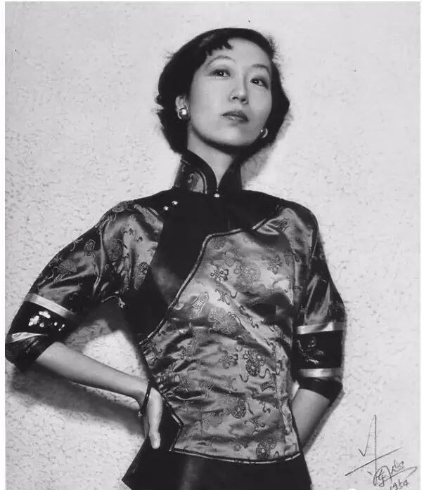
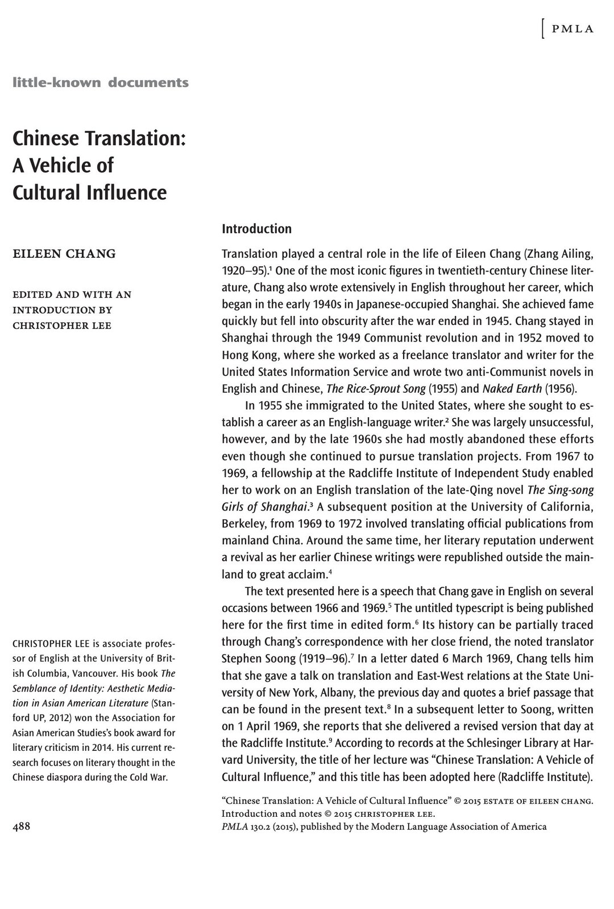
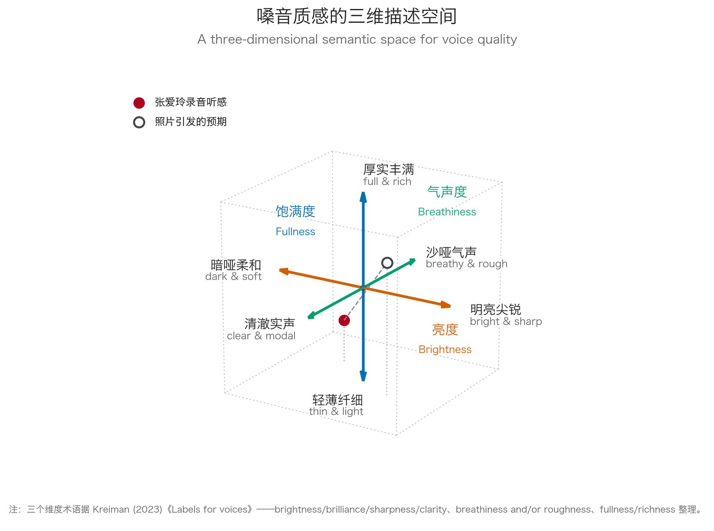
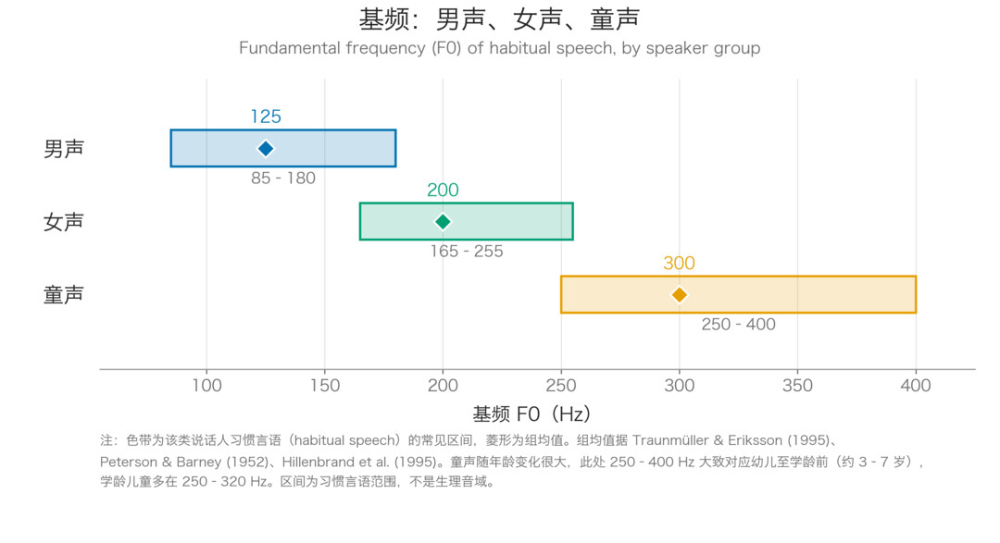
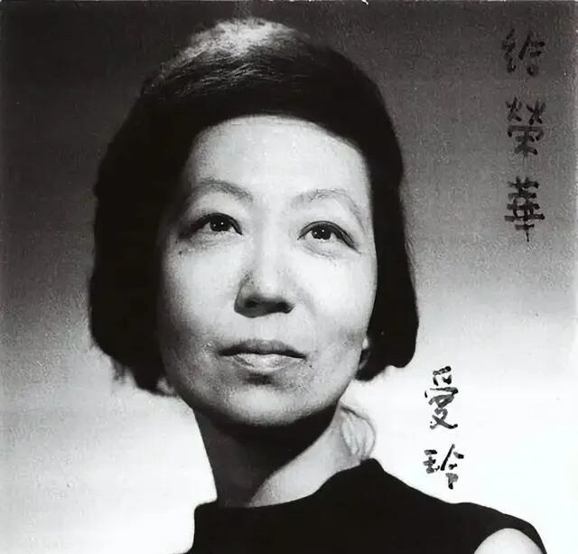

{: .img-fluid .d-block .mx-auto style="max-height:70vh;"}

How many loved your moments of glad grace,  
And loved your beauty with love false or true,  
But one man loved the pilgrim soul in you,  
And loved the sorrows of your changing face.  
—— William Butler Yeats

## 寻找张爱玲的声音

---
一千个人心中，有一千个哈姆雷特；但每个人心中，都只有一个张爱玲。

那张民国旧照似乎成了她的标准像，一袭旗袍，身形清瘦，微抬的下颌透出一丝冷傲。太多年，我们从她的文字里，想象她的深情与睿智，想象她的苍凉与冷峻。这样的女子，讲起一口沪语来，想必带着一种疏离的调调吧——可是没人知道。从 1920 年出生，到 1995 年去世，从天津到上海，再到香港和美国，张爱玲留下了童年照片，青春旧物，写完和未写完的手稿，却似乎没有留下哪怕一段影像和声音。正如香港学者梁慕灵所说：“一直以来，学术界都在寻找张爱玲的声音”。

{: .img-fluid .d-block .mx-auto style="max-height:70vh;"}

_图 1　张爱玲，1954 年摄于香港兰心照相馆，三十三四岁。来源：凤凰网《张爱玲笑了——“祖师奶奶”张爱玲一生照片编年集》；原照收入张爱玲《对照记》。_

2026 年 10 月 17 日，张迷们“今夜无人入眠”。起因是柴静的一期节目，讲的是张爱玲 1952 年离开上海的始末。出乎意料，节目中播放的一段 1969 年的英文演讲原声让整个中文互联网沸腾了。台湾作家颜择雅的反应很能代表那一夜的气氛：“这真是大事情。”按她自己的描述，“昨本来要睡了，没想到柴静抛出 Radcliffe College 图书馆收藏的张爱玲演讲录音。”

这盘磁带现藏哈佛大学拉德克利夫学院的施莱辛格图书馆（Schlesinger Library）。1969 年 4 月 1 日，48 岁的张爱玲在拉德克利夫的一场研讨会（馆藏著录为 "Bunting Institute Seminars"）上，做了题为《中国翻译：文化影响的载体》（Chinese Translation: A Vehicle of Cultural Influence）的英文演讲，全长约 72 分钟——前面是她逐字宣读的讲稿，后面是现场问答。录音在馆藏里并不以她的名字编目，而是归在她已故丈夫赖雅的姓氏之下：“Reyher”。柴静在 10 月 20 日的文章《张爱玲录音如何发掘？》里交代了追索过程：她从张爱玲 1969 年写给宋淇的一封信里得知这场演讲，据此联系施莱辛格图书馆，找到一盘 2025 年刚完成数字化、以 “Reyher” 著录的磁带；再把录音与学者 Christopher Lee 整理发表的讲稿逐段比对，确认说话人正是张爱玲。

{: .img-fluid .d-block .mx-auto style="max-height:70vh;"}

_图 2　张爱玲英文讲稿《中国翻译：文化影响的载体》：PMLA 第 130 卷第 2 期（2015）。_

“她的声音轻细、柔和，有时几乎离开麦克风，主持人需要提醒她正对麦克风。”有张迷这样形容；也有的说，她的声音“温和内敛”，“和文字里的苍凉犀利更形成强烈反差”。一夜之间，这种“反差感”占据了各大媒体的头条。反差的程度，甚至超过了端庄的宋美龄赴美演讲时的慷慨激昂，也超过了儒雅的张学良接受英文采访时满口的大碴子味。在人们的头脑中，照片上那个“双手叉腰，似乎永远在审视别人”的她，文字里那个“苍凉犀利，不时带着嘲讽”的她，几乎注定有一副清冷、锋利、高昂的声音。人们难以相信，磁带里的声音“温和内敛”，甚至“带着林黛玉式的柔弱”。

---

## 我们为什么会“看脸猜声”？

### “美声”配“美人”

---
其实，“看脸猜声”是人类知觉系统的默认工作机制，您想不猜，大脑都不同意。近三十年的面孔—嗓音研究发现，当你看到一个人的形象的时候，你的大脑不仅关注这人是美是丑，性别年龄啊，高矮胖瘦啊，形象气质啊，这些通通在你头脑里挂了号了。而人的声音往往是由其生理特点决定的，于是“看脸猜声”这个事儿就变得比较靠谱了。

对于女性来说，面相越女人，人们就越觉得她的嗓音高（Feinberg et al., 2005）。还有研究发现，人们会自动把“美声”配“美人”——所谓“what sounds beautiful looks beautiful”，而且人们把“丑声”配“丑人”的倾向，比“美声”配“美人”还强，一张好看的脸配上平庸的嗓音，听者往往会大失所望，记忆更深（Hughes and Miller, 2016）。正因为这种预期是系统性的、大概率的，一旦事实违背了预期就会产生“反差感”。因此，我们不难理解台上扮了女装的李玉刚为什么不愿意讲话，而第一次听到周迅和张柏芝开口，我们会有点儿不相信自己的耳朵。

### 外貌形象与声音形象

谈到面孔，我们很多人都是“颜控”。如果问你喜欢什么样的女生，你可能张口就来“肤白貌美、胸大腰细”。可见我们有一整套的标准描述人的外貌。那么，声音如何描述呢？想想我们如何评价一个歌手的音色吧。你可能会说：周深的“声线高”，许巍是个“低音炮”；王菲的声音“空灵”，毛不易的声音“温暖”；王心凌的歌声“甜度爆表”，那英老师的歌声“颗粒感十足”，如此种种。很明显，我们对声音形象的主观感受可以从不同的维度去定义，我们欠缺的只是把零散的形容词分门别类，放在一个坐标系内去描述。

{: .img-fluid .d-block .mx-auto style="max-height:70vh;"}

_图 3　嗓音质感的三维描述空间：亮度、气声度、饱满度。归纳自 Kreiman (2023)《Labels for voices》。_

嗓音研究界反复比对各种描述方式后发现，无论让听者自由打标签还是用量表评分，最后收敛出的维度总是少数几个：亮度（明亮尖锐 ↔ 暗哑柔和）、气声度（清澈实声 ↔ 沙哑气声）、饱满度（厚实丰满 ↔ 轻薄纤细）（Kreiman, 2023）。

把大众对张爱玲录音的听感描述放进这个坐标系，位置立刻清楚了：“轻细”落在饱满度的轻薄一端；“柔和”落在亮度的偏暗一端；虽然录音里低噪和电流声明显，似乎我们还是能感觉出气声。至于人们反复说起的那个“温”字，严格说来已经越出了音色本身，属于社会印象的层面：听者从嗓音中得到了“友善、无威胁”这样的印象。那么我们不禁要问：声音的物理质感，是如何一步步变成听者对他人的社会判断的呢？

### 生物信息维度
生物声学有一个影响深远的观察：动物（包括人类）会本能地用声音“投射”自己身体的大小——音调越低、共鸣腔越大，听起来体型越大、越有威慑力；反之则显得小巧、温和、没有攻击性。英国伦敦大学学院许毅教授等研究者把这种观察发展为“生物信息维度”（Bio-informational Dimensions，简称 BIDs）框架：说话人会沿着体型投射、活力、可听度、联想这几个维度调节自己的声音，去影响听者对自己的态度（Xu et al., 2013）。实验也证明，把同一句话合成出不同的版本，气声音质被评为最友好也最快乐，音高调得越高，听起来越友好（Noble and Xu, 2011）。

要注意，BIDs 描述的是声音的“调节”，即人在不同的情境和情绪下如何塑造声音，而不是一个人天生的嗓音。天生的音高和体型其实关系很弱：一项汇总了三十九个独立样本的元分析发现，在同性别的成年人里，音高只能解释身高、体重差异的不到 2%；可听者却倾向于把低沉的声音归类于“大个子”（Pisanski et al., 2014）。所以，一个人嗓音天生低一点，并不等于“威慑力”高。

换言之，声音“温润”与否，要看说话的方式：语调起伏平缓、音量轻柔，再加一点气声的底色。接下来，我们就沿用 BIDs 框架，看看张爱玲那天是怎样说话的，以及她的声音形象是否符合大家心中的期待。

---

## B（不）I（一）D（定）s（是）

---

### 三个特征

BIDs 的四个维度里，“联想”和本文关系不大；“体型投射”（音高、声道共鸣、嗓音质量）和“活力”（音高与语调的摆动）可以从录音里测量；“可听度”主要靠音量，可老磁带的绝对音量早已无从还原，只能借助现场的描述。我们先来认识三个声学术语：

- **基频（fundamental frequency，F0）**：声带每秒钟开合的次数，单位赫兹（Hz），就是我们日常所说的“音高”——声带每秒振动 200 次，就是 200 Hz。我们不取音高平均值，而取**音高中位数（pitch median）**，这样个别跑调的瞬间不至于带偏整体。

{: .img-fluid .d-block .mx-auto style="max-height:70vh;"}

_图 4　三类说话人的基频（F0）区间：男声 85–180 Hz、女声 165–255 Hz、童声约 250–400 Hz，菱形为各组均值。_

- **共振峰（formant）与声道长度**：声道像一件乐器的共鸣腔管，会放大某些频率，被放大的频率位置就是共振峰。管子越长，共振峰之间挤得越近，声音越显得低沉——这就是大提琴听起来浑厚、小提琴清亮的原因。反过来，量出共振峰之间的平均间距，就能算出这根“管子”有多长。如果把人声比作乐器，共鸣管也就是**表观声道长度**（Reby and McComb, 2003）。成年女性平均约 14.8 厘米，男性约 17.4 厘米（Pisanski et al., 2014）。

- **音高范围（pitch range）**：一段语音里音高摆动的幅度，或者叫“音域”。单位用**半音（semitone）**——钢琴上相邻的两个琴键就是一个半音；语音摆动 6 个半音，就相当于跨了 6 个琴键的范围。一个人说话淡定，音高范围就窄；一个人动不动就“哎呀我的妈呀”，音高范围就宽。BIDs 的“活力”还包括音高变化的速度，不过速度和幅度相关性很高（Xu and Sun, 2002），这里只测幅度。

### 核心公式

#### 公式一｜音高中位数

$$
M = \operatorname{median}\left\{F_0(t)\mid t\in\text{浊音帧}\right\}
$$

时间 t 遍历所有“浊音帧”求中位数——浊音声带振动强烈，音高测量准确；清音声带基本不振动，音高难以探测。

#### 公式二｜声道长度

$$
\begin{aligned}
F_i &\approx \frac{2i-1}{2}\,\Delta F \qquad (i = 1, 2, 3)\\
L &= \frac{c}{2\,\Delta F}
\end{aligned}
$$

把一根一端封闭的管子想成声道，它的共振峰会等距排开。把测到的前三个共振峰 F1、F2、F3 拟合成一条过原点的直线，斜率就是平均间距 ΔF；c 是声道里的声速，取 35000 厘米/秒，L 就是表观声道长度（Reby and McComb, 2003; Pisanski et al., 2014）。只用前三个共振峰，是因为这盘老磁带 3.5 kHz 以上的声音已被噪声淹没，第四共振峰测不出来。

#### 公式三｜音高范围

$$
\begin{aligned}
R_{\mathrm{Hz}} &= P_{90}-P_{10}\\
R_{\mathrm{ST}} &= 12\times\log_2\left(\frac{P_{90}}{P_{10}}\right)
\end{aligned}
$$

$$P_{90}$$ 与 $$P_{10}$$ 是音高分布的第 90 与第 10 百分位——把音高数据排列后，去掉最低的 10% 和最高的 10%，避免个别瞬间的失真污染数据，两者之差在文献里叫“80% 音域”（Mennen et al., 2012）；$$R_{\mathrm{ST}}$$ 是把赫兹换算成半音，便于不同说话人之间比较（Xu and Sun, 2002）。

### 数据处理

先用与录音逐字对齐的讲稿确定“锚点”，按完整的句子切出 6 个内容可考的段落（林纾“铜镜”段、阿瑟·韦利引文段、大卫·科波菲尔段、“旧衣服”段、中国戏曲段、“马克思可以弗洛伊德不行”段），每段 12–38 秒，横跨演讲早期和中期约 17 分钟。用语音分析软件 Praat 每 10 毫秒取一帧追踪音高，剔除倍频跳点之类的追踪错误；共振峰只在每个音节最响的元音“核心”处测量，参数先按文献对女声的建议设置（Pisanski et al., 2014），再针对这盘磁带的频宽做了调整。为了确认数字靠得住，还做了几项核查：用五种原理不同的算法交叉测音高，结果都落在 157–177 Hz 之间；用录音里 60 Hz 的电源哼声核对磁带转速，没有发现偏差。

### 试测结果

| 片段 | 音高中位数 | 声道长度 | 音高范围 |
|---|---|---|---|
| 06:36 林纾“铜镜” | 159 Hz | 15.3 cm | 4.2 半音 |
| 07:14 韦利引文 | 166 Hz | 15.0 cm | 6.7 半音 |
| 07:44 科波菲尔 | 162 Hz | 15.0 cm | 6.8 半音 |
| 12:37 “旧衣服” | 176 Hz | 15.2 cm | 7.8 半音 |
| 15:59 戏曲 | 162 Hz | 15.0 cm | 6.1 半音 |
| 23:43 马克思 | 160 Hz | 15.1 cm | 5.6 半音 |
| **六段中位数** | **162 Hz** | **15.1 cm** | **6.4 半音** |

### 初步结论

1. **音高中位数约 162 Hz**，落在图 4 女声区间的下沿。乍一看相当低，但如果考虑到音高随音量上升的效应，音高偏低可能部分来自她说话很轻。

根据 Berg（2017）对 2472 名德国中年女性的研究，最轻声 161 Hz，日常对话 168 Hz，教室讲课的音量 198 Hz, 我们测得的 162 Hz 属于正常说话的音高。

2. **声道长度约 15 厘米**，和成年女性的平均值（约 14.8 厘米）几乎一样 (Pisanski et al., 2014)。

3. **音高摆动 4.2–7.8 半音**，整体平缓；按她自己的音高水平折算，摆动幅度也比英语女性的平均略小（Mennen et al., 2012）。个别段落（如“旧衣服”的比喻处）略微活泼。

那么，回到 BIDs 框架。既然音高中位数和声道长度中规中矩，“体型投射”维度不好下结论；但是“说话方式”维度结论明确：语调起伏平缓——活力低；声音轻到“几乎离开麦克风”——可听度低。两个维度指向同一个方向：**低烈度、非威胁**，这才是“温和内敛”的来源。

如此，反差感的来源也就清楚了：照片里给人感觉的“冷、利、高”，一条也没有对上——她的音高并不高，语速并不快，说话也谈不上冷，而是轻声慢语。其实，BIDs 里还有一个和“友好”关系密切的特征——嗓音质量的“气声/实声”，由于母带老旧，噪声很大，只靠算法便不太牢靠了。于是，我把以上六个演讲片段做了一个短片，请各位自己听听看，张爱玲的声音是更偏清澈的实声还是略带沙哑的气声呢？

---

## 岁月永不败美人

不管如何，我们的“反差感”分析依然忽略了一个关键：时间。我们熟悉的张爱玲照片多摄于 1940 年代，那时她不过二十三四岁；这段录音却来自 1969 年，张爱玲 48 岁，中间隔着二十多年的人生。二十年红尘滚滚，青春的嗓音也早已被岁月改变。女性的嗓音在五十岁前后的更年期会明显降低（Pisanski et al., 2014），而声音知觉研究告诉我们，年龄是最容易产生偏差的变量。Boltz（2017）的实验，让受试者听一段中年人的嗓音，同时把嗓音配上不同年龄的脸——配上年轻的脸，声音被“听”成 32 岁；配上年老的脸，答案就变成了 61 岁；完全没有面容参考的时候，人们的答案是 44 岁。

也就是说，当我们按照张爱玲 1940 年代的面容去感受她 1969 年的声音，得到的反差感不仅来自声音本身，也来自时光从我们手中悄然偷走的二十年。

{: .img-fluid .d-block .mx-auto style="max-height:70vh;"}

_图 5　张爱玲，1968 年摄于波士顿。照片右侧两行竖写题赠：上为“給榮華”，下为“愛玲”。1983 年，她把这张照片寄赠给忘年交庄信正的夫人杨荣华。来源：腾讯新闻《张爱玲一生影像》。_

正如上个月，息影多年的王祖贤接受李诞的采访，网友惊呼“哎，脸怎么变了”，“是啊，声音也不一样了”。姐姐温柔地说：“我已经 59 岁了，而你们的记忆中，还是我 19 岁的样子，怎么能不变呢？”

是啊，时光是永久地流逝，容颜和声音总会被岁月改变。爱玲也好，祖贤也罢，再美的花终要凋残，但那些留在岁月里的影像和文字，悸动和笑声，将会永远光辉。

此刻，我想起了叶芝那著名的句：

多少人曾愛你青春歡暢的時辰，  
愛慕你的美麗假意或真心。  
只有一個人還愛你虔誠的靈魂，  
愛你蒼老的臉上的皺紋。

## 参考资料

Berg, M., Fuchs, M., Wirkner, K., Loeffler, M., Engel, C., & Berger, T. (2017). The speaking voice in the general population: Normative data and associations to sociodemographic and lifestyle factors. *Journal of Voice, 31*(2), 257.e13–257.e24.

Boltz, M. G. (2017). Facial biases on vocal perception and memory. *Acta Psychologica, 177*, 54–68.

Chang, E. (1969, April 1). *Chinese translation: A vehicle of cultural influence* [Audio recording]. Schlesinger Library, Harvard Radcliffe Institute. (Bunting Institute Seminars collection, RG XX, Series 8–9, RA.T-106/nd., Audiotape 01).

Chang, E. (2015). Chinese translation: A vehicle of cultural influence. *PMLA, 130*(2), 488–499.

Feinberg, D. R., Jones, B. C., DeBruine, L. M., Moore, F. R., Law Smith, M. J., Cornwell, R. E., Tiddeman, B. P., Boothroyd, L. G., & Perrett, D. I. (2005). The voice and face of woman: One ornament that signals quality? *Evolution and Human Behavior, 26*(6), 398–408.

Hughes, S. M., & Miller, N. E. (2016). What sounds beautiful looks beautiful stereotype: The matching of attractiveness of voices and faces. *Journal of Social and Personal Relationships, 33*(7), 984–996.

Kreiman, J. (2023). Labels for voices. In *Proceedings of the 20th International Congress of Phonetic Sciences*.

Mennen, I., Schaeffler, F., & Docherty, G. (2012). Cross-language differences in fundamental frequency range: A comparison of English and German. *The Journal of the Acoustical Society of America, 131*(3), 2249–2260.

Noble, L., & Xu, Y. (2011). Friendly speech and happy speech – are they the same? In *Proceedings of the 17th International Congress of Phonetic Sciences* (pp. 1502–1506).

Pisanski, K., Fraccaro, P. J., Tigue, C. C., O'Connor, J. J. M., Röder, S., Andrews, P. W., Fink, B., DeBruine, L. M., Jones, B. C., & Feinberg, D. R. (2014). Vocal indicators of body size in men and women: A meta-analysis. *Animal Behaviour, 95*, 89–99.

Reby, D., & McComb, K. (2003). Anatomical constraints generate honesty: Acoustic cues to age and weight in the roars of red deer stags. *Animal Behaviour, 65*(3), 519–530.

Xu, Y., Kelly, A., & Smillie, C. (2013). *Emotional expressions as communicative signals* [Author manuscript]. University College London.

Xu, Y., & Sun, X. (2002). Maximum speed of pitch change and how it may relate to speech. *The Journal of the Acoustical Society of America, 111*(3), 1399–1413.

*聽完張愛玲的真實聲音，才發現我們誤解了她半個世紀！* (n.d.). 微信公众号文章.

虛詞編輯部. (2026, October 20). *聽得見張愛玲！哈佛館藏流出 57 年前演講錄音*. 虛詞.

---

*本文首发于微信公众号「元语言」，[阅读原文](https://mp.weixin.qq.com/s/64FI6EPCGhMeIIG7UhpUcA)。*
